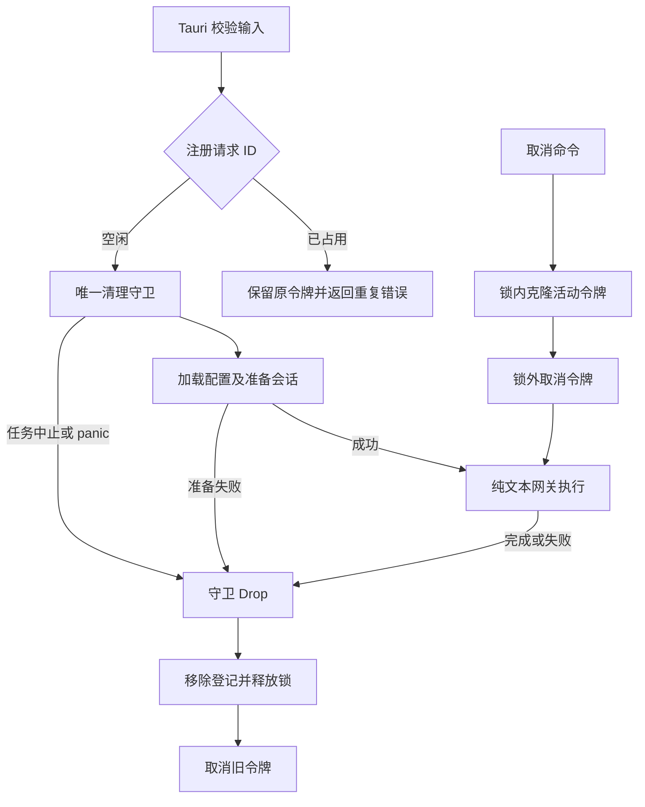

# R9-10 Cancellation Registry

状态：`VERIFYING`。用户2026-10-12“收尾09开始10”授权；原分支rewrite/r9-research-ai-backend，基线8d80ee6a29144377ddb1f69041344d0a8411dd67（09仅文档收尾，源码同已通过Windows的4ed656d）。09 DONE，10实施与本地静态完成，须自身精确Windows全SUCCESS方可DONE；11 BLOCKED、R9 IN_PROGRESS。

### 1. 目标

将普通AI问答的活动请求ID、取消令牌和释放生命周期收敛至Application取消目录，切换Tauri实际入口并删除旧map操作。

### 2. 现状与来源

R0命令/类型/调用方清单与实际链路核对：AppState原持有Arc<tokio::Mutex<HashMap<String, CancellationToken>>>；send命令在写用户消息并记录request_started之后insert，cancel命令直接锁map。原insert先替换活动token再返回重复错误，导致原请求无法按ID取消；原手动remove在网关await之后，Future被中止或panic时无法执行。

### 3. 目标文件与目录

crates/application/src/use_cases/ai_workspace/cancellation/下mod.rs仅登记/显式导出，registry.rs唯一持有注册表与不可克隆清理守卫，tests.rs使用既有Application unit target。Application lib增加两个Rust类型导出，Tauri继续原命令和AppState字段名。

### 4. 文件职责边界

AiWorkspaceRequestRegistry负责请求ID原子登记、查找取消和私有map；AiWorkspaceRequestLease负责该登记唯一生命周期及其token。二者是同一活动请求资源职责，私有锁helper不暴露容器。Tauri只做原输入校验、调用登记/取消API及原会话/网关编排。

### 5. 输入

原request_id文本由send边界trim并校验UUID，cancel仍只trim/拒绝空串；Registry不新增格式/大小写规范化，使用调用者传入的原精确ID。

### 6. 输出

register返回唯一Lease或既有“AI问答请求 ID 已在使用”；cancel返回活动请求是否存在。Lease向原网关借用CancellationToken。新增Rust接口为加法，全部既有命令签名、DTO、JSON和返回错误类型保持。

### 7. 允许依赖

原football_research_gateway::CancellationToken与标准库Arc/Mutex/HashMap/Entry；测试使用已有Tokio 1.52.3、标准库Barrier/thread/catch_unwind。未改Cargo依赖或锁文件。

### 8. 禁止依赖

Registry不依赖Tauri、UI、数据库、具体HTTP transport/profile/store，不使用static map或新增全局State，不复制Gateway token/远端Responses取消实现。

### 9. 状态所有权

每个AppState持有独立Registry::default，Registry clones只共享该实例map；唯一状态登记tauri.api-requests转至Application registry.rs::AiWorkspaceRequestRegistry，唯一writer同文件。19状态ID及其余owner保持。Lease不可克隆，map只允许Vacant登记，没有公开remove/replace/clear；不存在第二owner或旧Tauri锁写入。

### 10. 副作用边界

Registry只操作内存并通知既有token，所有通知发生在map锁释放后。原profile、会话/消息持久化、日志、网关和回答写入继续原adapter/use case，不新增IO、migration或配置项。

### 11. 异常路径

原纯输入校验完成后、首次profile加载及会话副作用前登记；忙ID立即拒绝且保留原token，不再先写会话/消息/请求开始日志。准备步骤任何错误或panic均释放登记，正常网关成功/失败在原remove边界显式drop，再执行原日志/回答处理。空cancel ID原错误保持；未知ID false，活动ID重复cancel均true。

### 12. 并发/异步/生命周期

Entry占用判定和Vacant插入在一次短同步Mutex临界区完成，guard不跨await。cancel锁内克隆token，锁外通知；Lease Drop移除登记并释放锁，再取消旧token。Future abort/unwind同样运行Drop；旧token与ID复用后的新token独立。锁poison恢复用于保证Drop不因poison二次panic；不新增用户错误。取消准备中的请求只发token信号，不承诺撤销已完成的会话/消息写入或直接中断远端服务，正式Responses远端取消仍原owner。

### 13. 兼容要求

原171命令/DTO/Schema/profile/配置/数据库数据/版本、原日志字段与UI不变。正式研究只走Responses，普通问答双协议纯文本，不加入tools/schema/token字段。原输入及取消错误文案保持；明确行为修正为重复ID不覆盖/先拒绝副作用，所有退出路径自动清理及释放后token取消。

### 14. 实施步骤

核对实际map消费链，新增Registry/Lease及8 unit，切换AppState和send/cancel入口，删除旧map/锁/手动remove；同步唯一owner和两个库存的真实扫描，扩展既有AI问答门禁，完成静态/逆切等价/破坏探针与记录。没有新runner/target/workflow/数据库专项入口。

### 15. 切换入口

Application lib显式导出两个生命周期类型；AppState默认实例。send持有registration跨原准备与网关await，网关接收registration.cancellation()，结果返回即drop。cancel委托Registry.cancel，不再直接读写map。

### 16. 删除清单

删除原AppState map类型/构造及其CancellationToken/HashMap/tokio Mutex imports，send的覆盖式insert及手工remove，cancel的锁/查找/通知代码。整文件删除、移动/重命名均无；原路径仍承担各自真实bootstrap/命令职责，无旧实现转发。

### 17. 最小验证

83/83既有JS静态、完整architecture、Rustfmt 1.88对7变更Rust文件check、逆切等价、8破坏探针和diff通过。新增8 Application unit等待自身Windows执行，预期Application138、Persistence179、Gateway106 unit/39 contract；未把静态或测试数量当作动态PASS。

### 18. 阶段回归

原Public Platform CI/Windows Automated执行frontend/contracts/TypeScript/Vite/17视口、cargo fmt --all -- --check、Clippy locked workspace all-targets -D warnings、workspace tests、Windows release/MSI/NSIS/启动/日志。遵守任务书，仅Windows动态；本地未运行非Windows Cargo/check/Clippy/build/test/loopback/浏览器运行时。

### 19. 失败停止条件

自身精确Windows全SUCCESS前10 VERIFYING、11 BLOCKED。保护/契约/静态或自身CI失败先修，不跳测试、压制Clippy或降低门禁；09成功不能替代10验收。

### 20. 回退点

8d80ee6a29144377ddb1f69041344d0a8411dd67。受控revert本节点源码、owner/库存、门禁和记录；不得手工复制恢复旧map或保留双owner。

### 21. 根 README 摘要记录

根README记录09 DONE、10 VERIFYING、11 BLOCKED，注册表/唯一守卫、重复ID与退出清理修正、静态结果和自身Windows待验，引用本记录。

### 22. docs 阶段节点详细记录

本记录23字段及全部A/M/D、行为/兼容/命令/工具/回退/延期；阶段README和任务书同步节点状态与链接，不创建R9阶段完成或独立fix log。

### 23. 完成标准

唯一新owner、实际入口切换、旧操作移除、静态和记录已完成；自身Windows完整SUCCESS后方可DONE。真实PG/历史保护四项/账本并发回滚/有效XLSX/Windows Full/私有P4/P7固定回归及继承model.runs/0041删除风险继续最终封包新库待验，ignored/公开unavailable stub不能计真实PASS。

## 生命周期与验证证据

8新增unit覆盖同实例clone/不同实例隔离、未知/重复cancel、重复ID保留运行token、不同ID取消及清理互不影响、结束后ID复用token独立、准备错误释放、Tokio任务abort后token取消与登记移除、panic unwind清理、Barrier并发同ID仅一owner。并发测试无需sleep，abort测试通过oneshot确认已登记且join确认Drop结束；均在原Application src unit target。

等价报告逆切send/cancel三个明确生命周期改动后整个commands文件逐字一致，AppState逆切后其余字段/初始化/日志逐字一致；Application lib只有两个类型加法导出、use_cases出口只有一个模块登记。1309个其余已有文件逐字保持，包括Application会话/Ports/composition、Persistence全部SQL/事务/审计、Gateway全部传输/协议/原测试、Domain/Tauri其余模块/UI/contracts/schema/模型/workflow；原Cargo/锁/package/保护清单保持。

8负向探针：覆盖活动token、缺失Drop删除、提前token取消、profile后才登记、网关结果后不释放、AppState恢复旧map、cancel固定false、Lease可克隆；均被原verify-api-workspace门禁拒绝，源码完整恢复后专项通过。新增检查只扩展原门禁，不放宽原纯文本/profile/P4/历史契约。

本地命令：`node scripts/verify-application-ports.mjs --refresh-source-scan`、`node scripts/generate-domain-type-inventory.mjs`；`python /workspace/scratch/eb298ad5cdcb/r910_static.py`；`npm run verify:architecture`；Rustfmt1.88 `--check --edition 2021 --config skip_children=true`7文件；`python /workspace/scratch/eb298ad5cdcb/r910_equivalence.py`；`python /workspace/scratch/eb298ad5cdcb/r910_probes.py`；`git diff --check`。报告r910-static-checks.json/r910-architecture.log/r910-equivalence.json/r910-negative-probes.json/r910-review.json位于/workspace/scratch/eb298ad5cdcb；辅助文件只用于本地源审查，不加入repo/regression target。

Application文件404→407、43Ports/19Port源保持；Domain扫描1152→1155，365类型/300 DB映射/声明摘要保持，rustUsageDigest 316f3fcc3ccf3fb2477acd41c5fefe5a677b2475347eabd387ec9c36db8a2710。19状态只更新取消owner/writer，171命令、46迁移/18PG集成测试源码、18保护资产保持。保护聚合d74e0936b60c69f444a498405fed3e704b8db63b81f26b40036f772b4b6eac57；数据库迁移和18PG源码与09逐字一致，继承静态聚合d9f2eb50bacd747b7cbf08492189c2635b7c0ec2cf4c764def1d32a837f8ba93。

## 工具与实施调整

Context7已按真实Tokio1.52.3查询短同步锁/Drop问题，返回泛化文档未冒充锁版本；另读官方tokio-rs/tokio精确tag tokio-1.52.3的tokio/src/sync/mutex.rs及runtime/task/core.rs，前者明确data-only短临界区可用标准Mutex，后者Future释放逻辑支持abort清理设计。实际Drop与abort unit仍须Windows执行。Mermaid Chart已展示实际生命周期；Create State使用已确认足球稳定ID96f03270-c236-46de-99fa-db85d2fbf4ce保存状态。

预审发现oneshot.send(...).unwrap要求CancellationToken实现Debug，改用assert!(send(...).is_ok())，保留原Token公开类型不变；panic测试用AssertUnwindSafe包住专用测试闭包以免依赖Tokio内部自动unwind trait，不改变生产错误策略；测试准备失败夹具直接返回原结果避免无必要泛型推断。未执行本地Rust编译。没有新增generation/config/cache，因为私有Vacant-only map及不可克隆Lease已保证单一登记owner；源门禁冻结该约束。

同一分支推送原Windows CI；确认本项精确head的Windows job开始即停止查询，预计20～30分钟。自身结果未完成，10 VERIFYING、11 BLOCKED、R9 IN_PROGRESS。

## 完整实际路径清单

相对8d80ee6，按`git diff --no-renames`及新增文件核对 **4A / 12M / 0D**，16路径；移动/重命名无，独立整文件删除无。

新增（4）：

- crates/application/src/use_cases/ai_workspace/cancellation/mod.rs
- crates/application/src/use_cases/ai_workspace/cancellation/registry.rs
- crates/application/src/use_cases/ai_workspace/cancellation/tests.rs
- docs/modular-rewrite/R09-research-ai-backend/R09-10-cancellation-registry.md

修改（12）：

- README.md
- architecture/application-port-inventory.json
- architecture/domain-type-inventory.json
- architecture/state-ownership.json
- crates/application/src/lib.rs
- crates/application/src/use_cases/ai_workspace/mod.rs
- docs/TESTING.md
- docs/football-model-platform-modular-rewrite-19-docs/09-R9-research-ai-backend.md
- docs/modular-rewrite/R09-research-ai-backend/README.md
- scripts/verify-api-workspace.mjs
- src-tauri/src/bootstrap/state.rs
- src-tauri/src/commands/api_workspace.rs
