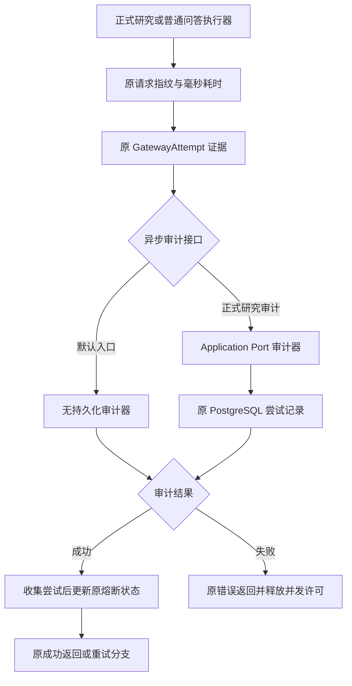

# R9-11 Runtime Diagnostics

状态：`DONE`（修复自身精确Windows全SUCCESS；下述VERIFYING/首轮失败为实施历史）。用户2026-10-12“收尾10开始11”授权；唯一原分支rewrite/r9-research-ai-backend，基线6f471d02f0358ee5991fe426d5471515cd662dc6（10文档收尾，源码同已通过Windows的07da8d9）。10 DONE；11已实施与静态复核，须自身精确Windows完整SUCCESS方可DONE；R9 IN_PROGRESS，不进入R10、不创建阶段完成记录。

### 1. 目标

将网关尝试证据、异步审计协议与纯诊断辅助函数收敛至唯一diagnostics目录，保持执行、审计、日志和恢复策略。

### 2. 现状与来源

R0命令/类型/调用方清单及实际链路核对：GatewayAttempt原在types.rs；GatewayAttemptSink、NoopAttemptSink、指纹/响应ID/耗时helper原在client.rs；正式研究Application PortAttemptSink通过原ResearchGatewayAuditPort写PostgreSQL，普通问答默认无持久化sink。Tauri runtime_log拥有桌面会话JSONL、去重/脱敏/路径，不属于Gateway诊断类型owner。

### 3. 目标文件与目录

crates/research-gateway/src/diagnostics/下mod.rs仅登记/显式导出；attempt.rs唯一证据DTO，sink.rs唯一异步审计协议与默认实现，evidence.rs纯请求指纹和响应身份提取，timing.rs单一毫秒耗时转换，tests.rs原Gateway unit target。

### 4. 文件职责边界

诊断目录不发送网络、不写库/日志、不选协议/重试/熔断。client继续原执行编排与八个结果分支的语义组装；分别调用唯一指纹/时间/响应身份helper和原sink协议。审计接口与默认空实现为同一审计边界，未为默认实现新增转发层。Application Port adapter与Tauri日志职责保持原owner。

### 5. 输入

原JSON请求/响应、Instant、GatewayAttempt中的16字段及GatewayError/Usage/UTC时点；record借用原&GatewayAttempt，无请求ID/配置/凭据字段新增。

### 6. 输出

原GatewayAttempt及GatewayAttemptSink名字从crate根显式导出；三个helper只增加必要crate内可见性。原Result<(), GatewayError>、指纹小写hex SHA256、响应ID Option<String>和毫秒u64不变。

### 7. 允许依赖

既有async-trait0.1.89、chrono、serde/serde_json、sha2/hex及标准Instant；tests使用既有Tokio和现有FakeTransport/RejectAttemptSink。Cargo/锁/依赖和目标平台保持。

### 8. 禁止依赖

diagnostics不依赖Tauri/具体数据库/HTTP transport/ApiKey，不创建全局状态、缓存、锁、配置或后台任务；不把请求原文/Schema/raw response新增到桌面根日志。

### 9. 状态所有权

无新共享状态。原Gateway semaphore/circuit、Application Port与PostgresStore、Tauri RuntimeLogStore各自唯一；19状态ID及state-ownership文件逐字保持。module-boundaries中既有GatewayAttemptSink owner仅迁至diagnostics/sink.rs，四个Gateway/model Port条目数量保持。

### 10. 副作用边界

NoopAttemptSink原返回Ok(())，正式研究PortAttemptSink仍唯一写原PostgreSQL尝试审计。调用方原八条路径先await record并传播失败，再push attempt、改变原熔断或进入原结果/重试。原请求/响应证据可供数据库审计；桌面根日志仍不落问题正文、Schema或raw response，保持原脱敏/去重/会话路径及事件载荷。

### 11. 异常路径

原指纹serde错误映射InvalidConfiguration及原提示保持；响应ID只接收字符串，空白/空字符串不擅自过滤；耗时u128→u64仍饱和到u64::MAX。sink失败原样返回，不绕过审计、不提前更新熔断；许可按原异步作用域释放。取消/重试/回退/拒绝/Schema/来源政策及远端恢复均不变。

### 12. 并发/异步/生命周期

原#[async_trait]与Send+Sync保留，dyn GatewayAttemptSink及借用输入跨await仍原签名。Noop无状态；诊断helpers无await/共享容器。执行、取消令牌、并发许可与异步审计先后顺序逐字保持，不新增超时/取消/过期策略。

### 13. 兼容要求

56个原Gateway crate根公开导出名字、GatewayAttempt字段/derive/serde/可选null、sink签名不变。171命令/DTO/Schema/profile/配置、数据库迁移/事务审计、日志/UI/模型/版本保持。正式研究Responses-only与普通双协议纯文本边界不变，不加tools/schema/token fields。

### 14. 实施步骤

迁原DTO/trait/default sink及三个helper，切根出口和实际client/types消费；移除旧owner正文，补6 unit和2双协议contract于原targets。更新实际Port owner、Domain使用扫描、既有运行诊断门禁和记录；未新增runner/workflow/target/DB专项入口。

### 15. 切换入口

crate根直接从diagnostics导出GatewayAttempt/GatewayAttemptSink；types只借用原根GatewayAttempt，client显式导入诊断helper/Noop，并使用原根trait/DTO。Application/Tauri调用方不用改名、增加转发或改变载荷。

### 16. 删除清单

移除client旧trait/default sink/三helper与相应async-trait/sha2 imports，移除types旧GatewayAttempt定义及只为其需要的GatewayError import。整文件删除、移动/重命名无；原client/types仍承担真实执行/其余协议类型，不留旧实现或重复导出。

### 17. 最小验证

83/83既有JS静态、完整architecture、Rustfmt1.88对10变更Rust文件check、字节等价、8破坏探针与diff通过。新增6 Gateway unit和2 contract待自身Windows，预期Gateway112 unit/41 contract；Application138、Persistence179保持。静态和数量不记为动态PASS。

### 18. 阶段回归

原Public Platform CI/Windows Automated执行frontend/contracts/TypeScript/Vite/17视口、Rust fmt、locked workspace Clippy all-targets -D warnings、workspace tests、Windows release/MSI/NSIS/启动及日志扫描。本地仅源码/差异/JS静态/独立Rustfmt，不运行非Windows Cargo/check/Clippy/build/test/loopback/浏览器运行时。

### 19. 失败停止条件

自身精确Windows全SUCCESS前11 VERIFYING、R9 IN_PROGRESS、R10不启动，阶段完成记录不创建。保护/契约/静态/自身CI失败先修，不跳测试、抑制Clippy或降低门禁；10成功不替代11验收。

### 20. 回退点

6f471d02f0358ee5991fe426d5471515cd662dc6，同10精确已验源码。受控revert本节点源码、清单、门禁、记录，不手工复制旧DTO/sink/helper恢复双owner。

### 21. 根 README 摘要记录

记录10 DONE、11 VERIFYING、R9 IN_PROGRESS；诊断owner/审计顺序/兼容边界、实际A/M/D、静态通过与自身Windows待验，引用本记录。

### 22. docs 阶段节点详细记录

本记录含23字段、全部实际路径、测试/等价/工具/失败探针/回退和延期；阶段README/任务书/TESTING同步状态。无独立fix log或R9阶段完成记录。

### 23. 完成标准

唯一新owner、入口切换、旧职责移除与静态/记录完成；自身Windows完整SUCCESS后才可DONE。真实PG/历史保护四项/账本并发回滚/有效XLSX/Windows Full/私有P4/P7固定回归及继承model.runs/0041删除风险仍最终封包新库待验，ignored/公开unavailable stub/静态指纹不能计真实执行PASS。

## 测试与等价证据

6新增Gateway unit：固定UTF8 JSON字节SHA256小写hex；数组顺序/JSON值类型区分的固定指纹；原响应ID字符串（含空/空白）及非字符串拒绝；完整16字段/Usage/Error/provider/UTC时点/JSON证据序列化与往返、可选null显式保留；原dyn无持久化sink接受完整证据且不改变输入；不sleep的过去Instant夹具核对毫秒下界。指纹夹具为固定常量，不用同一生产hash函数计算预期值。

2新增既有gateway_contract测试各覆盖Responses/ChatCompletions：plain与structured的审计失败保留完整Persistence错误且只发一次请求；下一次无持久化请求收到RateLimit，说明失败审计未提前开熔断且许可已释放；再请求CircuitOpen、不再发网络。复用原FakeTransport、config/request、RejectAttemptSink和2秒有界timeout；已有formal同类contract保持。这里为纯内存HTTP mock，不是真实API或PG执行。

源等价确认client自test_openai_connection至末尾unsupported-structured政策的全部执行正文逐字一致，包含8个attempt构造、record await?/push/circuit顺序、默认sink及全部请求/解析/重试/取消/恢复。原DTO与sink/default实现逐字一致，三个helper只改crate内可见性，types逆迁DTO后逐字一致；56个公开导出名字保持，原39 contract完整前缀逐字保持。181个原生产字符串出现多重集不变，1330个其余原文件逐字保持，包括全部Application/Persistence/Tauri/UI/正式及普通协议owner/其余Gateway/Domain/contract/schema/模型/workflow；policy_changes=[]。

8负向探针：旧审计owner、pretty JSON指纹、响应ID trim、秒替换毫秒、忽略审计错误、审计前更新熔断、omit可选null、旧types重复DTO；均被原运行诊断门禁拒绝，源码完全恢复后专项通过。扩展原verify-api-runtime-diagnostics同时保留原桌面日志/脱敏/路径/正文不落盘断言。

本地命令`node scripts/generate-domain-type-inventory.mjs`、`node scripts/verify-domain-type-inventory.mjs`、`python /workspace/scratch/eb298ad5cdcb/r911_static.py`、`npm run verify:architecture`、Rustfmt1.88 `--check --edition 2021 --config skip_children=true`10文件、`python /workspace/scratch/eb298ad5cdcb/r911_equivalence.py`、`python /workspace/scratch/eb298ad5cdcb/r911_probes.py`、`git diff --check`。报告r911-static-checks.json/r911-architecture.log/r911-equivalence.json/r911-negative-probes.json/r911-review.json位于/workspace/scratch/eb298ad5cdcb；辅助helpers不加入仓库/targets。

Domain扫描1155→1161、365类型/300 DB映射/声明摘要保持，usageDigest a2c53fec67a2de7f23d108829504ae4f0d9bffeb1f3a8ca87bd916fa18bf6be9。Application407文件/43Ports/19Port文件、19状态、171命令、46迁移/18PG集成源码及18保护资产保持；module-boundaries只变GatewayAttemptSink实际owner，未改adapter或模块计数。保护聚合d74e0936b60c69f444a498405fed3e704b8db63b81f26b40036f772b4b6eac57；数据库源码逐字同10，继承静态聚合d9f2eb50bacd747b7cbf08492189c2635b7c0ec2cf4c764def1d32a837f8ba93。

## 工具与边界决定

Context7按实际async-trait0.1.89查询dyn/Send/借用Future，返回master泛化文档未冒称锁版本；另读官方dtolnay/async-trait准确tag0.1.89 README，确认原宏展开Pin<Box<dyn Future+Send>>及Self:Sync，保留原宏/签名，不改?Send或改为原生async trait。Mermaid Chart已展示实际证据→默认/Port审计→先await成功再熔断及失败释放许可。Create State先确认足球稳定ID96f03270-c236-46de-99fa-db85d2fbf4ce，保存实施与等待状态。

按职责保留client结果语义组装及原Noop路径，不抽出会统一formal与ordinary状态策略的通用builder，不把Tauri RuntimeLogStore或Application PostgreSQL写入下沉Gateway；没有新增状态、依赖、公开接口或诊断持久化副作用。没有已发现待修的本地静态失败。

同一分支推送原Windows CI；确认本项精确head的Windows job开始即停止所有CI查询，预计20～30分钟。11 VERIFYING、R9 IN_PROGRESS；不启动R10、不把阶段验收待项变为PASS。

## 完整实际路径清单

相对6f471d0，按`git diff --no-renames`及新增文件核对 **7A / 11M / 0D**，18路径；移动/重命名无，独立整文件删除无。

新增（7）：

- crates/research-gateway/src/diagnostics/attempt.rs
- crates/research-gateway/src/diagnostics/evidence.rs
- crates/research-gateway/src/diagnostics/mod.rs
- crates/research-gateway/src/diagnostics/sink.rs
- crates/research-gateway/src/diagnostics/tests.rs
- crates/research-gateway/src/diagnostics/timing.rs
- docs/modular-rewrite/R09-research-ai-backend/R09-11-runtime-diagnostics.md

修改（11）：

- README.md
- architecture/domain-type-inventory.json
- architecture/module-boundaries.json
- crates/research-gateway/src/client.rs
- crates/research-gateway/src/lib.rs
- crates/research-gateway/src/types.rs
- crates/research-gateway/tests/gateway_contract.rs
- docs/TESTING.md
- docs/football-model-platform-modular-rewrite-19-docs/09-R9-research-ai-backend.md
- docs/modular-rewrite/R09-research-ai-backend/README.md
- scripts/verify-api-runtime-diagnostics.mjs

## 首轮 Windows 契约失败修复（2026-10-12）

用户15:52:17北京“未通过”。精确提交5ff91641dbc992c3b9f66b1fde3257f9b488c738 / Windows run38218231140 / job114707912576整体FAILURE，2026-10-12 15:43:16北京结束。architecture/前端静态及构建、fmt/Clippy通过，Application138/138、Persistence179/179、Gateway112/112 unit（新增6项均通过）；gateway_contract 39通过/2失败。后续workspace及Windows release/MSI/NSIS/启动未完成，不将这轮或旧10成功替代自身验收。

失败位于gateway_contract.rs原2808/2861构造网关处。两个新增双协议循环只改api_protocol，config()仍显式request_endpoint=/v1/responses；ChatCompletions因此触发原GatewayConfig.validate的“兼容 API请求端点与所选协议不一致”，尚未进入该协议的sink断言。这是本轮新增测试夹具遗漏，保留原严格配置校验。

两处新增逐协议match：Responses→https://api.openai.com/v1/responses，ChatCompletions→https://api.openai.com/v1/chat/completions。保留原两协议循环、完整Persistence错误、RateLimit后CircuitOpen、请求数1/2和2秒permit释放断言。不存在删除测试、跳过协议或生产配置/代码调整。

原verify-api-runtime-diagnostics新增逐个fixture检查：两协议不能删；api_protocol之后/网关构造之前必须设置端点；match两分支必须使用各自精确端点。4源破坏探针分别恢复plain遗漏、structured遗漏、错误Chat→Responses映射、删除Chat覆盖，均被门禁拒绝并完整恢复。

本轮以5ff9164为基线，两个端点块逆移除后整个contract文件逐字一致；git差异确认全部生产Rust/前端/SQL/日志/模型/协议/配置校验/公开接口未变。Application138/Persistence179/Gateway112unit及41contract数量保持；Domain仅rustUsageDigest更新为ca1c4ca5b864d11ae14b5d766950dc10f1bbae568694469f435b2983cfc5ad9e，1161文件/365类型/300映射/声明摘要保持。19状态/171命令/46迁移/18PG源码/保护聚合保持，policy_changes=[]。

验证：python /workspace/scratch/eb298ad5cdcb/r911_fix_static.py 83/83，npm run verify:architecture，原runtime诊断及Domain门禁通过；Rustfmt1.88 --check --edition2021 --config skip_children=true对唯一变更Rust contract通过；Python内联夹具逆切/生产无变化/库存与数量证明通过；python /workspace/scratch/eb298ad5cdcb/r911_fix_probes.py 4/4，git diff --check通过。报告r911-fix-static-checks.json/r911-fix-architecture.log/r911-fix-equivalence.json/r911-fix-negative-probes.json/r911-fix-review.json位于/workspace/scratch/eb298ad5cdcb。未运行非Windows Cargo/check/Clippy/build/test/loopback/浏览器动态，新提交自身Windows仍待完整执行。

本轮Context7按Rust1.88查询enum match仅返回通用master资料，未冒称锁版本；实际两协议/端点规则以原ApiProtocol.endpoint_suffix、GatewayConfig.validate及既有Chat fixtures核对。单一测试夹具修正不改变原Mermaid诊断图。Create State已先确认足球稳定ID96f03270-c236-46de-99fa-db85d2fbf4ce，保存本次失败原因/修复/待验；不写入HFM项目。

本轮实际 **0A/8M/0D**，移动/重命名无；整个11相对6f471d0仍7A/11M/0D，18路径，上述完整节点清单保持。修改8路径：

- README.md
- architecture/domain-type-inventory.json
- crates/research-gateway/tests/gateway_contract.rs
- docs/TESTING.md
- docs/football-model-platform-modular-rewrite-19-docs/09-R9-research-ai-backend.md
- docs/modular-rewrite/R09-research-ai-backend/README.md
- docs/modular-rewrite/R09-research-ai-backend/R09-11-runtime-diagnostics.md
- scripts/verify-api-runtime-diagnostics.mjs

仅修复原R9分支并推送原Windows CI；精确新head的Windows job开始即停止查询，预计20～30分钟。11 VERIFYING、R9 IN_PROGRESS，未进入R10或创建R9阶段完成记录。原最终新库待验项（真实PG/历史保护四项/账本并发回滚/有效XLSX/Windows Full/私有P4/P7固定回归及继承model.runs/0041删除风险）保持；ignored/公共stub不能记为真实PASS。回退可受控revert本夹具修复到5ff9164（该提交是失败记录，不能视为通过的回退验收基线）；最近完整已验源码仍10的07da8d9，若撤回整个11应按原受控revert至6f471d0。

## R9-11 精确 Windows 完成与阶段收尾（2026-10-12）

精确修复提交b50d8047a6dbf32775d70704afde61d99b897069 / tree7dd421459bbff3156d4c034fc01e9b74dd2985d5，[Windows run38221009454](https://github.com/uniquenesssta/123/actions/runs/38221009454) / job114716987812整体SUCCESS，2026-10-12 16:29:01北京完成。Gateway112/112 unit、41/41 contract，Application138/138、Persistence179/179；两项plain/structured双协议审计失败契约已实际通过，首轮39/41失败由本修复自身关闭。前端/contracts/TypeScript/Vite/17视口、Rust fmt/Clippy -D warnings/workspace、Windows release/MSI/NSIS/启动与日志扫描通过（7记录、3完成操作）。

证据artifact11735687461，14,038,470字节，SHA-256 3e28db7fddd900f59e4655c058df08e7d69c04feaab92e02e641f99900c05a68；报告windows-acceptance-20261012-080203.json及同名.txt。

用户2026-10-12“收尾11”：11 DONE；R9全部01～11及Windows Automated阶段出口DONE，阶段完成记录与实际总表已建立。仅R10-01 Review Package Workflow READY，02～13 BLOCKED；未开始R10实现、未建立第二分支。本次纯文档[skip ci]，源码、门禁与清单同精确成功提交。真实PG/历史保护四项/账本并发回滚/有效XLSX/Windows Full/私有P4/P7固定回归及继承model.runs/0041删除风险仍最终封包新库待验，ignored/公开stub不计真实PASS；此前VERIFYING/失败叙述保留为实施历史。
