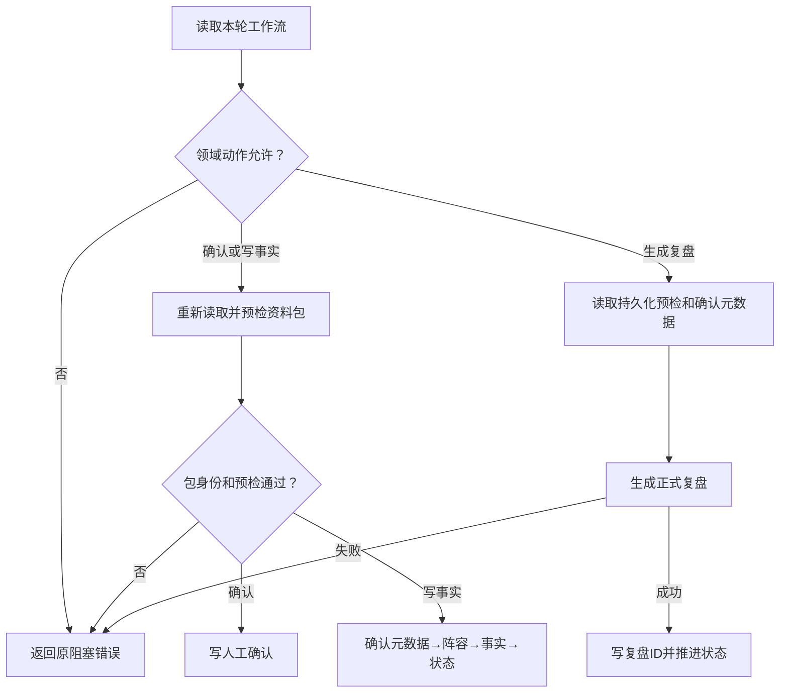

# R10-01 Review Package Workflow

状态：`DONE`（自身精确Windows全SUCCESS；下述VERIFYING为实施历史）。用户2026-10-12“开始R10-01”授权；仓库uniquenesssta/123，版本0.23.0，唯一R10分支rewrite/r10-review-analytics-release-backend，基线48618fed2d7ff7c2a4db831a037f227dc789f278（源码同R9已验b50d804）。R10 IN_PROGRESS，02～13 BLOCKED。

### 1. 目标

收拢复盘资料包生命周期编排、包身份前检、人工确认元数据和工作流数据库适配，实现唯一owner与明确可拆分边界。

### 2. 现状与来源

实际调用链为原Tauri postmatch命令→Application review facade→ReviewService→package lifecycle；export、preview、workbook已分层。Domain package/workflow统一解释八状态、动作权限及阻塞原因；界面九步含比赛选择。原PG根match_review_package.rs持有十个工作流方法和两个SQL/映射helper。原事实、review-engine、候选人工决定和postmatch结算继续各自owner。

### 3. 目标文件与目录

Application use_cases/review/package/workflow下mod只登记并导出，coordinator五编排，guards纯预检/身份门禁，confirmation人工确认元数据，tests原unit target。PG adapters/review/package_workflow/repository持有原工作流SQL/事务/映射；上层两个mod只登记。

### 4. 文件职责边界

保持export、preview、workbook及共享快照/成员/事件身份helper的现有职责。任务书目录是参考，依总纲语义目录订正采用既有package下workflow，避免机械移动无关IO。事实、纯review计算公式、候选事务、结算和分析分别留给02～13，不提前实施。

### 5. 输入

原package_id、match_id、预检载荷、导入路径/SHA256、人工确认人和备注；五编排继续原State/Source/Facts/Review/Lineup Ports与Domain请求。

### 6. 输出

原可选工作流、WorkflowRecord、FactsCommitResult、ReviewResult、CommitResult及ID；facade、Ports、DTO/serde格式与字段不变。

### 7. 允许依赖

只用既有Application Ports、football-domain和crate内package preview；既有async-trait、Tokio、chrono、serde_json、uuid。PG仅原sqlx/Domain/审计；不新增依赖或版本API。

### 8. 禁止依赖

Application owner无具体SQL/PostgresStore、UI、Tauri或模型公式。PG适配器不决定UI步骤、候选自动接受或参数晋升；不引入通用Repository/第二状态机。

### 9. 状态所有权

Domain原allowed_actions/require_action/with_capabilities唯一权威，原八状态、能力DTO和19共享状态ID逐字保持；PG单活动包索引与全部状态条件不变。测试Mutex仅fixture，生产不新增共享状态/锁。直接PG模块仍36；不能按新增子文件数量扩大直接owner清单。

### 10. 副作用边界

确认重新预检文件后才写确认。事实提交重新预检并注入元数据后，原顺序create_lineup_pair→commit_review_facts→mark_facts_committed保持三个Port操作各自原事务，不声称跨操作原子性。生成原顺序读持久预检→确认元数据→generate_match_review→mark_review_created。PG导出登记仍一个事务内旧包supersede→插入→审计→提交，其他方法原查询/更新边界保持。

### 11. 异常路径

状态权限先于文件IO；缺路径、预检未ready/错误、包UUID/SHA256变化按原错误拒绝。组合提交保持更严格Some(hash)身份判断，重检路径保留原None与空字符串比较，不擅自统一。依赖失败立即返回、不调用后续状态写入；元数据非object替换为object，原已存字段、原备注trim/追加规则保持。

### 12. 并发/异步/生命周期

原await先后、Send+Sync/?Sized/async_trait Ports及数据库事务、条件UPDATE、唯一索引继续原实现；未新增锁/超时/取消/幂等键或事务。已Settled读取、重复结算COALESCE与活动包superseded过滤不变。

### 13. 兼容要求

171命令、Ports/公开facade、Domain DTO/Schema/状态、配置、错误提示、日志、UI、九步操作、模型ID/保护资产与版本0.23.0保持。原人工确认、候选人工决定、人工参数生命周期不变，不将合成fixture写入真实统计。

### 14. 实施步骤

抽出三项纯门禁及确认两个helper，迁五编排并切ReviewService五入口；迁PG原十方法/二helper到对应适配器、移除根挂载；沿原unit target补8边界测试；更新原三门禁和清单，完成等价/负向探针与记录。

### 15. 切换入口

ReviewService直接调用package::workflow::{read_active_workflow,confirm,commit_facts,generate_review,commit}；mod只显式导出coordinator。PG根lib移除match_review_package挂载，adapters登记review→package_workflow→repository；PostgresStore原公开方法、Application composition adapter调用名不变，无旧路径转发壳。

### 16. 删除清单

删除原Application package/lifecycle.rs与PG根match_review_package.rs；原shared确认两个helper删除，其他共享helper保持，旧模块注册与Service旧调用删除。移动对应关系见完整清单，不保留双owner。

### 17. 最小验证

84/84原JS源码门禁（原83项及原verify-review-service）、完整verify:architecture、13实际变更Rust文件独立Rustfmt1.88 check、等价复核/8负向探针/diff通过。新增8 Application unit预期146，PG179/Gateway112 unit及41 contract保持，待本节点自身Windows动态，不记预期为PASS。

### 18. 阶段回归

仅原Public Platform CI Windows Automated执行frontend/contracts/TypeScript/Vite/17视口、Rust fmt/locked workspace Clippy all-targets -D warnings/workspace tests、release/MSI/NSIS/启动及日志扫描。本地只JS源码/差异/独立Rustfmt，不运行Linux/macOS Cargo/check/Clippy/build/test、loopback或浏览器运行时。无新runner/workflow/target/DB专项入口。

### 19. 失败停止条件

自身精确Windows完整SUCCESS前保持01 VERIFYING，02～13 BLOCKED；静态/保护/原契约/CI失败先修，不跳测或抑制警告。Windows job开始即停止CI查询，预计20～30分钟，不提前声称DONE或创建阶段完成记录。

### 20. 回退点

48618fed2d7ff7c2a4db831a037f227dc789f278；受控revert本节点代码、清单、原门禁及记录至已验R9源码，不手工复制恢复旧职责与双owner。

### 21. 根 README 摘要记录

根README同步R10 IN_PROGRESS、01 VERIFYING、02～13 BLOCKED，说明workflow/PG owner、保留语义、8新增unit及静态证据，引用本记录；历史R9状态保留为当时历史。

### 22. docs 阶段节点详细记录

本23字段及完整实际A/M/D、两对移动、原测试/门禁/等价/负向证据、工具/偏差/回退及最终新库延期；阶段索引、R10任务书与TESTING同步。无独立fix log或完成记录。

### 23. 完成标准

唯一owner/真实入口切换/旧实现删除与源码核验已完成；须本节点精确Windows完整SUCCESS后才能DONE。真实PG、历史保护四项、不可变账本/并发/回滚、有效XLSX、Windows Full、私有P4/P7固定回归及继承model.runs/0041删除风险仍最终封包新库待验；ignored/公开unavailable stub/静态指纹不计真实PASS。

## 实际工作流与事务

图仅表达实际三条Application链路；事实三次Port各自保持原事务，未绘制全包统一事务。PG导出登记独立事务按supersede/insert/audit/commit原顺序执行；结算/候选/参数仍原owner。

## 验证与等价证据

8 unit覆盖逐项包身份/ready/errors、两路径None/空SHA差异、确认三处元数据与原字段/备注规则、确认前状态/ready/路径失败无IO、生成真实调用顺序/返回ID/注入确认、逐依赖失败停止后续状态推进及领域阻断、活动查询Some/None/失败无写入。fixture只在原Application tests；不新增并行测试框架或数据库target。

等价复核：五Application编排内联新guards后规范化相等；确认两个helper、剩余共享helper与Service逆切相等；完整PG文件只逆转super→crate导入后逐字相等，十方法、二helper/SQL/字段/事务/审计不变。Domain/Ports/facade/composition、其余资料包export/preview/workbook、Gateway/UI/Tauri、模型边界、迁移/原PG测试、依赖/工作流及契约逐字冻结。

8负向源码探针均被原资料包门禁拒绝并完整恢复：绕过确认动作、放宽重检SHA、放宽组合缺失SHA、遗漏生成前确认元数据、放宽PG确认状态、提前/重复提交导出事务、遗漏客队确认元数据、恢复旧owner。初次提前提交探针暴露原有序检只约束后一个commit，已增加首次commit在审计之后及仅一次commit约束；最终8/8拒绝。这是静态破坏检查，不冒充动态事务测试。

实际本地命令：node scripts/verify-review-service.mjs、verify-match-review-package.mjs、verify-stage-a-architecture.mjs及原83项；npm run verify:architecture；node scripts/verify_protected_assets.mjs / verify_command_contract.mjs / verify_database_baseline.mjs；node scripts/verify-application-ports.mjs --refresh-source-scan；node scripts/generate-domain-type-inventory.mjs；独立rustfmt1.88 --edition2021 --config skip_children=true --check；git diff --check；本地可重建等价/负向源码复核。84/84与架构PASS，8/8负向拒绝；Windows dynamic待自身提交。

清单：Domain365/300映射、129声明文件/sourceDigest217241ac243726a5ab6805a7f169e222b97e78c7c971749a5904714af673ebdd保持；扫描1167、usageDigest8da9e65bd81b6d17649f59c27658b3be2f73981b548af12e4083b41989b3295b。Application411文件/43 Ports/19 Port文件，PG直接owner36、状态19。18保护资产聚合d74e0936b60c69f444a498405fed3e704b8db63b81f26b40036f772b4b6eac57；46迁移/18PG静态聚合d9f2eb50bacd747b7cbf08492189c2635b7c0ec2cf4c764def1d32a837f8ba93保持。

源码报告位于本次scratch的r1001-static-checks.json、r1001-architecture.log、r1001-equivalence.json、r1001-negative-probes.json；详细可重建判定写入本记录，不依赖临时报告作为唯一验收依据。

## 工具与规则

已核对两份项目附件、仓库AGENTS、uniquenesssta/skil main的0.0.1/AGENTS、总纲及本R10-01完整字段，按用户授权执行。GitHub插件用于原库/唯一新分支与原CI；Mermaid图记录真实复杂流程；Create State以已核实足球项目UUID96f03270-c236-46de-99fa-db85d2fbf4ce保存状态，不能替代Git和本记录。既有版本/API复用已核对实现，本次无第三方版本或新API问题，不重复调用Context7。无子代理。

## 完整实际文件清单

相对基线按no-renames：9A / 15M / 2D，共26路径。新增与删除口径列出全部实际路径；两对职责移动分别为旧lifecycle→workflow/coordinator（另拆guards/confirmation）及旧PG match_review_package→新repository。没有其他文件移动或重命名。

| 类型 | 路径 |
|---|---|
| A | crates/application/src/use_cases/review/package/workflow/confirmation.rs |
| A | crates/application/src/use_cases/review/package/workflow/coordinator.rs |
| A | crates/application/src/use_cases/review/package/workflow/guards.rs |
| A | crates/application/src/use_cases/review/package/workflow/mod.rs |
| A | crates/application/src/use_cases/review/package/workflow/tests.rs |
| A | crates/persistence-postgres/src/adapters/review/mod.rs |
| A | crates/persistence-postgres/src/adapters/review/package_workflow/mod.rs |
| A | crates/persistence-postgres/src/adapters/review/package_workflow/repository.rs |
| A | docs/modular-rewrite/R10-review-analytics-release-backend/R10-01-review-package-workflow.md |
| D | crates/application/src/use_cases/review/package/lifecycle.rs |
| D | crates/persistence-postgres/src/match_review_package.rs |
| M | README.md |
| M | architecture/application-port-inventory.json |
| M | architecture/domain-type-inventory.json |
| M | architecture/module-boundaries.json |
| M | crates/application/src/services/review/service.rs |
| M | crates/application/src/use_cases/review/package/mod.rs |
| M | crates/application/src/use_cases/review/package/shared.rs |
| M | crates/persistence-postgres/src/adapters/mod.rs |
| M | crates/persistence-postgres/src/lib.rs |
| M | docs/TESTING.md |
| M | docs/football-model-platform-modular-rewrite-19-docs/10-R10-review-analytics-release-backend.md |
| M | docs/modular-rewrite/R10-review-analytics-release-backend/README.md |
| M | scripts/verify-match-review-package.mjs |
| M | scripts/verify-review-service.mjs |
| M | scripts/verify-stage-a-architecture.mjs |

## R10-01 精确 Windows 完成与02授权（2026-10-12）

精确提交 `838e39ea35355662c192769a358c56a06131a6ed` / tree `7f42a75620aa8eb44441670a69a379b0c1a7830b`，[Public Platform CI run38229119264](https://github.com/uniquenesssta/123/actions/runs/38229119264) / Windows job114743919870全SUCCESS，run于2026-10-12 17:44:15北京完成。实际Application146/146（新增8 workflow unit均成功）、Persistence179/179、Gateway112/112 unit和41/41 contract；frontend/contracts/TypeScript/Vite/17视口、Rust fmt/locked Clippy all-targets -D warnings/workspace、Windows release/MSI/NSIS/客户端启动及运行日志扫描全部通过。报告windows-acceptance-20261012-092001.json。

artifact11739056741，14,041,808字节，SHA-256 `2831911b9159911fb03ebc9bf894e03f00a4a01c73001b9ffddc8f9a289a1fa7`。01自身完整成功后标记DONE；用户2026-10-12“收尾01开始02”授权，02 Structured Match Facts READY，同一rewrite/r10-review-analytics-release-backend分支，03～13 BLOCKED，R10 IN_PROGRESS。本次仅五既有文档收尾[skip ci]，源码同上述成功提交；后续02必须取得自身完整Windows证据。

真实PG/历史保护四项/不可变账本/并发/回滚/有效XLSX/Windows Full/私有P4/P7固定回归与继承model.runs/0041删除风险仍最终封包新库待验；ignored/公开unavailable stub/静态指纹不计这些真实项目PASS。此前01 VERIFYING及预期计数保留为实施历史，不替代当前DONE状态。

本收尾5M/0A/0D，无移动/重命名：README.md、docs/TESTING.md、R10任务书、阶段README与本记录。相对01实施基线48618...完整9A/15M/2D清单及两对职责移动保持。
