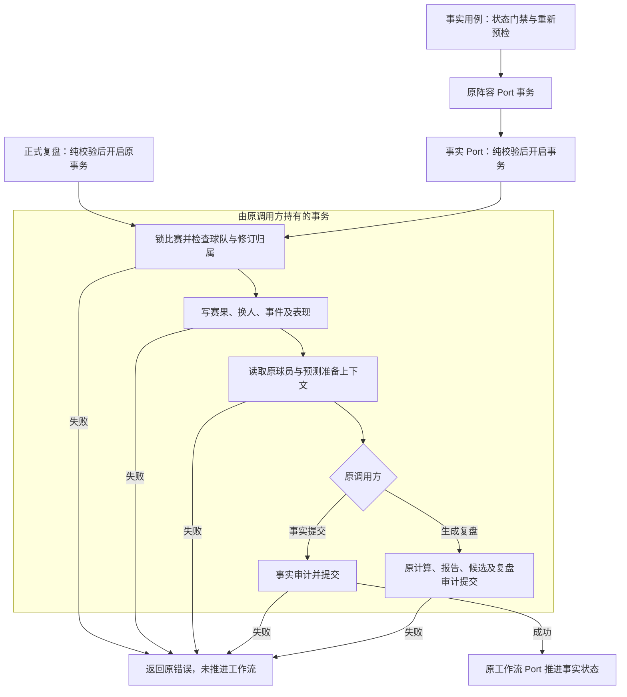

# R10-02 Structured Match Facts

状态：`VERIFYING`。用户2026-10-12“收尾01开始02”授权；uniquenesssta/123 v0.23.0，唯一rewrite/r10-review-analytics-release-backend，基线ab43aee85ad2911b87fe1fa1a57f5aa0138fcb32。01精确838e39e / run38229119264 / job114743919870全SUCCESS并DONE；03～13 BLOCKED，R10 IN_PROGRESS。

### 1. 目标

将结构化赛后事实的校验、身份、事务写入、读回与摘要收拢至唯一可拆分owner，保持正式事实/报告语义。

### 2. 现状与来源

实际Application R10-01 workflow commit_facts与PG根review.rs混合事实、计算准备、候选事务和查询。R0/当前调用清单确认：资料包事实Port、直接PostgresStore提交、正式复盘prepare三条路径共享原事实写入；read_match_result也由现有package validation_context调用。

### 3. 目标文件与目录

Application use_cases/review/facts/{mod,coordinator}.rs；PG adapters/review/facts/{mod,identity,mapping,read,repository,validation,write,tests}.rs。出口只模块登记/显式导出，各文件按事实阶段编排、身份、映射、查询、事务或纯校验分工。

### 4. 文件职责边界

coordinator承担真实状态/预检/阵容/事实/状态阶段，不是转发壳。repository仅保留原事实事务协调；write借用原Transaction执行比赛锁、球队/历史修订检查、四类事实写入和同事务读换人。validation原纯载荷/指标/比分门禁；identity原事件键和包来源；mapping原三行映射；read原三公开查询/事务内换人/摘要。root review仍实际持有计算准备、报告与候选，03～13不提前实施。

### 5. 输入

原package_id、WorkflowRecord、重新预检载荷、MatchReviewDraft及同一借用Transaction；原赛果、换人、结构化事件/修订/来源、球员表现与数据覆盖率，无新增请求字段。

### 6. 输出

原FactsCommitResult、PortResult<()>、可选赛果、事件/换人记录与摘要；私有writer返回原MatchRecord/MatchResultRecord/Vec<SubstitutionRecord>三元组供原prepare继续；不新增Domain/公开DTO。

### 7. 允许依赖

既有Domain、Application原Source/State/Facts/Lineup Ports和package预检/确认helpers；PG原sqlx/chrono/serde_json/sha2/hex/uuid与原准备/审计函数。不新增依赖或版本API。

### 8. 禁止依赖

Application核心不泄漏具体持久化；纯校验/身份/摘要无IO。write不另开/提交/回滚事务；不调用UI、自动接受候选、参数晋升或修改模型公式。

### 9. 状态所有权

原Domain八状态/权限与九步界面、19共享状态ID保持；生产不增加共享锁/缓存/请求ID/定时器。PG直接owner仍36，既有review adapter内增加facts子职责，不把子文件数当直接模块数。

### 10. 副作用边界

Application原状态门禁→重检→确认元数据→create_lineup_pair→commit_review_facts→mark_facts_committed顺序保持，三个Port仍各自原事务。PG提交先纯validate再begin；prepare借用writer锁比赛并写赛果/换人/事件/表现，再原球员/连续性/预测上下文，审计后commit；正式复盘仍原调用同一prepare，calculate_review/报告/候选/审计另按其原事务。

### 11. 异常路径

原InvalidState类型/中文错误保持。身份/同场修订检查在写事实之前；事件稳定键/sequence、已核验时间、不能手填superseded、比分不倒退/90分钟与加时一致、有限指标及来源策略保持。依赖失败返回原错误、后续阶段不执行；不将commit返回错误的数据库结果擅自记为成功或保证回滚。

### 12. 并发/异步/生命周期

原FOR UPDATE OF fixture及所有&mut **tx查询/写入保持，writer只借用同一事务；原行/事件唯一索引、ON CONFLICT/缺失事件superseded与元数据合并不变。取消/事务Drop交由既有SQLx与原调用方，不新增timeout/cancel策略。

### 13. 兼容要求

十个PG公开方法签名、原Ports/facade/composition、171命令/DTO/serde/Schema/迁移/配置/错误/日志/UI/模型保护区、0.23.0保持。两条SHA前检差异继续R10-01语义；报告不可变、候选人工接受与参数人工晋升保持。

### 14. 实施步骤

迁Application真实事实协调、切Service与组合工作流；抽PG14原方法/helpers及prepare事实前段，root prepare继续原上下文；补8原PG unit，更新四个现有门禁/官方扫描与记录，等价/负向检查后推送原Windows CI。

### 15. 切换入口

ReviewService事实入口直接facts::commit_facts；组合workflow coordinator导入并直接复用同一函数，旧workflow函数删除。PG facts repository/read保持原PostgresStore方法，root review仅从facts导入validate/摘要/writer。两个package确认helper只扩大到Review内部可见；PG prepare和比赛行映射仅crate内可见，无公开crate根出口增加。

### 16. 删除清单

移除旧workflow commit_facts与root review14旧事实函数、原prepare事实写入正文/对应imports，不留双实现。整文件删除无；review.rs仍持有真实未迁计算/候选/context职责，无为了目录示例改名或空壳。

### 17. 最小验证

84/84原源码门禁、完整architecture、19实际变更Rust独立Rustfmt1.88 check、等价/8负向探针/diff和文档字段/清单/链接通过。新增8原PG unit待Windows，预期PG187；Application146/Gateway112 unit+41 contract保持，预期不计PASS。

### 18. 阶段回归

只原Public Platform CI Windows Automated/原Rust targets执行frontend/contracts/TypeScript/Vite/17视口、locked fmt/Clippy all-targets -D warnings/workspace tests、Windows release/MSI/NSIS/启动/日志。本地不运行非Windows Cargo/check/Clippy/build/test、loopback或浏览器动态。

### 19. 失败停止条件

自身精确Windows全SUCCESS前02 VERIFYING、03～13 BLOCKED；失败先修，不能继承01成功标记02 DONE，不跳测/抑制警告/降门禁。job开始即停CI查询并预计20～30分钟，不建立R10阶段完成记录。

### 20. 回退点

ab43aee85ad2911b87fe1fa1a57f5aa0138fcb32，源码同已成功838e39e；受控revert本节点代码/清单/门禁/记录，不手工复制旧函数恢复双owner。

### 21. 根README摘要记录

根README同步01 DONE、02 VERIFYING、03～13 BLOCKED、唯一分支和新增8 unit/真实待验；引用本节点，不以历史VERIFYING覆盖当前状态。

### 22. docs阶段详细记录

本23字段、完整11A/19M/0D及职责迁移/入口/测试/等价/工具/偏差/回退/最终新库延期；阶段README、R10任务书与TESTING同步。01收尾为单独5M [skip ci]提交，不与02实施基线混淆。

### 23. 完成标准

唯一事实owner/入口切换/旧职责删除与源码记录完成，必须02自身精确Windows全SUCCESS后才能DONE。真实PG/历史四项/不可变账本/并发/回滚/有效XLSX/Full/私有P4P7与继承model.runs/0041删除风险仍最终封包新库待验；ignored/公开stub/指纹不能计真实PASS。

## 等价、单测与负向证据

14迁出PG职责的规范化签名/正文相等，剩余root函数正文保持；writer事实前段和prepare内联后相等，全部原锁/SQL/映射/读回与准备/审计顺序保持。比较只忽略Rustfmt参数尾逗号/空白及必要crate内可见性；不改SQL/错误/JSON字段。原十个公开方法签名保持；Application事实guard别名逆切、四个剩余workflow函数、Service逆切和确认helpers可见性逆切等价。Domain/Ports/facade/composition、原export/preview/workbook/shared、Gateway/review-engine/analytics-engine/analysis-package、UI/Tauri、模型、迁移/原PG integration、workflow/依赖/契约逐字冻结。

8新增PG unit：显式event_key trim与自动键稳定/身份字段变更、描述/比分/来源/核验等非身份更新不改变键；顶层来源UUID/非法或缺值兼容；赛果ID/负数/加时点球成对/覆盖率/重复表现；分钟/分数/可信度/有限指标/射正和对抗/供应商评分与出场信号；换人/门将关系；事件键/顺序/补时/核验/修订/成对比分；90分钟/加时/倒退与cancelled忽略；有效统计与核验/取消/争议计数分离。原PG真实integration及事务回滚/并发仍沿用最终新库待验，不把unit纯函数断言作为数据库运行证据。

8/8负向源码探针拒绝且完整恢复：绕过事实领域动作、丢比赛锁、允许跨场修订、审计前提交、禁用缺失事件superseded、跳事件有限数门禁、反转乌龙球对手分支、恢复旧身份owner。乌龙球探针初次暴露全文件同文字检查会误命中关联球员条件，已补精确OwnGoal/else分支检查，最终8/8均拒绝；没有生产行为修订或断言降低。

实际本地：原84 JS源码检查；npm run verify:architecture；node scripts/verify-review-service.mjs / verify-match-review-package.mjs / verify-match-event-facts.mjs / verify-stage-a-architecture.mjs；node scripts/verify_protected_assets.mjs / verify_command_contract.mjs / verify_database_baseline.mjs；官方Ports --refresh-source-scan和Domain生成；19 Rust独立rustfmt1.88 --edition2021 --config skip_children=true --check；git diff --check；等价/负向源码复核及23字段/完整路径/相对链接核对。报告scratch r1002-static-checks.json、r1002-architecture.log、r1002-equivalence.json、r1002-negative-probes.json可重建，本记录保留判定，不依赖临时报告作为唯一证据。

365 Domain/129声明文件/sourceDigest217241ac243726a5ab6805a7f169e222b97e78c7c971749a5904714af673ebdd保持；扫描1177、usageDigest02197c04a23585c69e915efd0c7bf447a1ce1f2174c6015368c76d5d2a6c583c。自动扫描映射300→301仅因新增typed fixture首次显式引用SubstitutionDraft，唯一路径facts/tests.rs；真实生产映射/Schema没有增加。Application413/43Ports/19Port文件、PG直接owner36/状态19。18保护聚合d74e0936b60c69f444a498405fed3e704b8db63b81f26b40036f772b4b6eac57；171命令；46迁移/18PG静态聚合d9f2eb50bacd747b7cbf08492189c2635b7c0ec2cf4c764def1d32a837f8ba93保持。

## 原事实与正式复盘共享事务准备链

图表达实际代码；三个Application Port各自原事务，事实与正式复盘分别由其原调用方开/完成事务，借用writer不会新增内部事务。后续计算/报告/候选只是已存在的共享调用，不表示本节点已执行03～05重写。未擅自将commit失败的未知结果宣称回滚成功。

## 工具与规则

两份附件/root AGENTS/uniquenesssta/skil main0.0.1规则、总纲及本02任务完整字段已核对；附件SHA同前轮，依未变规则不重复通读。原GitHub接口核实01精确运行/日志/artifact，完成5文档收尾[skip ci]与02同分支交付；Mermaid Chart显示已核实的中文借用事务图。Create State仍使用已验证稳定足球UUID96f03270-c236-46de-99fa-db85d2fbf4ce；本轮读取world model因服务内部sequence/str-dict错误失败，改用项目列表核对稳定标识，不把旧综合摘要当代码证据，写入结果另核回执。既有版本/API复用，无新增第三方版本问题，不重复Context7；无子代理。

## 完整实际文件清单

相对02基线ab43aee85ad2911b87fe1fa1a57f5aa0138fcb32：11A / 19M / 0D，共30路径。职责移动为workflow commit_facts→Application facts coordinator，以及PG root review.rs14方法/helpers与prepare事实前段→facts各owner。无整文件移动/重命名或删除；旧函数正文/重复imports已移除。

| 类型 | 路径 |
|---|---|
| A | crates/application/src/use_cases/review/facts/coordinator.rs |
| A | crates/application/src/use_cases/review/facts/mod.rs |
| A | crates/persistence-postgres/src/adapters/review/facts/identity.rs |
| A | crates/persistence-postgres/src/adapters/review/facts/mapping.rs |
| A | crates/persistence-postgres/src/adapters/review/facts/mod.rs |
| A | crates/persistence-postgres/src/adapters/review/facts/read.rs |
| A | crates/persistence-postgres/src/adapters/review/facts/repository.rs |
| A | crates/persistence-postgres/src/adapters/review/facts/tests.rs |
| A | crates/persistence-postgres/src/adapters/review/facts/validation.rs |
| A | crates/persistence-postgres/src/adapters/review/facts/write.rs |
| A | docs/modular-rewrite/R10-review-analytics-release-backend/R10-02-structured-match-facts.md |
| M | README.md |
| M | architecture/application-port-inventory.json |
| M | architecture/domain-type-inventory.json |
| M | crates/application/src/services/review/service.rs |
| M | crates/application/src/use_cases/review/mod.rs |
| M | crates/application/src/use_cases/review/package/workflow/confirmation.rs |
| M | crates/application/src/use_cases/review/package/workflow/coordinator.rs |
| M | crates/application/src/use_cases/review/package/workflow/guards.rs |
| M | crates/application/src/use_cases/review/package/workflow/mod.rs |
| M | crates/persistence-postgres/src/adapters/mod.rs |
| M | crates/persistence-postgres/src/adapters/review/mod.rs |
| M | crates/persistence-postgres/src/review.rs |
| M | docs/TESTING.md |
| M | docs/football-model-platform-modular-rewrite-19-docs/10-R10-review-analytics-release-backend.md |
| M | docs/modular-rewrite/R10-review-analytics-release-backend/README.md |
| M | scripts/verify-match-event-facts.mjs |
| M | scripts/verify-match-review-package.mjs |
| M | scripts/verify-review-service.mjs |
| M | scripts/verify-stage-a-architecture.mjs |
