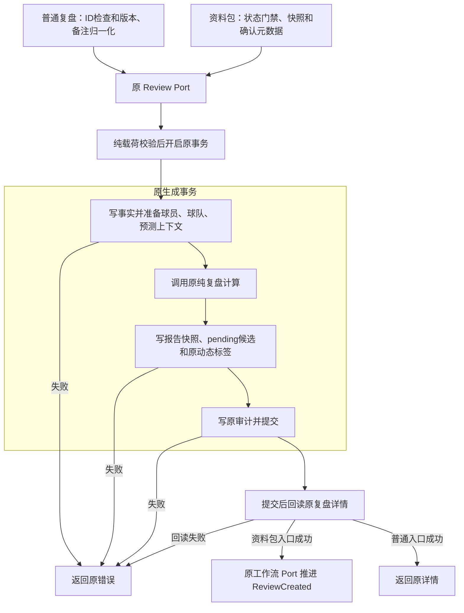

# R10-03 Review Engine Adapter

状态：`DONE`（自身精确Windows全SUCCESS；下述VERIFYING为实施历史）。用户2026-10-12“收尾02开始03”授权；uniquenesssta/123 v0.23.0，唯一rewrite/r10-review-analytics-release-backend，基线93a008e007490b60eeb1ecbcd27c61d5fc12bb18。01～03自身精确Windows DONE；04～13 BLOCKED，R10 IN_PROGRESS。

### 1. 目标

将两条复盘生成编排及数据库对原纯计算引擎的适配收拢为唯一模块，明确准备/计算/报告/事务边界。

### 2. 现状与来源

普通用例generate_match_review/mod.rs负责ID校验/版本和备注归一化；资料包workflow generate_review负责状态/持久化预检/确认/生成/状态推进。PG根review.rs同时持有generate、完整prepare、三上下文读取与persist_calculation。R0/现有Ports/Service/facade调用核对后限定准确六PG职责，不提前重写04候选人工事务。

### 3. 目标文件与目录

Application use_cases/review/engine_adapter/{mod,draft,package,tests}.rs；原fixture按#[cfg(test)]共用review/test_support.rs。PG adapters/review/engine_adapter/{mod,repository,preparation,context,report}.rs。采用Rust语义snake_case目录替代任务书参考engine-adapter；不新增空壳crate或端口。

### 4. 文件职责边界

draft保留普通生成真实归一化/前检/Port调用；package保留资料包真实生成阶段。PG repository原生成事务及纯引擎调用，preparation组装原完整计算输入，context集中同事务baseline/历史连续性/指定或最近成功预测读取，report集中紧密耦合的版本替代/不可变快照/球员球队报告/pending候选/原动态标签写入；mod只登记/显式导出。纯计算crate不改，Root剩余查询/人工候选职责不是转发壳。

### 5. 输入

原MatchReviewDraft、package_id/WorkflowRecord与确认后预检、ReviewPreparationData、CalculatedMatchReview和借用Transaction；无新DTO/字段/config。

### 6. 输出

原MatchReviewDetail、MatchReviewPackageReviewResult及review ID，原结果/换人快照、预测评估/结论、球员/球队报告与pending候选。原PG公开generate签名及Application Ports/facade保持。

### 7. 允许依赖

Application原Review/State Ports及确认helper；PG原Facts validate/write、football_review_engine::calculate_review、sqlx/Domain/chrono/serde_json/uuid与原审计。复用现有依赖/锁版本，不新增Calculator trait/通用Repository或后台任务。

### 8. 禁止依赖

Application无SQL/具体PG/Tauri/模型公式；原纯引擎不新增IO。context/preparation/report只借用原事务，不新开/提交/回滚；不自动接受候选或晋升参数，不将合成fixture写入统计。

### 9. 状态所有权

原八状态/权限/九步界面与19共享状态ID保持；资料包仍生成成功且原详情回读成功才mark_review_created。生产不新增共享State/Mutex；原Fixture Mutex仅#[cfg(test)]共用，未创建测试框架/target。PG直接owner仍36。

### 10. 副作用边界

普通入口维持ID先检、版本trim空转None、备注trim保留可选值，再原Review Port。资料包维持状态门禁→持久化预检→确认元数据→Review Port→状态Port。PG维持validate→begin→完整prepare→原calculate_review→persist→audit→commit→read；报告所有写入与原事实/上下文同事务，状态推进仍独立Port，不将多个事务画为全包原子。

### 11. 异常路径

原App/Port/PG类型与中文错误保持；普通ID失败无Port副作用，资料包领域失败无预检读取。准备/持久化/审计失败返回原错误，不调用后续阶段；纯calculate_review原返回值不新增Result映射。提交后回读失败仍可能已有已提交报告，资料包不因此提前推进状态，不擅称提交错误未知结果已回滚。

### 12. 并发/异步/生命周期

原比赛锁、SQL条件和借用&mut **tx、await及commit后回读作用域保持；context严格前场日期/最近10actual历史/成功同场source_run约束保留。取消和事务生命周期按原SQLx与调用方，无新timeout/cancel/listener/request字段。

### 13. 兼容要求

原普通和资料包前检差异不统一；纯计算源码/phase4-review-v1/公式与输出字段、十个PG公开方法签名、Ports/facade/composition、171命令/DTO/Schema/迁移/配置/错误/日志/UI/模型保护区/0.23.0保持。报告快照不改写，旧报告状态及旧pending候选按原supersede审计，原新候选仍pending、接受/参数晋升仍人工。

### 14. 实施步骤

迁两实际Application生成函数、切Service/组合工作流、删除旧生成模块和函数；迁六PG职责、切事实repository的共享prepare import并清旧body/imports。原8测试正文保持，2迁入引擎owner、同一fixture共用，新增5unit。四既有门禁与官方清单/记录更新，等价/负向后推原Windows。

### 15. 切换入口

ReviewService直接engine_adapter::{generate_match_review,generate_review}，组合workflow直接导入同一资料包生成。PG生成公开方法由engine_adapter repository直接调用纯函数；facts repository直接引入engine_adapter::prepare_review_in_tx，不保留root旧prepare转发。crate内出口只共享必要prepare，未新增公开root API。

### 16. 删除清单

删除原Application use_cases/review/generate_match_review/mod.rs及旧注册；移除workflow原generate_review、PG根六函数及不再需要的calculation/context imports。原fixture/2测试迁至共用测试支持/新owner无复制。整文件删除仅上述mod.rs，原review.rs仍真实持有读取/候选决定。

### 17. 最小验证

84/84原JS源码、完整architecture、18变更Rust独立Rustfmt1.88check、规范化等价与生产SQL/错误/JSON字面量精确集合、8/8负向/diff/文档核对通过。新增5Application unit待Windows，预期151/PG187/Gateway112 unit、41contract，不记预期为PASS。

### 18. 阶段回归

仅原Public Platform CI Windows Automated/原Rust targets执行frontend/contracts/TypeScript/Vite/17视口、locked fmt/Clippy all-targets -D warnings/workspace tests、Windows release/MSI/NSIS/启动/日志。未运行Linux/macOS Cargo/check/Clippy/build/test、loopback或浏览器动态；无新runner/workflow/target/DB专项入口。

### 19. 失败停止条件

自身精确Windows完整SUCCESS前03 VERIFYING、04～13 BLOCKED；失败先修、不继承02成功、不跳测/抑制警告/降低门禁。job开始即停止CI查询，预计20～30分钟，阶段完成记录不创建。

### 20. 回退点

93a008e007490b60eeb1ecbcd27c61d5fc12bb18，源码同02已验1ad6e68；受控revert本节点代码/清单/门禁/记录，不手工复制恢复双owner。

### 21. 根README摘要记录

根README记录01～02 DONE、03 VERIFYING、04～13 BLOCKED、实际owner/5新增unit/静态与Windows待验，引用本节点及阶段索引，历史状态保留为当时实施记录。

### 22. docs阶段详细记录

本23字段与完整实际A/M/D、职责/测试迁移、兼容/验证/失败尝试/工具/回退和最终新库延期；阶段README、R10任务书与TESTING同步。02收尾单独5M [skip ci]提交，不混作03已验源码。

### 23. 完成标准

唯一生成/适配owner、真实入口切换、旧职责删除与源码核验完成；须03自身精确Windows全SUCCESS后才能DONE。真实PG/历史四项/账本并发回滚/有效XLSX/Windows Full/私有P4P7固定回归及继承model.runs/0041删除风险最终新库待验；ignored/公开unavailable stub/指纹不能计真实PASS。

## 等价、单测与修订证据

六PG函数规范化签名/正文相等，剩余root读取/候选/映射函数及PG公开签名保持；facts commit正文相同，仅共享prepare的import切到实际owner。普通生成仅函数名/目录变，资料包生成正文相同，三剩余workflow编排保持；Service两入口逆切并按导入集合对账相等。完整受影响生产SQL/中文错误/JSON字面量多重集合逐字相同，防止仅忽略空白的比较掩盖载荷/错误变化。纯review-engine、Domain、Ports/facade/composition、Application facts/包IO/shared/确认/guards、Gateway/analytics-engine/analysis-package/UI/Tauri/模型/迁移/原PG integration/工作流/依赖/契约逐字冻结。

原8 Application测试正文逐项保持，其中2生成unit实际移至engine_adapter/tests.rs，原fixture按#[cfg(test)]共用；新增5测试断言ID前检无Port、空值/Unicode归一化、原事实/覆盖率/source_run载荷、完整返回DTO与失败无状态写入。预期Application151，PG187/Gateway112+41不变，原纯引擎测试保持；全部待本节点自身Windows。

8/8负向源码探针拒绝且恢复：反转普通结果ID检查、跳版本trim、绕过GenerateReview领域动作、生成前提前/重复推进状态、绕过原纯calculate_review输入、审计前commit、跳原预测上下文、候选改accepted自动接受。既有Review门禁增加首次状态写入必须在生成之后且只有一次，并保持单事务/审计/完整准备与报告顺序；不另建验证框架。

首次职责提取脚本将普通字符串末尾r误当原始字符串开始，导致report截断和root额外括号，被独立Rustfmt立即拒绝；已改为单次词法扫描正常/原始字符串和注释，从已验93a008e重建PG六函数再格式/全文等价，生产逻辑未改。Service逆切比较因Rustfmt导入排序不同最初不相等，按相同导入集合和函数正文复核后通过。以上为本地迁移/检查问题，不是伪造Windows失败或下调断言。

实际本地：原84 JS源码；npm run verify:architecture；原verify-review-service / match-review-package / match-event-facts / stage-a-architecture；verify_protected_assets / verify_command_contract / verify_database_baseline；官方Ports --refresh-source-scan与Domain生成；18 Rust独立rustfmt1.88 --edition2021 --config skip_children=true --check；等价/8负向、git diff --check、23字段/完整文件/相对链接。scratch报告r1003-static-checks.json、r1003-architecture.log、r1003-equivalence.json、r1003-negative-probes.json可重建，判定保留本记录，不依赖临时报告作唯一证据。

365 Domain/129声明/sourceDigest217241ac243726a5ab6805a7f169e222b97e78c7c971749a5904714af673ebdd及扫描映射301保持（02已有SubstitutionDraft fixture扫描引用，不是生产Schema）；扫描1186、usageDigeste99f65817e3af3b300d9afa5a182174c454ea41195205af291e564c5da91d060。Application417/43Ports/19Port文件、PG直接owner36、状态19。18保护聚合d74e0936b60c69f444a498405fed3e704b8db63b81f26b40036f772b4b6eac57；171命令；46迁移/18PG静态聚合d9f2eb50bacd747b7cbf08492189c2635b7c0ec2cf4c764def1d32a837f8ba93保持。

## 实际生成与原事务

图只表达实际已有代码；原纯函数无Result，未虚构错误分支。提交后回读失败不撤销已提交报告，资料包后续状态Port不提前写入；原多Port事务未合并。候选接受/参数晋升属原人工链路，图中pending生成不是自动接受。

## 工具与规则

两附件SHA同前轮，root AGENTS、uniquenesssta/skil main0.0.1入口、总纲及03完整字段已核对，未变规则复用；当前源码/精确CI优先于跨项目旧记忆。GitHub核实02精确运行/日志/artifact、五文档收尾[skip ci]与同分支03交付；Mermaid Chart显示已核实中文原事务图；Create State按项目列表核实稳定足球UUID96f03270-c236-46de-99fa-db85d2fbf4ce保存续接。既有版本/API与已验实现复用，无新第三方兼容问题，不重复Context7；无子代理。无新依赖/迁移/目标/runner/workflow/DB专项入口，无R10阶段完成记录。

## 完整实际文件清单

相对基线93a008e007490b60eeb1ecbcd27c61d5fc12bb18：11A / 18M / 1D，共30路径。移动关系：原generate_match_review/mod.rs→engine_adapter/draft.rs；workflow generate_review→engine_adapter/package.rs；PG root六函数→新适配器四职责文件；2原unit→新tests、原fixture→test_support。除普通用例整文件迁移对应A/D外，其余是职责移出，不重命名剩余真实owner。

| 类型 | 路径 |
|---|---|
| A | crates/application/src/use_cases/review/engine_adapter/draft.rs |
| A | crates/application/src/use_cases/review/engine_adapter/mod.rs |
| A | crates/application/src/use_cases/review/engine_adapter/package.rs |
| A | crates/application/src/use_cases/review/engine_adapter/tests.rs |
| A | crates/application/src/use_cases/review/test_support.rs |
| A | crates/persistence-postgres/src/adapters/review/engine_adapter/context.rs |
| A | crates/persistence-postgres/src/adapters/review/engine_adapter/mod.rs |
| A | crates/persistence-postgres/src/adapters/review/engine_adapter/preparation.rs |
| A | crates/persistence-postgres/src/adapters/review/engine_adapter/report.rs |
| A | crates/persistence-postgres/src/adapters/review/engine_adapter/repository.rs |
| A | docs/modular-rewrite/R10-review-analytics-release-backend/R10-03-review-engine-adapter.md |
| D | crates/application/src/use_cases/review/generate_match_review/mod.rs |
| M | README.md |
| M | architecture/application-port-inventory.json |
| M | architecture/domain-type-inventory.json |
| M | crates/application/src/services/review/service.rs |
| M | crates/application/src/use_cases/review/mod.rs |
| M | crates/application/src/use_cases/review/package/workflow/coordinator.rs |
| M | crates/application/src/use_cases/review/package/workflow/mod.rs |
| M | crates/application/src/use_cases/review/package/workflow/tests.rs |
| M | crates/persistence-postgres/src/adapters/review/facts/repository.rs |
| M | crates/persistence-postgres/src/adapters/review/mod.rs |
| M | crates/persistence-postgres/src/review.rs |
| M | docs/TESTING.md |
| M | docs/football-model-platform-modular-rewrite-19-docs/10-R10-review-analytics-release-backend.md |
| M | docs/modular-rewrite/R10-review-analytics-release-backend/README.md |
| M | scripts/verify-match-event-facts.mjs |
| M | scripts/verify-match-review-package.mjs |
| M | scripts/verify-review-service.mjs |
| M | scripts/verify-stage-a-architecture.mjs |

## R10-03 精确 Windows 验收完成（2026-10-12）

精确提交 `99b15ad261a178322231320ad9dc2f8af00ded8e` / tree `a52fd71ad9551a615720c49d9a69d3380d90361f`，[Public Platform CI run38259438025](https://github.com/uniquenesssta/123/actions/runs/38259438025) / Windows job114845878326 全 SUCCESS，run 于 2026-10-12 22:22:12 北京时间完成。实际 Application151/151、Persistence187/187、Gateway112/112 unit 和41/41 contract；新增5个普通入口测试及迁移的2个资料包生成测试均实际通过。前端契约、TypeScript、Vite、17视口、Rust fmt、locked Clippy all-targets -D warnings、完整workspace tests、Windows release/MSI/NSIS、客户端启动和运行日志扫描全部通过（7条记录、3个完成操作）。

证据 artifact11753201967，14,041,892字节，SHA-256 `984de7735649121de192de496d5d92921feb46583e145ad7b8985d37a483ff04`；报告 `windows-acceptance-20261012-135927.json` 及同名.txt。验收对应上述03自身代码，不借用02结果。本次仅五份既有文档补齐验收状态并提交 [skip ci]，生产源码、测试、门禁、清单及依赖均与精确成功提交一致，不重复运行同源码Windows。

03自身完整Windows通过，当前 DONE；01～03 DONE，04～13 BLOCKED，R10 IN_PROGRESS，继续唯一 `rewrite/r10-review-analytics-release-backend` 分支。用户重复“收尾02开始03”的范围已完成；本次没有新增04授权或进入04实施，没有创建R10阶段完成记录。此前03 VERIFYING、预期151和待Windows描述保留为实施历史，以本节和首部当前状态为准。

真实PG、历史保护四项、不可变账本、并发/回滚、有效XLSX、Windows Full、私有P4/P7固定回归及继承的model.runs/0041删除风险仍最终封包新库待验；ignored、公开unavailable stub、静态指纹不计这些真实验收PASS。本轮未运行非Windows Cargo/check/Clippy/build/test、loopback或浏览器动态。

本次验收补记5M/0A/0D，无移动/重命名：根README、TESTING、R10任务书、阶段README及本节点。03实施相对93a008e的11A/18M/1D、旧职责清理及基线回退记录保持。GitHub核对精确run/job/log/artifact与当前分支；沿用已核实的Mermaid Chart真实生成事务图，不变更图中链路；Create State保存当前验收状态，未产生新的API兼容问题。
