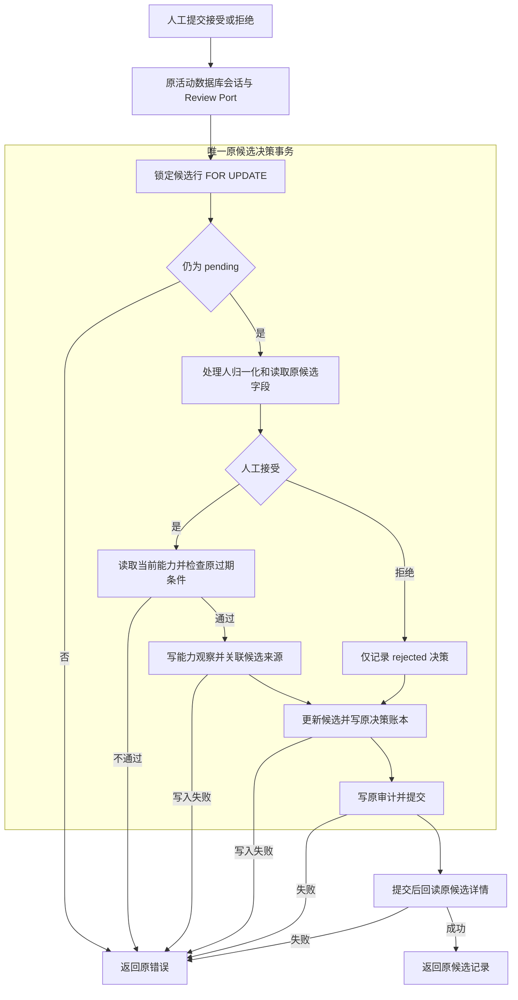

# R10-04 Ability Candidate Transaction

状态：`DONE`（自身精确Windows全SUCCESS；下述VERIFYING为实施历史）。用户2026-10-12“收尾03开始04”授权；uniquenesssta/123 v0.23.0，唯一rewrite/r10-review-analytics-release-backend，基线aa24f5a3c05ec6008206a53af47f136e92bd7f4a。01～03自身精确Windows DONE；05～13 BLOCKED，R10 IN_PROGRESS。

### 1. 目标

将能力候选查询、映射与人工决定的原事务收拢为唯一实际owner，明确接受与拒绝副作用差异。

### 2. 现状与来源

已验03后的PG root review.rs仍持有list_ability_candidates、decide_ability_candidate、read_ability_candidate和ability_candidate_from_row。ReviewService/原MatchReviewPort及组合适配器已按原公开方法调用；R10-04参考目标仅PG候选事务，Application透传没有新增业务职责，不机械迁移。

### 3. 目标文件与目录

crates/persistence-postgres/src/adapters/review/ability_candidate_transaction/{mod,read,mapping,validation,repository,tests}.rs。遵循原Rust目录，不新增crate/trait、DTO或代理层。

### 4. 文件职责边界

repository持有完整原决策事务；read持有列表与提交后单候选回读；mapping持有原行字段/四状态解码；validation集中原pending、处理人及过期门禁；tests纳入原PG unit target，mod只登记。紧密耦合的锁、观察、状态、决策和审计步骤留在同一具名事务，不按每条SQL拆文件。

### 5. 输入

原AbilityCandidateDecisionDraft与原候选行；只读入口原可选status/match_review_id和limit。Accept/Reject来自原人工命令，不新加request ID、确认字段或DTO。

### 6. 输出

原AbilityUpdateCandidateRecord列表/详情，原pending→accepted/rejected、决策账本/审计与接受时的能力观察关联。原accepted_observation_id、evidence、计算版本和来源不变。

### 7. 允许依赖

原sqlx/PgPool/Row、football_domain、chrono/uuid/serde_json和write_audit_event及PersistenceResult/Error。PostgresStore同名impl方法仍为唯一公开边界；借用原事务，不新增依赖版本。

### 8. 禁止依赖

不引入UI、Tauri、Application具体引用、模型公式/参数晋升、通用Repository、后台任务或共享State。read/mapping/validation不写入或另开事务；纯引擎仍只生成pending候选。

### 9. 状态所有权

候选状态与原观察/决策账本由PG事务持有；派生当前能力仍原数据库投影。19状态ID、PG直接owner36、Application417/43Ports/19Port文件保持；无新跨模块可变状态。

### 10. 副作用边界

self.pool.begin→原FOR UPDATE OF candidate→原pending前检→原处理人trim/default及字段读取→Accept读取当前投影并按原0.01/None规则门禁后写观察，Reject仅生成rejected/None→更新候选→写原决策账本→原审计→commit→pool回读详情。所有写入/审计共用一个原事务；拒绝不读当前投影或写观察。

### 11. 异常路径

原候选不存在/已处理/已过期/未知状态的InvalidState和原SQL/序列化错误逐字保持。提交前任何失败不执行后续步骤；提交结果未知或提交后回读失败不能声称已经回滚，提交后读失败仍可能已有已持久化决定。

### 12. 并发/异步/生命周期

保留原候选行FOR UPDATE与await/借用原tx作用域，同候选重复决定通过原pending状态阻断。没有新增跨候选/球员维度锁、超时、取消、请求编号或全局互斥；原锁不等同于证明不同候选的跨行并发隔离。真实锁/并发/回滚在最终新库沿用既有验收验证，本轮源码等价不记为真实PG PASS。

### 13. 兼容要求

原两个公开PostgresStore签名及Application facade/Service/Ports/composition/Tauri命令、九步流程、报告不可变、候选人工接受、参数人工晋升、四状态、limit1..2000和排序保持。Domain/Schema/SQL/载荷/错误/日志/UI/配置/依赖/迁移/模型保护区/0.23.0不变。

### 14. 实施步骤

迁四候选职责，提取原状态/身份/当前投影纯门禁及行状态codec，登记唯一模块并清root旧body/imports。补8原PG unit、扩原Review门禁并刷新官方Domain使用清单；完成逐字/逆内联等价和8破坏探针后通过原静态/架构与Rustfmt，再推原Windows。

### 15. 切换入口

PostgresStore::list_ability_candidates/decide_ability_candidate实际方法移至候选模块，原Port适配器无需转发层变更；原read_match_review继续同名候选列表方法，新repository直接read::read_ability_candidate。mod仅登记，无root旧函数转发壳。

### 16. 删除清单

从root review.rs移除四候选函数和对应chrono/候选类型/JSON/审计imports。整文件删除/移动/重命名均无，root仍真实持有三复盘读取及五行映射函数；旧候选职责删除而非保留第二实现。

### 17. 最小验证

84/84既有JS源码、完整verify:architecture、8实际Rust独立Rustfmt1.88 check、13等价核对、8/8负向、git diff --check及23字段/完整文件清单/相对链接通过。新增8 PG unit待自身Windows；预期PG195不记动态PASS。

### 18. 阶段回归

仅原Public Platform CI Windows Automated及原Rust targets承担frontend/contracts/TypeScript/Vite/17视口、fmt/locked Clippy all-targets -D warnings/workspace、Windows release/MSI/NSIS/启动/日志。预期App151/PG195/Gateway112unit+41contract，等待自身精确完整SUCCESS；未运行Linux/macOS Cargo/check/Clippy/build/test、loopback或浏览器动态。

### 19. 失败停止条件

自身Windows完整SUCCESS前04 VERIFYING、05～13 BLOCKED；失败先修本唯一R10分支，不继承03成功或用静态/预期代替动态，不跳测试、抑制警告或减门禁。原Windows job开始后停止查询并提示约20～30分钟；无R10阶段完成记录。

### 20. 回退点

aa24f5a3c05ec6008206a53af47f136e92bd7f4a，03收尾文档HEAD，源码同99b15ad/Windows run38259438025 SUCCESS。受控revert本节点代码/门禁/清单/记录提交，不手工复制旧文件恢复双owner。

### 21. 根README摘要记录

根README记录03已收尾、04实际候选唯一事务/8新增unit/静态与Windows待验、05～13 BLOCKED及最终新库延期；完整清单和证据链接本节点/阶段索引，历史状态保留。

### 22. docs阶段详细记录

本23字段、完整A/M/D与实际职责迁移、兼容/异常/并发/测试/工具/失败尝试及回退；R10任务书、阶段索引与TESTING同步。03验收已经aa24f5a纯文档保存，不重复修改03历史文件或创建阶段完成记录。

### 23. 完成标准

唯一候选事务/读取/映射owner、原入口切换与旧职责删除及源码复核完成；须04自身精确Windows全SUCCESS才能DONE。真实PG/历史四项/不可变账本/并发回滚/有效XLSX/Windows Full/私有P4P7固定回归与继承model.runs/0041删除风险仍最终封包新库待验；ignored/公开unavailable stub/静态指纹不计真实PASS。

## 测试、等价与实际修订证据

8新增原PG unit：pending三已处理状态拒绝；未知/大小写/空白pending拒绝且错误逐字；处理人缺失/Unicode空白默认local_user；Unicode trim/身份大小写及内部空格保持；None/None与0.01包含边界；过期/单边None/NaN/Infinity拒绝且原错误；四状态解码；未知状态不归一化且原错误。全部调用实际生产validation/mapping函数，未增加测试target、runner、workflow或数据库专项入口。原187 PG/App151/Gateway112+41及纯引擎/原integration正文不变，新增8待Windows真实执行。

13等价核对通过：四原职责删除；root八剩余函数相同；列表/单读签名正文相同；pending/投影门禁与身份表达式逆提取相同；事务逆内联后原全文相同；全部行字段/顺序值与四状态codec相同；生产SQL/错误/JSON字面量多重集合逐字相同；公开PG签名相同；Application/Ports/facade/领域/UI/模型/纯引擎/facts/参数/迁移/原integration/依赖/targets冻结；365声明/301扫描映射分类保持。

8/8负向探针拒绝且最终逐文件字节快照恢复：移除候选锁、绕过pending、跳接受时投影门禁、放宽0.01、取消空白身份过滤、拒绝改接受、审计前提前提交、accepted错误映射pending。原verify-review-service加唯一owner/入口、SQL与人工分支/事务顺序/原载荷和8测试守卫；原Exchange等门禁未下调。

本地检查中require_pending通用函数名被原Exchange账本唯一owner门禁拒绝，已改为候选专用require_pending_candidate，保留原账本门禁。状态codec逆内联比较先因Rustfmt简化Err表达式分支括号不同失败，校正比较规范化后13/13通过，未改生产语义。一次探针复核后发现仓库残留other_pending临时调用，使Domain指纹/Review架构检查拒绝；已恢复真实guard，并增加全候选文件字节快照恢复核对，再完成探针、等价、清单、84/84与完整架构复验。所有临时文本已清理；以上为本地提取/验证问题，不虚构为Windows CI失败。

实际命令：node scripts/generate-domain-type-inventory.mjs；原84 JS；npm run verify:architecture；verify-review-service/verify-domain-type-inventory/verify-application-ports；verify_protected_assets/verify_command_contract/verify_database_baseline；8实际Rust rustfmt1.88 --edition2021 --config skip_children=true --check；规范化/逆内联/SQL字面量集合、8负向、git diff --check、23字段/链接/文件清单。scratch可重建报告r1004-static-checks.json、r1004-architecture.log、r1004-equivalence.json、r1004-negative-probes.json，正式结论本记录保留。

365 Domain/129来源/sourceDigest217241ac243726a5ab6805a7f169e222b97e78c7c971749a5904714af673ebdd、301映射分类保持；1192扫描，rustUsageDigest c71c0df0e496a9dc51dbb098a5d503fd5f5201bf373be877b5eb40cd1aa28e34。Application417/43Ports/19Port文件与官方清单不变，PG直接owner36/state19；18保护聚合d74e0936b60c69f444a498405fed3e704b8db63b81f26b40036f772b4b6eac57，171命令，46迁移/18PG原静态聚合d9f2eb50bacd747b7cbf08492189c2635b7c0ec2cf4c764def1d32a837f8ba93保持。

## 实际人工门禁与原事务

图表达原真实流程，拒绝不写观察，处理人默认不等于系统自动接受。全部写入/决策/审计同一原事务；提交后读失败不能保证已提交决定回滚。此图与Mermaid Chart本节点中文渲染一致，不把源码等价画成真实PG并发验收。

## 工具与来源

两附件scratch复制SHA同前轮，root AGENTS/总纲和完整04字段已核对；uniquenesssta/skil main0.0.1/AGENTS.md sha5cc6750404092a080ddcd18685a25dfb90d3f809不变。GitHub核对同分支aa24f5a精确HEAD与已验03证据，按本节点交付原Windows；Mermaid Chart显示本人工候选真实链路；Create State按已核实足球UUID96f03270-c236-46de-99fa-db85d2fbf4ce保存续接。既有API/依赖版本复用，无新兼容问题不重复Context7；无子代理。没有新依赖/配置/迁移、DB专项、持续回归框架或R10阶段完成记录。

## 完整实际文件清单

相对aa24f5a3c05ec6008206a53af47f136e92bd7f4a：7A / 8M / 0D，共15路径。整文件移动/重命名/删除无；root四候选职责移入新模块，原内联门禁与codec移入同模块。

| 类型 | 路径 |
|---|---|
| M | README.md |
| M | architecture/domain-type-inventory.json |
| A | crates/persistence-postgres/src/adapters/review/ability_candidate_transaction/mapping.rs |
| A | crates/persistence-postgres/src/adapters/review/ability_candidate_transaction/mod.rs |
| A | crates/persistence-postgres/src/adapters/review/ability_candidate_transaction/read.rs |
| A | crates/persistence-postgres/src/adapters/review/ability_candidate_transaction/repository.rs |
| A | crates/persistence-postgres/src/adapters/review/ability_candidate_transaction/tests.rs |
| A | crates/persistence-postgres/src/adapters/review/ability_candidate_transaction/validation.rs |
| M | crates/persistence-postgres/src/adapters/review/mod.rs |
| M | crates/persistence-postgres/src/review.rs |
| M | docs/TESTING.md |
| M | docs/football-model-platform-modular-rewrite-19-docs/10-R10-review-analytics-release-backend.md |
| A | docs/modular-rewrite/R10-review-analytics-release-backend/R10-04-ability-candidate-transaction.md |
| M | docs/modular-rewrite/R10-review-analytics-release-backend/README.md |
| M | scripts/verify-review-service.mjs |

## R10-04 精确 Windows 完成与05授权（2026-10-13）

精确提交 `221d21134c46fa45e280230238153694be415aa1` / tree `5f8234f89eb86a6aeb7c19dd8bfc1376385d31b4`，[Public Platform CI run38271387412](https://github.com/uniquenesssta/123/actions/runs/38271387412) / Windows job114886215505 全SUCCESS，run于2026-10-13 00:03:32北京时间完成。实际Application151/151、Persistence195/195（新增8候选unit均成功）、Gateway112/112 unit和41/41 contract；前端/contracts/TypeScript/Vite/17视口、Rust fmt/locked Clippy all-targets -D warnings/workspace、Windows release/MSI/NSIS、客户端启动及日志扫描通过（7条记录、3个完成操作）。报告windows-acceptance-20261012-153709.json及同名.txt。

证据artifact11758811423，14,041,670字节，SHA-256 `296e86e05c1a649bfab6cda6cb9a938f8b83d75c4f2b19c71d80a3ad404fec59`。04自身完整成功后DONE；用户2026-10-13“收尾04开始05”授权05 Postmatch Settlement READY，继续唯一rewrite/r10-review-analytics-release-backend，06～13 BLOCKED，R10 IN_PROGRESS。本次只五份既有文档收尾[skip ci]，源码同精确成功提交，后续05须自身完整Windows证据。此前04 VERIFYING与预期计数保留为实施历史。

真实PG/历史保护四项/不可变账本/并发回滚/有效XLSX/Windows Full/私有P4/P7固定回归及继承model.runs/0041删除风险仍最终封包新库待验；ignored、公开unavailable stub和静态指纹不计这些真实PASS。无R10阶段完成记录。

收尾5M/0A/0D：根README、TESTING、R10任务书、阶段索引与本节点。04实施7A/8M/0D及原职责/回退记录保持，源码不变。
