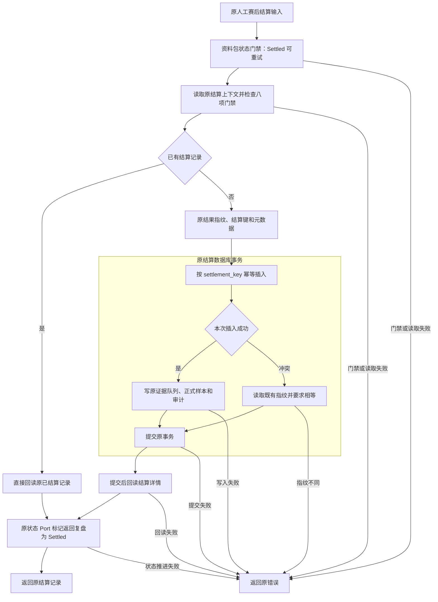

# R10-05 Postmatch Settlement

状态：`DONE`（自身精确Windows全SUCCESS；下述VERIFYING为实施历史）。用户2026-10-13“收尾04开始05”授权；uniquenesssta/123 v0.23.0，唯一rewrite/r10-review-analytics-release-backend，基线96ef21d3b206715a86b1377bd3389860504ae59f。01～04自身精确Windows DONE；06～13 BLOCKED，R10 IN_PROGRESS。

### 1. 目标

让赛后结算的应用编排、readiness/读取及直接事务依赖归唯一实际owner，保持已有幂等和资料包推进边界。

### 2. 现状与来源

原Application三独立execute用例由PostmatchService调用；PG root postmatch.rs混有结算、证据决定、供应商与漂移。核对真实上游/下游后纳入结算直接依赖的上下文、门禁、读取、fingerprint、证据队列和正式样本；后续06/07/08的人工决定/供应商/漂移正文保持。

### 3. 目标文件与目录

Application use_cases/postmatch/settlement/{mod,coordinator,read,tests}.rs；PG adapters/postmatch/mod.rs与settlement/{mod,context,readiness,read,repository,evidence_queue,evaluation_sample,validation,tests}.rs。参考App目录外增加实际PG事务owner以完成受影响链，不新增crate/port/框架。

### 4. 文件职责边界

App coordinator仅资料包领域门禁→settle Port→mark状态；read集中原readiness与列表透传。PG context原SQL/上下文；readiness原8门禁；read列表/详情/原SQL与映射；repository原完整幂等事务/指纹；evidence_queue冻结证据队列与原时效函数；evaluation_sample原正式样本；validation原概率/JSON必填校验；mod仅登记。紧密耦合的插入/冲突/审计/commit仍同一具名事务。

### 5. 输入

原PostmatchSettlementDraft、review_id/limit和原上下文/预测评价/冻结证据；原settled_by/settlement_note不新增trim或默认。无新DTO、request ID、配置、状态或确认字段。

### 6. 输出

原PostmatchSettlementRecord/Readiness/列表与不可变结算、证据队列、评价样本及审计；原资料包Settled仍由StatePort推进，返回完整原记录。版本常量、metadata/provider NOT_BUNDLED/automatic_parameter_promotion false保持。

### 7. 允许依赖

App原PostmatchSettlementPort/MatchReviewPackageStatePort与原领域动作；PG原sqlx/chrono/uuid/serde/serde_json、sha256_json/审计和Domain。原FORMAL_HORIZONS/non_negative_u64/round6由仍承担监控/评分的root保留单owner，只扩大crate内可见性供新结算复用，不复制公式或造通用helpers。

### 8. 禁止依赖

App不读SQL/具体PG/UI/模型公式；helper只借用原事务不新开/完成事务。结算不改参数/候选决定，队列生成不等于自动证据判定。不新增IO/监听/timeout/cancel或跨模块可变State。

### 9. 状态所有权

原数据库不可变结算/队列/样本与资料包领域动作仍唯一权威；19状态ID保持，原工作流八状态/九步UI不变。PG直接owner36→37仅登记真实postmatch adapter，新ctx/partition只是原私有数据形状共享给同一模块；App418/43Ports/19Port文件。

### 10. 副作用边界

App先read_workflow_by_review；有包且非Settled按原SettleReview动作门禁，Settled可幂等重试、无包仍结算。PG先读上下文/8门禁，再原已有ID回读或计算原指纹/键；新事务按key插入成功才在同tx写队列/样本/审计，冲突读取原指纹相等才返回既有ID；commit后pool回读。App按返回settlement.match_review_id调用mark_settled一次，不合并原两个Port事务。

### 11. 异常路径

原领域Validation与原Port/PG错误优先级/中文文本保持。workflow失败无settle；settle失败无mark；mark失败可能已有已提交结算。readiness仍先于已有ID返回，不擅自新加该快速路径指纹比较；插入冲突分支才按原fingerprint拒绝改变。提交结果未知或commit后读/状态失败不可宣称数据库已回滚。

### 12. 并发/异步/生命周期

原读取在事务前，ON CONFLICT键/条件与借用tx/await作用域保持；重复插入不重复队列/样本/审计。无新比赛锁/全局Mutex/取消策略，不把静态逆切比较声称真实并发隔离；真实PG幂等/并发/回滚/状态重试仍最终新库沿用原入口验证。

### 13. 兼容要求

原7 facade/Service/Tauri命令、两个Ports及原StatePort/公开PG签名、Domain/DTO/Schema/SQL/字段/错误/日志/UI/配置/依赖/迁移/模型保护区/0.23.0保持。原时效阈值/评分公式、样本概率与结果标签检查均正文相同，不提前实施06/07/08。

### 14. 实施步骤

迁App三用例并切Service/删除旧路径；迁PG15生产函数、3私有上下文类型及1原unit，切登记与共享符号可见性、清旧body/imports。原验证器路径切实际owner，加顺序/唯一事务/幂等/原测试守卫；刷新官方Ports/Domain/module清单，补8App/4PG unit、等价/负向后推原Windows。

### 15. 切换入口

Service直接postmatch::settlement::{postmatch_settlement_readiness,settle_postmatch_review,list_postmatch_settlements}。PG原同名PostgresStore方法实际迁移，新context/read/queue/sample crate私有方法供同父模块使用；facade/组合adapter继续原签名，root不保留settlement转发壳。

### 16. 删除清单

删除旧App三个mod.rs/注册；root移出15生产函数和3类型/1unit及无用chrono/serde/Transaction导入。其余21原函数（含证据决定/供应商/漂移/真实共享支持/原unit）正文保持，不删除仍真实承担后续职责的root文件。三个App整文件职责移动对应A/D，其余PG是函数移出，无整文件rename。

### 17. 最小验证

84/84既有JS、完整architecture、18实际Rust独立Rustfmt1.88 check、12等价核对、8/8负向全文件字节恢复、diff/23字段/完整A/M/D与链接通过。新增8App/4PG unit待自身Windows，预期159/199不记动态PASS。

### 18. 阶段回归

仅原Public Platform CI Windows Automated与原Rust unit/contract targets承担前端/contracts/TypeScript/Vite/17视口、fmt/locked Clippy all-targets -D warnings/workspace、Windows release/MSI/NSIS/启动/日志。原时效unit移动但数量不加，原PGintegration18契约不变；未运行非Windows Cargo/check/Clippy/build/test、loopback或浏览器动态。

### 19. 失败停止条件

05精确提交自身完整Windows SUCCESS前VERIFYING，06～13 BLOCKED；失败修本唯一分支，不继承04结果、不跳测试/减门禁/抑制警告。Windows job开始即停止查询并提示20～30分钟，无阶段完成记录。

### 20. 回退点

96ef21d3b206715a86b1377bd3389860504ae59f，源码同04精确221d211/Windows run38271387412 SUCCESS。受控revert05代码/清单/门禁/记录，不手工复制旧版本形成双owner。

### 21. 根README摘要记录

根README记录04已DONE/05唯一结算链/新增12原unit/静态与Windows待验、06～13BLOCKED及延期，引用节点和阶段索引；完整实现/失败/文件证据保存在本节点。

### 22. docs阶段详细记录

本23字段、原事务/异常/已有与冲突差异/状态/类型/函数与测试迁移、实际文件清单/工具/失败尝试/验证和回退；阶段索引/R10任务书/TESTING同步。04收尾5文档[skip ci]独立提交，05从该已验源码文档基线实施。

### 23. 完成标准

三App入口与PG直接结算链已唯一owner、真实调用切换/旧职责清理/源码核对完成；自身精确Windows完整SUCCESS才可DONE。真实PG/历史四项/不可变账本/并发回滚/有效XLSX/Windows Full/私有P4P7固定回归及继承model.runs/0041删除风险仍最终新库待验，ignored/公共unavailable stub/静态指纹不计真实PASS。

## 等价、测试及实施修订证据

12等价核对：15生产函数及原时效unit签名/正文相同；root21剩余函数相同；3ctx/fingerprint/partition字段形状相同（仅同模块可见性）；3既有共享纯符号保持单owner；生产SQL/错误/JSON字面量多重集合逐字相同；公开PG签名相同；三App用例仅路径/函数名变化；Service逆切全文相同；其余Ports/Domain/UI/模型/公式/Review/证据决定/监控/原integration/依赖/工作流/targets冻结；模块清单仅增真实owner和36→37；原时效与verdict两unit各登记一次且正文保持；365声明/301映射分类保持。

8App新unit覆盖无包draft原可选字段/空白及完整详情透传、按返回reviewID标记；ReviewCreated合法动作成功后一次推进；Settled两次幂等Port调用且不加readiness；全部六不允许状态按原Domain原因阻断；workflow失败无后续；settle/mark失败优先级和原副作用边界；readiness/列表参数及完整返回（limit0/u32MAX不加App clamp）；读取Port失败无状态写。Fake fixture只在#[cfg(test)]原unit target，未创建通用测试框架。

4PG新unit调用真实readiness：四正式horizon与real/manual源及完整身份返回；八门禁原因原顺序；四快照身份轴与synthetic/非formal证据域/时点拒绝；已有结算ID不覆盖当前readiness。原timeliness测试迁入evidence_queue并保留#[test]一次，verdict原unit仍root。所有新增unit待05自身Windows，预期App159（151+8）/PG199（195+4）/Gateway112+41。

8负向探针拒绝并全文件字节恢复：绕过SettleReview、生成前提前mark、按请求而非返回review标记、反转readiness阻断、取消结果指纹冲突、共同写入前commit、允许synthetic正式源、反转证据冻结截止。原Postmatch Service/settlement/Stage A三门禁切真实owner；门禁锁定旧职责删除、原两Port边界/单数据库事务/原幂等与测试属性，不新建验证框架。

提取原timeliness unit时#[test]最初留在root形成重复属性、新处缺属性；源码检查在提交前补迁属性并清重，正文/测试数量保持，既有Postmatch门禁新增该注册检查。首次架构/84检查发现新Postmatch直接adapter未列模块owner/count；按实际声明补唯一owner与36→37，不修改门禁算法或放宽政策；复验84/84、完整架构与12等价通过。以上为本地迁移/清单问题，不虚构Windows失败。

实际命令：原84 JS、npm run verify:architecture；verify-postmatch-service/verify-postmatch-settlement/verify-stage-a-architecture；verify-application-ports --refresh-source-scan；generate-domain-type-inventory；verify_protected_assets/verify_command_contract/verify_database_baseline；18实际Rust独立rustfmt1.88 --edition2021 --config skip_children=true --check；逐函数/字面量/类型/逆切、8负向、git diff --check、23字段/文件清单/相对链接。可重建scratch报告r1005-static-checks.json、r1005-architecture.log、r1005-equivalence.json、r1005-negative-probes.json，正式结论本记录保留。

Domain365/129/sourceDigest217241ac243726a5ab6805a7f169e222b97e78c7c971749a5904714af673ebdd、301映射分类保持；扫描1203、rustUsageDigest819b53c9f9b9b8845b324b6f33881a6a461d890fa2e759f2ea04fc738ce76966；App418/43Ports/19Port文件，PG直接owner37/state19。18保护聚合d74e0936b60c69f444a498405fed3e704b8db63b81f26b40036f772b4b6eac57、171命令、46迁移/18原PG静态聚合d9f2eb50bacd747b7cbf08492189c2635b7c0ec2cf4c764def1d32a837f8ba93保持。

## 实际幂等结算与原资料包推进

已有ID快速回读与INSERT冲突分支是原两条实际路径；后者比较指纹，前者仍先readiness、不擅加指纹比较。图中原结算事务只包含结算/队列/样本/审计；StatePort推进仍另一个原调用，不声称整体原子、全局并发隔离或提交后失败保证回滚。图与Mermaid Chart中文渲染一致。

## 工具与依据

scratch两附件SHA及rootAGENTS与前轮一致；skil main0.0.1/AGENTS.md sha5cc6750404092a080ddcd18685a25dfb90d3f809核对不变；总纲/05完整字段及实际源码调用优先。GitHub核对04精确run/job/log/artifact及唯一分支，04五文档收尾96ef21d[skip ci]；Mermaid Chart显示05真实幂等及状态推进；Create State按已核实稳定足球UUID96f03270-c236-46de-99fa-db85d2fbf4ce保存。既有API/依赖实现复用，无兼容疑问不重复Context7，无子代理；无新增依赖/迁移/runner/target/workflow/DB专项或R10阶段完成记录。

## 完整实际文件清单

相对96ef21d3b206715a86b1377bd3389860504ae59f：15A / 14M / 3D，共32路径。三App原mod.rs→settlement/coordinator与read对应A/D；PG15函数/3类型/1unit按职责移出，不整文件移动root。其余整文件移动/重命名无。

| 类型 | 路径 |
|---|---|
| M | README.md |
| M | architecture/application-port-inventory.json |
| M | architecture/domain-type-inventory.json |
| M | architecture/module-boundaries.json |
| M | crates/application/src/services/postmatch/service.rs |
| D | crates/application/src/use_cases/postmatch/list_postmatch_settlements/mod.rs |
| M | crates/application/src/use_cases/postmatch/mod.rs |
| D | crates/application/src/use_cases/postmatch/postmatch_settlement_readiness/mod.rs |
| D | crates/application/src/use_cases/postmatch/settle_postmatch_review/mod.rs |
| A | crates/application/src/use_cases/postmatch/settlement/coordinator.rs |
| A | crates/application/src/use_cases/postmatch/settlement/mod.rs |
| A | crates/application/src/use_cases/postmatch/settlement/read.rs |
| A | crates/application/src/use_cases/postmatch/settlement/tests.rs |
| M | crates/persistence-postgres/src/adapters/mod.rs |
| A | crates/persistence-postgres/src/adapters/postmatch/mod.rs |
| A | crates/persistence-postgres/src/adapters/postmatch/settlement/context.rs |
| A | crates/persistence-postgres/src/adapters/postmatch/settlement/evaluation_sample.rs |
| A | crates/persistence-postgres/src/adapters/postmatch/settlement/evidence_queue.rs |
| A | crates/persistence-postgres/src/adapters/postmatch/settlement/mod.rs |
| A | crates/persistence-postgres/src/adapters/postmatch/settlement/read.rs |
| A | crates/persistence-postgres/src/adapters/postmatch/settlement/readiness.rs |
| A | crates/persistence-postgres/src/adapters/postmatch/settlement/repository.rs |
| A | crates/persistence-postgres/src/adapters/postmatch/settlement/tests.rs |
| A | crates/persistence-postgres/src/adapters/postmatch/settlement/validation.rs |
| M | crates/persistence-postgres/src/postmatch.rs |
| M | docs/TESTING.md |
| M | docs/football-model-platform-modular-rewrite-19-docs/10-R10-review-analytics-release-backend.md |
| A | docs/modular-rewrite/R10-review-analytics-release-backend/R10-05-postmatch-settlement.md |
| M | docs/modular-rewrite/R10-review-analytics-release-backend/README.md |
| M | scripts/verify-postmatch-service.mjs |
| M | scripts/verify-postmatch-settlement.mjs |
| M | scripts/verify-stage-a-architecture.mjs |

## R10-05 精确 Windows 完成与06授权（2026-10-13）

精确提交 `fe3529f93ac1ec6777ccff53da73c0836d310a7f` / tree `950654f5357fb05a162fe4cd1449cb071aa9fd79`，[Public Platform CI run38277864089](https://github.com/uniquenesssta/123/actions/runs/38277864089) / Windows job114907643831 全SUCCESS，run于2026-10-13 00:58:51北京时间完成。实际Application159/159、Persistence199/199、Gateway112/112 unit和41/41 contract；新增8App/4PG unit与迁移的原timeliness unit通过，前端/contracts/TypeScript/Vite/17视口、Rust fmt/locked Clippy all-targets -D warnings/workspace、Windows release/MSI/NSIS、启动及日志扫描通过（7条记录、3个完成操作）。报告windows-acceptance-20261012-163146.json及同名.txt。

证据artifact11761067078，14,042,191字节，SHA-256 `65186f8312bf643c3b6547cc36cc7a61669e23f735a82be172128584ecb382f2`。05自身完整成功后DONE；用户2026-10-13“收尾05开始06”授权06 Evidence Scoring READY，继续唯一rewrite/r10-review-analytics-release-backend，07～13 BLOCKED，R10 IN_PROGRESS。本次只五份既有文档收尾[skip ci]，源码同精确成功提交，06须自身完整Windows证据。此前05 VERIFYING与预期计数保留为实施历史。

真实PG/历史保护四项/不可变账本/并发回滚/有效XLSX/Windows Full/私有P4/P7固定回归及继承model.runs/0041删除风险仍最终封包新库待验；ignored、公开unavailable stub和静态指纹不计真实PASS。无R10阶段完成记录。

本收尾5M/0A/0D：根README、TESTING、R10任务书、阶段索引与本节点。05实施15A/14M/3D及职责/回退记录保持，源码不变。
