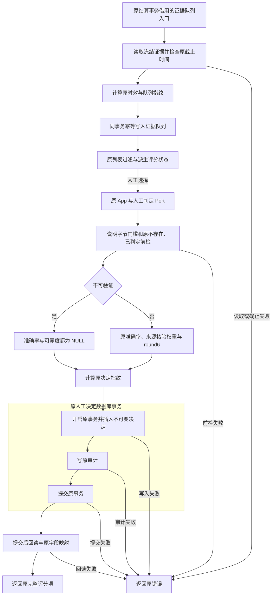

# R10-06 Evidence Scoring

状态：`VERIFYING`。用户2026-10-13“收尾05开始06”授权；uniquenesssta/123 v0.23.0，唯一rewrite/r10-review-analytics-release-backend，基线18f726400d70024e90c8335a4b9f1b6d1cfeced6。01～05自身精确Windows DONE；07～13 BLOCKED，R10 IN_PROGRESS。

### 1. 目标

让证据队列生成、读取、人工判定和原评分规则拥有唯一实际模块，保持冻结/人工/不可变边界。

### 2. 现状与来源

原App两execute用例直接透传原PostmatchSettlementPort，PG root持有查询/详情/行映射/决定/评分与verdict单测；05 settlement目录持有原队列与timeliness单测。核对结算调用、Overview读取、未来供应商/漂移后只迁本证据链，07/08正文不变。

### 3. 目标文件与目录

App use_cases/postmatch/evidence_scoring/{mod,read,decision,tests}.rs；PG adapters/postmatch/evidence_scoring/{mod,read,mapping,repository,policy,queue,tests}.rs。采用Rust snake_case替代任务书参考evidence-scoring；不新crate/Port/框架。

### 4. 文件职责边界

App read/decision保留原参数透传与错误返回，mod仅登记/导出。PG read查询/过滤/派生状态，mapping原字段解码，repository原人工决定事务，policy原状态/说明/评分纯规则，queue原冻结证据生成/时效/幂等写入。queue借用结算事务，不用额外转发壳或新事务合并生命周期。

### 5. 输入

原可选status/limit，原EvidenceScoringDecisionDraft(item_id/verdict/decided_by/decision_note)，原冻结证据与原借用Transaction。无新DTO/配置/确认字段/request ID。

### 6. 输出

原EvidenceScoringItemRecord列表/完整详情、不可变评分决定/指纹/审计；NotVerifiable准确率与可靠度均None/DB NULL，pending/scored/not_verifiable状态仍原SQL派生。

### 7. 允许依赖

App原SettlementPort/Domain/ApplicationResult；PG原SQLx/chrono/uuid/json、sha256_json/审计、EvidenceVerdict与PersistenceResult/Error。原round6仍root共享纯owner，无重复公式或新通用Repository。

### 8. 禁止依赖

App无SQL/具体PG/评分公式/额外trim或clamp；read/mapping/policy/queue不另开/结束决定事务。队列生成不自动判定/调用外部模型，不改候选/参数人工接受，不新增后台任务或共享State。

### 9. 状态所有权

原不可变items/decisions与item_id唯一约束保留；状态由原LEFT JOIN/CASE派生而非新内存状态。420App/43Ports/19Port文件、PG直接owner37/state19；仅cfg(test)本地fixture Mutex，无生产状态变化。

### 10. 副作用边界

决定先原note.trim().len()门槛，再pool读item/EXISTS已判定/verification/source；原评分与指纹在begin之前，单事务INSERT原决定→审计→commit→pool详情回读。说明入指纹/DB继续trim，处理人原Option保持不trim/default。队列从原结算repository同方法调用并借用原tx，截止门禁/时效/指纹/ON CONFLICT序列保持。

### 11. 异常路径

原说明/状态/不存在/已决定不可覆盖、SQL与序列化错误逐字保持。说明.len原为trim后UTF-8字节，不改成字符计数；虽旧文案称8字符，实际8字节边界保持。提交前失败不执行后续，commit结果未知或提交后详情读失败不可声称已回滚已提交决定。

### 12. 并发/异步/生命周期

原已判定预查在事务前且没有新增FOR UPDATE；原数据库item_id UNIQUE与不可变触发器保持，未加UPSERT/UPDATE/DELETE、自动重试/超时/取消策略。真正重复判定/竞争/事务回滚与账本保护仍最终新库待验，源码等价不等同实库执行PASS。

### 13. 兼容要求

原7公共命令、facade/Service/Ports/composition/公开PG签名与DTO/Domain/Schema/SQL/字段/错误/日志/UI/配置/依赖/迁移/模型保护区/版本0.23.0保持。原评分三数值1/.5/0、核验大小写精确、来源ASCII小写别名且不trim、70/15/15与round6、时效阈值不变。

### 14. 实施步骤

迁App两用例/切Service/删旧路径；迁PG五职责与原verdict unit，提取原status/note纯校验，队列全文与timeliness unit迁入唯一评分模块并删除原队列位置。队列方法仅扩大至postmatch父模块内可见，原结算事务调用正文不变；两既有门禁/官方清单/记录同步，补6App/8PG unit后等价/负向/原Windows。

### 15. 切换入口

Service直接evidence_scoring::{list_evidence_scoring_items,decide_evidence_scoring_item}。PG同名PostgresStore公开方法实际移至新owner；原Overview同名读取复用，新repository self.read_evidence_scoring_item回读。队列pub(in crate::adapters::postmatch)仅供原结算同父模块调用，未新增公共root API。

### 16. 删除清单

删App旧两个mod.rs与注册；root移除五证据函数/原verdict test模块和相关Domain imports；删settlement/evidence_queue.rs与注册。root仍15真实监控/供应商/漂移/共享支持函数。实际3D，与App两个和PG队列A对应；其余为函数移出，未整文件删除root。

### 17. 最小验证

84/84既有JS、完整architecture、16实际Rust独立Rustfmt1.88check、16等价核对、8负向全文件字节恢复、diff/23字段/完整清单/链接通过。新增6App/8PG unit待本节点自身Windows，预期165/207不记动态PASS。

### 18. 阶段回归

仅原Public Platform CI Windows Automated及原unit/contract targets执行frontend/contracts/TypeScript/Vite/17视口、fmt/locked Clippy all-targets -D warnings/workspace、release/MSI/NSIS/启动/日志。原verdict与timeliness各迁移注册一次，原PGintegration18契约不改；未运行非Windows Cargo/check/Clippy/build/test/loopback/browser。

### 19. 失败停止条件

06自身精确Windows完整SUCCESS前VERIFYING、07～13 BLOCKED；失败修本唯一R10分支，不借05成功、不跳测试/减门禁/压警告。看到Windows job启动即停止CI查询并提示约20～30分钟；无阶段完成记录。

### 20. 回退点

18f726400d70024e90c8335a4b9f1b6d1cfeced6，05纯文档收尾，源码同fe3529f/Windows run38277864089 SUCCESS。受控revert06代码/门禁/清单/记录，不手工复制旧版本形成双owner。

### 21. 根README摘要记录

根README记录05DONE、06评分唯一owner/原人工边界/新增14unit/静态与Windows待验、07～13BLOCKED及最终新库延期，链接本节点/阶段索引。

### 22. docs阶段详细记录

本23字段与完整A/M/D、职责/公式/公开和内部可见性、调用/事务/验证/工具/回退；阶段index/R10任务书/TESTING同步。05收尾独立5M[skip ci]，06从18f7264基线实施，原实施历史保留。

### 23. 完成标准

唯一证据owner/真实入口切换/旧职责清理与源码复核完成；自身精确Windows完整SUCCESS才可DONE。真实PG/历史四项/不可变账本/并发回滚/有效XLSX/Windows Full/私有P4P7回归与继承model.runs/0041删除风险仍最终新库待验，ignored/公开unavailable stub/指纹不计这些真实PASS。

## 等价与测试证据

16等价核对全通过：五原生产职责/原verdict test移除；root十五剩余函数相同；详情/mapper/原公式/旧test签名正文相同；status守卫与列表逆内联相同；note字节守卫与决定逆内联相同；队列/时效/原test全文相同，队列仅内部可见性扩至原postmatch父模块；生产SQL/错误/JSON字面量多重集合精确相同；原PG公开签名相同；App两入口仅名/路径变；Service逆切相同；结算编排及其余上下文/正式样本/readiness/读/验证/原tests、07/08、模型/UI/Ports/契约/依赖/工作流/原integration冻结；两个原unit各注册一次；365声明/301映射分类保持。

6App新unit只断言原Port边界：None filter/limit0/完整DTO；status精确字符串(含无效值不在App改写)/u32MAX不clamp；四verdict和完整draft/返回；None/空白/Unicode处理人及短note透传、校验仍PG负责；列表全部六Port错误种类保持；决定失败一次调用无重试/监控。Fake只cfg(test)，不将测试评分项当正式统计。

8PG新unit调用实际policy：原None/三个状态接受；未知/大小写/空白状态拒绝；trim后8UTF8字节(含3汉字9字节)边界接受；短/空白(2汉字6字节)原错误；三人工准确率与基准可靠度；原六核验质量/未知回退/大小写；全部source tier别名/ASCII大小写/不trim回退；所有上下文NotVerifiable均None。原verdict和timeliness单测正文完整迁移且各注册一次；新增14待06自身Windows，预期App165=159+6/PG207=199+8/Gateway112+41。

8负向探针拒绝且全文件字节恢复：App擅自trim过滤、跳note校验、按字符而非字节改门槛、不可验证伪造0分、改可靠度权重、审计前commit、INSERT改UPDATE覆盖旧决定、逆转冻结截止。原Postmatch Service/settlement两门禁切实际owner并补唯一入口/原顺序/公式/人工/旧test检查，不新增验证框架；队列继续被原结算流程复用。

本次源码提取、逆内联与静态最终均通过，没有Windows失败修复记录；未沿用旧05VERIFYING/预期计数替代本06证据。真实PG并发/不可变触发器和提交后失败仍待实库，原SQL无新增锁/覆盖策略。内部queue方法可见性调整是实际跨模块借用所需，公开接口无新增。

实际命令：原84JS；npm run verify:architecture；verify-postmatch-service/verify-postmatch-settlement；verify-application-ports --refresh-source-scan；generate-domain-type-inventory；verify_protected_assets/verify_command_contract/verify_database_baseline；16实际Rust独立rustfmt1.88 --edition2021 --config skip_children=true --check；逐函数/逆内联/字面量/原test/公开签名/冻结链、8负向、git diff --check、23字段/完整清单/链接。可重建scratch r1006-static-checks.json/r1006-architecture.log/r1006-equivalence.json/r1006-negative-probes.json，正式结论本记录保留。

Domain365/129/sourceDigest217241ac243726a5ab6805a7f169e222b97e78c7c971749a5904714af673ebdd、301映射分类保持；scan1211、rustUsageDigest8d50c3635998f66d1a26a5d4da8312d58f45339ebf4ae15e438301273098fcca；App420/43Ports/19Port文件、PG直接owner37/state19。18保护聚合d74e0936b60c69f444a498405fed3e704b8db63b81f26b40036f772b4b6eac57、171命令、46迁移/18原PG静态聚合d9f2eb50bacd747b7cbf08492189c2635b7c0ec2cf4c764def1d32a837f8ba93保持。

## 实际冻结队列与人工判定

队列借用原结算事务，人工选择才进入独立原决定事务；预查未新加行锁，原UNIQUE/immutable约束保持，但静态不等同真正竞争/回滚PASS。纯评分无Result，图不虚构纯计算失败分支。commit结果未知/提交后详情失败不保证已提交决定回滚。

## 工具与来源

两附件scratch复制SHA/root AGENTS同前轮；skil main0.0.1/AGENTS.md sha5cc6750404092a080ddcd18685a25dfb90d3f809核对，总纲/06字段/源调用已读取。GitHub核对05精确Windows/log/artifact及同分支，05五文档18f7264[skip ci]收尾；Mermaid Chart成功显示本证据真实链；Create State按已核实稳定足球UUID96f03270-c236-46de-99fa-db85d2fbf4ce保存。既有API/依赖实现复用，无新兼容疑问不重复Context7；无子代理。无新增依赖/迁移/runner/target/workflow/DB专项、第二分支或R10阶段完成记录。

## 完整实际文件清单

相对18f726400d70024e90c8335a4b9f1b6d1cfeced6：12A / 13M / 3D，共28路径（--no-renames记数）。两个App mod.rs→evidence_scoring read/decision与原settlement/evidence_queue.rs→evidence_scoring/queue.rs为整文件职责移动，对应A/D；其余是函数/旧unit移出，其他移动/重命名无。

| 类型 | 路径 |
|---|---|
| M | README.md |
| M | architecture/application-port-inventory.json |
| M | architecture/domain-type-inventory.json |
| M | crates/application/src/services/postmatch/service.rs |
| D | crates/application/src/use_cases/postmatch/decide_evidence_scoring_item/mod.rs |
| A | crates/application/src/use_cases/postmatch/evidence_scoring/decision.rs |
| A | crates/application/src/use_cases/postmatch/evidence_scoring/mod.rs |
| A | crates/application/src/use_cases/postmatch/evidence_scoring/read.rs |
| A | crates/application/src/use_cases/postmatch/evidence_scoring/tests.rs |
| D | crates/application/src/use_cases/postmatch/list_evidence_scoring_items/mod.rs |
| M | crates/application/src/use_cases/postmatch/mod.rs |
| A | crates/persistence-postgres/src/adapters/postmatch/evidence_scoring/mapping.rs |
| A | crates/persistence-postgres/src/adapters/postmatch/evidence_scoring/mod.rs |
| A | crates/persistence-postgres/src/adapters/postmatch/evidence_scoring/policy.rs |
| A | crates/persistence-postgres/src/adapters/postmatch/evidence_scoring/queue.rs |
| A | crates/persistence-postgres/src/adapters/postmatch/evidence_scoring/read.rs |
| A | crates/persistence-postgres/src/adapters/postmatch/evidence_scoring/repository.rs |
| A | crates/persistence-postgres/src/adapters/postmatch/evidence_scoring/tests.rs |
| M | crates/persistence-postgres/src/adapters/postmatch/mod.rs |
| D | crates/persistence-postgres/src/adapters/postmatch/settlement/evidence_queue.rs |
| M | crates/persistence-postgres/src/adapters/postmatch/settlement/mod.rs |
| M | crates/persistence-postgres/src/postmatch.rs |
| M | docs/TESTING.md |
| M | docs/football-model-platform-modular-rewrite-19-docs/10-R10-review-analytics-release-backend.md |
| A | docs/modular-rewrite/R10-review-analytics-release-backend/R10-06-evidence-scoring.md |
| M | docs/modular-rewrite/R10-review-analytics-release-backend/README.md |
| M | scripts/verify-postmatch-service.mjs |
| M | scripts/verify-postmatch-settlement.mjs |
