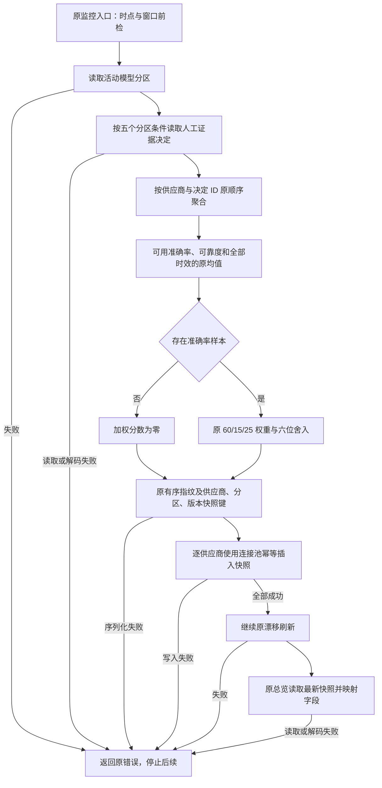

# R10-07 Provider Score

状态：`DONE`（自身精确cdd2797完整Windows全SUCCESS，以下VERIFYING为实施历史）。

### 1. 目标

把原供应商证据聚合、评分与快照读写收拢到唯一实际模块，保持同一正式分区、人工决定来源、历史快照和监控顺序。

### 2. 现状与来源

原PG root postmatch.rs实际持有两供应商方法、mapper、ProviderAggregate/total与mean。Application只有综合refresh_postmatch_monitoring/postmatch_overview及PostmatchMonitoringPort，没有独立Provider Score入口；任务书App目标目录为参考，不为满足文件路径新增Port/DTO/空转发或重复公式。原活动分区/漂移/总览属于跨供应商与08的原共享编排，本项不提前重写08。

### 3. 目标文件与目录

crates/persistence-postgres/src/adapters/postmatch/provider_score/{mod,aggregation,repository,read,mapping,tests}.rs；原postmatch.rs继续活动分区/漂移/总览/共享纯支持。Rust snake_case职责目录符合现有crate，不新crate或通用框架。

### 4. 文件职责边界

mod仅登记。aggregation持有原临时ProviderAggregate/total/mean、原BTreeMap逐行解码聚合、scores与snapshot_identity；repository持有原五分区查询和逐供应商快照写入；read持有原最新快照查询；mapping逐字段解码原Domain记录；tests只cfg(test)边界行为。不是把整原root文件搬走，剩余10真实函数保持，原五供应商职责迁出。

### 5. 输入

原PostmatchMonitoringRequest的competition_id/horizon/baseline_size/current_size；活动绑定产生原PostmatchPartition五分区身份与partition_key；原人工决定verdict/可选accuracy/reliability/全部timeliness/按SQL顺序的decision_fingerprint；原总览limit。无新配置、请求ID、字段或自动判定。

### 6. 输出

原ProviderScoreSnapshotRecord全部字段、analytics.provider_score_snapshots原快照；原PostmatchOverview供原App返回。空查询无分组/无供应商写入；无accuracy时weighted_score=0，timeliness/reliability均值保持原输入，不凭不可验证样本伪造准确率。

### 7. 允许依赖

现有SQLx Row/pool、Uuid、Domain ProviderScoreSnapshotRecord和POSTMATCH_MONITORING_VERSION、sha256_json、PersistenceResult及root原round6/non_negative_u64/PostmatchPartition。纯均值/权重/身份函数无数据库或外部模型调用；聚合行函数只解码并建立局部集合。

### 8. 禁止依赖

不引入Application→SQL/具体PG新引用、不新Provider Port/入口/通用Repository、无共享可变State/全局缓存/新后台任务；不调用提供器预测或改P4/P7/参数/Profile/Schema/Golden，不自动决定证据或晋升参数。供应商链不添加事务/审计/覆盖更新。

### 9. 状态所有权

原快照存储及snapshot_key唯一约束保留；ProviderAggregate为每次刷新内部局部BTreeMap/Vec，不是长期State。PG直接owner37/state19、App420/43Ports/19Port文件保持。原PostmatchPartition仍root唯一owner，结构/字段仅pub(crate)支持原root与内部适配器跨模块调用；外部公共API不扩展。

### 10. 副作用边界

原监控先时点/窗口前检→活动绑定查询→供应商→漂移→overview。供应商先pool读取，按provider_id与decision.id原SQL升序、BTreeMap provider顺序聚合；每组先均值/加权/指纹/键，再原20字段INSERT ON CONFLICT(snapshot_key) DO NOTHING并execute(&self.pool)。没有原不存在的统一begin/commit/rollback或新增审计，某后组失败前组已完成写入不能声称一并回滚。

### 11. 异常路径

原SQL/Row/序列化/InvalidState错误与负数计数标签逐字保持。未知verdict仍计not_verifiable；可选accuracy/reliability按原Some样本独立分母，timeliness包含每行，原错误读取先后不改。读取或解码/哈希/写入失败直接停止后续漂移和总览；漂移/overview失败不会撤销之前pool写入。

### 12. 并发/异步/生命周期

原snapshot_key含供应商/partition_key/有序指纹SHA/POSTMATCH_MONITORING_VERSION，ON CONFLICT DO NOTHING保持幂等身份；不重排/去重指纹、追加锁/重试/取消/超时/并发任务。原DISTINCT ON(provider_id,scope_key)以generated_at DESC,id DESC取最新，limit仍clamp(1,500)。真实并发重试、不可变保护、部分写入后失败及读回仍最终新库待验。

### 13. 兼容要求

原App/7公共命令/facade/Service/两Ports/composition、公开PostgresStore方法签名与Domain记录、全部SQL/绑定/错误/JSON/日志/UI/配置/依赖/迁移/工作流/版本0.23.0保持。仅两个原私有供应商方法跨实际模块改pub(crate)；分区内部可见性同步。原均值未先round，weighted=round6(accuracy*.60+timeliness*.15+reliability*.25)，插入时三均值分别round6。

### 14. 实施步骤

提取原供应商query/write到repository、read和mapper；原BTreeMap逐行循环提取为aggregate_provider_rows，原评分与身份段提取为scores/snapshot_identity，逆内联精确核对。原root删除五职责及供应商struct/import、登记新module；原共享partition仅crate可见。原两个源码门禁更新实际路径并补原政策，Domain使用摘要更新，新增9原PG unit；完成原静态/负向/文档后推送原Windows。

### 15. 切换入口

原root self.refresh_provider_scores_for_partition与self.list_provider_scores同名方法由新repository/read实际实现；没有保留root空壳或重复函数。repository调用实际aggregation，read复用同一mapper；原App无需切新接口，原Ports仍进入原监控/总览。

### 16. 删除清单

从root移除refresh_provider_scores_for_partition/list_provider_scores/provider_score_from_row、ProviderAggregate/total/mean与相关BTreeMap/ProviderScore import；root文件保留10真实监控/漂移/共享函数。没有整文件删除或重命名，实际0D；不删08活动分区/漂移实现或06/05已验模块。

### 17. 最小验证

实际84/84既有JS源码门禁、完整npm run verify:architecture、8实际Rust文件独立Rustfmt1.88 --check、14等价核对、10负向拒绝且文件字节恢复、diff/23字段/实际A/M/D/链接核对通过。新增9PG unit须自身Windows实跑，预期216=207+9，App165/Gateway112+41不变；本地不运行非Windows Cargo/check/Clippy/build/test/loopback/browser。

### 18. 阶段回归

沿用原Public Platform CI Windows Automated/原workspace unit和contract targets执行前端/contracts/TypeScript/Vite/17视口、Rust fmt/locked Clippy all-targets -D warnings/workspace tests、Windows release/MSI/NSIS/启动/运行日志。原PGintegration与18静态契约保持，没有新target/runner/workflow/专项库；ignored/公开unavailable stub不计实库或私有模型PASS。

### 19. 失败停止条件

07自身精确Windows完整SUCCESS前VERIFYING、08～13 BLOCKED；失败只修同一R10分支，不借06成功、不跳测试或压警告。原Windows job启动后停止CI查询，提示约20～30分钟；不提前记录R10阶段完成或启动08。

### 20. 回退点

85ecf15e0b9f75e5f02ccf73576f6430f5c2f7c9（06纯文档收尾，源码同1ed6dbe/Windows run38290328302全SUCCESS）。受控revert07源码/门禁/使用摘要/文档，不复制旧函数保留双owner。

### 21. 根README摘要记录

根README记录06DONE、07实际供应商owner/保留政策与新增9unit/验证待自身Windows、08～13BLOCKED，链接本节点/阶段索引；完整公式/风险/证据在此处。

### 22. docs阶段详细记录

本23字段与全A/M/D、真实入口/私有可见性取舍、原公式/SQL/事务边界、逆内联/单位测试/负向探针/风险/回退；阶段索引/R10任务书/TESTING同步。06另5M[skip ci]收尾85ecf15，07仅从该基线实施，保留实施历史。

### 23. 完成标准

供应商唯一owner/实际入口/旧职责清理与源码门禁通过；新增9unit及07自身精确Windows完整SUCCESS后才可DONE。真实PG、历史保护四项/不可变账本/并发回滚/有效XLSX/Windows Full/私有P4/P7固定回归及继承model.runs/0041删除风险仍最终封包新库待验；静态指纹不计这些实际验收PASS。

## 等价与测试证据

14等价核对全通过：原五供应商职责迁出；root剩余十函数正文精确相同；read/mapper/total/mean原正文相同；BTreeMap聚合/各Row getter顺序相同；纯scores逆替self与原未舍入均值、空accuracy零分及权重精确相同；snapshot_identity与原有序指纹/格式/版本相同；repository逆内联三处与原方法精确一致；生产SQL/错误/JSON字面量多重集合相同；两struct字段相同、仅内部可见性；新供应商方法仅crate可见；外部公共PG签名相同；App/Ports/05/06/Review/DB/其余引擎/models/UI/contracts/deps/workflow/target/state冻结；Domain365声明/129文件/301映射保持；9新unit注册在原PG target。

新增9PG单测：空行不创建供应商组；空aggregate计数/均值/分数零；不可验证样本保留时效/可靠度但没有accuracy时weighted=0；混合样本独立分母；三个均值保留未舍入精度后weighted六位舍入（该fixture若先round均值将错为0.264197，原正确0.264198）；缺时效/可靠度原零默认；sample_size仅四verdict计数、不用评分Vec长度；有序指纹及重复指纹精确SHA/key fixture，重排/去重改身份；同输入重试同key、供应商或分区改变仅key身份隔离。预期PG216=207+9/App165/Gateway112unit+41contract，待自身Windows实际执行，不记本地动态PASS。无需为当前没有独立供应商App入口增加假的测试接口。

10负向探针均拒绝且全部文件字节恢复：改变权重、不可验证样本伪造weighted=1、哈希前sort、取消horizon过滤、决定排序加DESC、快照DO NOTHING改覆盖UPDATE、增加供应商事务、丢计数负数门禁、limit上限变更、逆供应商/漂移顺序。首次排序探针暴露前缀token无法拦DESC，补精确原ORDER BY行检查后10/10重跑拒绝，生产源码完整恢复；不是Windows失败记录。两既有Postmatch门禁继续保留旧全部检查，读取实际新owner并补原分区/公式/顺序/幂等/无事务/原unit检查，无新检查框架。

实际命令：原84JS、npm run verify:architecture；generate-domain-type-inventory；verify-postmatch-service/verify-postmatch-settlement；原保护资产/171命令/数据库基线；8实际Rust文件独立rustfmt1.88 --edition2021 --config skip_children=true --check；原逐函数/三处逆内联/字面量/公开签名/struct字段/冻结链、10负向、git diff --check/23字段/清单/链接。scratch r1007-static-checks.json、r1007-architecture.log、r1007-equivalence.json、r1007-negative-probes.json可重建，正式结论在此保留。

Domain365/129/sourceDigest217241ac243726a5ab6805a7f169e222b97e78c7c971749a5904714af673ebdd、301映射分类保持；scan1217，rustUsageDigestd5856f6a851ac8fb95e9dcb3ed87ba63e9b53b1da405f6c2d6f65d84f753f56c；App420/43Ports/19Port文件、PG直接owner37/state19保持。18保护聚合d74e0936b60c69f444a498405fed3e704b8db63b81f26b40036f772b4b6eac57、171命令、46迁移/18PG静态聚合d9f2eb50bacd747b7cbf08492189c2635b7c0ec2cf4c764def1d32a837f8ba93保持。Application源码未变无需重刷其Port扫描。

## 实际供应商与监控链路

逐供应商pool写入无统一事务，后组/漂移/总览失败不撤销已写快照；纯均值/加权无Result，图只标真实错误出口。快照幂等/并发/历史保护须实库新库验收，源码保持不等于动态PASS。

## 工具与来源

附件按用户要求读取scratch既有复制，SHA与root AGENTS保持；skil main0.0.1/AGENTS.md sha5cc6750404092a080ddcd18685a25dfb90d3f809核对；总纲/07全部字段与实际source调用已读取。GitHub核对06精确Windows/log/artifact后5文档收尾85ecf15[skip ci]；Mermaid Chart成功显示本供应商真实链；Create State按稳定足球UUID96f03270-c236-46de-99fa-db85d2fbf4ce保存交接。复用既有Rust/SQLx/哈希接口，无新API或版本疑问不重复Context7；无子代理。无新增依赖/迁移/runner/target/workflow/DB专项、第二分支或R10阶段完成记录。

## 实际完整 A/M/D 清单

相对已验06收尾基线 85ecf15e0b9f75e5f02ccf73576f6430f5c2f7c9：**7A / 10M / 0D，共17路径**；无整文件移动或重命名，旧root职责按函数迁出。

| 类型 | 文件 | 实际职责/原因 |
| --- | --- | --- |
| M | `README.md` | 根摘要/当前状态与07链接 |
| M | `architecture/domain-type-inventory.json` | 实际Domain使用位置和扫描摘要 |
| M | `crates/persistence-postgres/src/adapters/postmatch/mod.rs` | 登记唯一provider_score模块 |
| A | `crates/persistence-postgres/src/adapters/postmatch/provider_score/aggregation.rs` | 原局部聚合/计数/均值/加权/指纹身份唯一owner |
| A | `crates/persistence-postgres/src/adapters/postmatch/provider_score/mapping.rs` | 原完整DTO/计数负数解码 |
| A | `crates/persistence-postgres/src/adapters/postmatch/provider_score/mod.rs` | 仅登记评分职责与cfg(test)原unit |
| A | `crates/persistence-postgres/src/adapters/postmatch/provider_score/read.rs` | 原最新快照查询/限制/复用mapper |
| A | `crates/persistence-postgres/src/adapters/postmatch/provider_score/repository.rs` | 原分区查询与逐组pool幂等写入 |
| A | `crates/persistence-postgres/src/adapters/postmatch/provider_score/tests.rs` | 九项原PG target边界行为测试 |
| M | `crates/persistence-postgres/src/postmatch.rs` | 移除五供应商职责；原编排保留；partition仅内部可见 |
| M | `docs/TESTING.md` | 原验证结果与新增unit/实库延期 |
| M | `docs/football-model-platform-modular-rewrite-19-docs/10-R10-review-analytics-release-backend.md` | 任务书状态与真实来源订正 |
| A | `docs/modular-rewrite/R10-review-analytics-release-backend/R10-07-provider-score.md` | 本23字段/全部清单/验证/回退 |
| M | `docs/modular-rewrite/R10-review-analytics-release-backend/README.md` | 阶段状态/07入口与继续边界 |
| M | `scripts/verify-postmatch-service.mjs` | 既有门禁切实际owner/补原政策及唯一入口 |
| M | `scripts/verify-postmatch-settlement.mjs` | 既有验证读取实际新评分owner |
| M | `scripts/verify-rust-source-hygiene.mjs` | 已确认供应商格式回归守卫，不抑制Clippy |

职责出口、旧owner清理、源路径与所有记录随同提交，清单未用预设文件数量替代实际diff。

## R10-07 首轮 Windows 失败修复（2026-10-13）

首轮精确提交 `688892dd1a67401df028cfdde9cbec08ccedf39b` / tree `aa331e6126bd926b7378ba44ba715d544ac02aff`，[Public Platform CI run38296053769](https://github.com/uniquenesssta/123/actions/runs/38296053769) / job114967284703已完整结束且FAILURE。架构、前端/contracts/TypeScript/Vite与17视口已实际通过，Rust在Clippy阶段因provider_score/aggregation.rs:47的 `uninlined_format_args` 失败；workspace单测和Windows release/MSI/NSIS/启动未执行完成，不记PASS。失败记录windows-acceptance-20261012-191326.txt，artifact11768138324，671字节，sha256 `23bbd18f0a2e47b2791aebbcd96de0138c8015b96ad23c464604b842065d8f8e`。

原因：原key的混合字段表达式partition.partition_key提取为纯函数参数partition_key后，四个format参数均为普通具名标识符，旧位置参数写法触发Rust1.88严格Clippy。现改为 `format!("{provider_id}:{partition_key}:{decision_set_sha256}:{POSTMATCH_MONITORING_VERSION}")`，相同四个Display值/冒号/顺序/版本，哈希和快照键字节语义不变。未改评分、SQL/绑定、幂等、事务、公开API、原9unit或前后调用顺序，未用allow或关闭-D warnings。原Postmatch身份守卫切到实际捕获写法；原Rust源码卫生门禁新增此已确认回归的含空白/换行/可选尾逗号拒绝检查，无新框架。

修复实际通过84/84原JS、完整npm run verify:architecture、1个实际修改Rust文件独立Rustfmt1.88check、单表达式逆替换精确恢复688892d全文、其余链/9unit冻结核对、原07的14项等价（仅先将捕获格式展开为原位置参数再比较）、原10破坏探针与新3格式回归探针，全部字节恢复。三新探针为旧多行、单行、可选尾逗号，分别由既有Rust卫生门禁独立拒绝。原9unit数量/断言保持，预期PG216/App165/Gateway112unit+41contract仍待修复提交自身Windows实跑。

Domain365/129/301映射、scan1217/sourceDigest217241ac243726a5ab6805a7f169e222b97e78c7c971749a5904714af673ebdd保持；使用摘要更新为 `18ce78fc3bd7b90bb6ba841e96ed6bd60a28f3660d9b278370c2ea4461f0891b`。18保护资产、171命令、46迁移与18原PG静态契约/State/Ports保持；旧使用摘要与首次无Windows失败描述保留为实施历史，以本节为准。scratch r1007fix-static-checks.json/r1007fix-architecture.log/r1007fix-equivalence-probes.json/r1007fix-original-equivalence.json均可重建。

按root AGENTS查询Context7：确认rust-toolchain/原workflow固定1.88.0；仓库索引无该精确问法结果，[Clippy官方stable文档](https://rust-lang.github.io/rust-clippy/stable/index.html#uninlined_format_args)给出uninlined_format_args规则及format!("{var}")写法（lint自1.66加入），结合本项目1.88实际诊断采用；没有声称取得1.88专属页面或新增版本/依赖。Create State使用稳定足球UUID96f03270-c236-46de-99fa-db85d2fbf4ce保存本轮精确失败/修复/新CI交接。链路逻辑未变，原Mermaid Chart图继续适用，无新增流程图或子代理。

修复提交仍VERIFYING，01～06DONE、08～13BLOCKED、R10IN_PROGRESS。沿用唯一rewrite/r10-review-analytics-release-backend和原Windows CI；实际Windows job启动后停止查询并提示约20～30分钟，不以首轮前端成功或源码检查替代整轮Windows通过。真实PG/历史四项/不可变账本/并发回滚/有效XLSX/WindowsFull/私有P4P7固定回归及继承model.runs/0041删除风险仍最终新库待验，ignored/公开stub/static指纹不计真实PASS。

### 本次修复实际 A/M/D

相对失败688892d：**0A / 9M / 0D**，无整文件移动或改名；原07清单已累计更新为7A/10M/0D，旧7A/9M为首版历史。

| 类型 | 文件 |
| --- | --- |
| M | `README.md` |
| M | `architecture/domain-type-inventory.json` |
| M | `crates/persistence-postgres/src/adapters/postmatch/provider_score/aggregation.rs` |
| M | `docs/TESTING.md` |
| M | `docs/football-model-platform-modular-rewrite-19-docs/10-R10-review-analytics-release-backend.md` |
| M | `docs/modular-rewrite/R10-review-analytics-release-backend/R10-07-provider-score.md` |
| M | `docs/modular-rewrite/R10-review-analytics-release-backend/README.md` |
| M | `scripts/verify-postmatch-service.mjs` |
| M | `scripts/verify-rust-source-hygiene.mjs` |

相对已验06收尾85ecf15的当前累计17路径包含新增Rust卫生门禁守卫；回退仍使用该已验源码基线受控revert。

## R10-07 第二轮 Windows 精度夹具修复（2026-10-13）

精确修复提交 `8c9ab5d4fae894ed0735c9adc74432e6b8a984c4` / tree `d31cfe075eaedc76c3f99ba59c251b179a9d4661`，[Windows run38346437982](https://github.com/uniquenesssta/123/actions/runs/38346437982) / job115128855419完整结束且FAILURE。前端/contracts/TypeScript/Vite/17视口与Rust fmt/Clippy all-targets -D warnings已实际通过，首轮uninlined_format_args问题关闭；Application165/165通过，Persistence215通过/1失败。失败唯一为weighted_score_uses_unrounded_means_before_original_six_digit_rounding；其余8个新供应商unit实际通过。PG失败后后续workspace目标、release/MSI/NSIS/启动未完成，不算完整WindowsPASS。失败记录windows-acceptance-20261013-042741.txt；artifact11789116976，669字节，sha256 `154ecca44731c101df3e238a31017de1e73f3f367f373aeb49fb834b12690717`。

实际原因是新增测试夹具/预期的算术错误，不是生产公式偏差：旧输入(.12345649,.87654349,.23456749)按原60/15/25加权的准确十进制值为.2641972900，原最后round6结果.264197，测试误写.264198；且该旧输入提前round均值也得.264197，原本不能区分被测错误。此前记录“该夹具正确.264198/能区分提前舍入”属于错误实施断言，由本节明确订正，不用于当前验收。

现只在该原unit中改为两个已独立核算的区分夹具，unit数量仍9、close容差仍1e-12，额外assert_ne明确拒绝提前舍入结果；没有删测试、调宽容差或改生产评分。两夹具见下表。原Postmatch Service源码门禁读取实际Rust测试数据，用整数BigInt按8位输入/6位输出独立核对60/15/25和正数四舍五入，检查正确分数、提前舍入分数及二者不同；这是静态测试数据检查，不能替代Rust单测实跑。无新框架/target/CI入口。

| 准确率输入 | 时效输入 | 可靠度输入 | 原公式未舍入结果 | 最后舍入正确值 | 提前舍入均值错误值 |
| --- | --- | --- | --- | --- | --- |
| .12345649 | .87654349 | .23456949 | .2641977900 | .264198 | .264197 |
| .12345651 | .87654351 | .23456751 | .2641973100 | .264197 | .264198 |

独立Decimal静态核对同时复查其余数值/样本计数与三个SHA断言：混合样本.5375、缺时效/可靠度.45、不可验证时效均值.9与零weighted、四verdict样本总数17及有序/重复/重排指纹SHA一致。只有一个测试函数变化，其他8个测试/close与全部生产Rust链、公式、快照键、原SQL/绑定/事务/Ports/API/Domain/状态/模型保护保持8c9ab5d逐字不变。

实际84/84原JS、完整npm run verify:architecture、1修改Rust独立Rustfmt1.88check、源夹具Decimal/整数双重核算、生产链冻结/单测试函数变更核对、3新夹具负向（错误预期、恢复旧坏夹具、让正确值与提前舍入值相同）均通过，探针全部文件bytes恢复；未运行非Windows Cargo/check/Clippy/build/test/前端构建/browser/loopback。之前13探针结果和快照格式化守卫保留，原07十四等价对应的生产代码此次完全不变，不重复生产破坏探针。本轮scratch r1007fix2-fixture-audit.json/r1007fix2-static-checks.json/r1007fix2-architecture.log可重建。修复后的原Rust9unit预期仍PG216/App165/Gateway112unit+41contract，必须自身完整Windows确认。

Domain365/129/301映射、scan1217/sourceDigest217241ac243726a5ab6805a7f169e222b97e78c7c971749a5904714af673ebdd保持，使用摘要因测试源更新为 `3b104aec0014ca938b9e67dff0d7b210a39dcfe152d21b268d72fecbb4c05a7c`。18保护/171命令/46迁移与18PG静态契约不变；旧使用摘要与前轮“9测试未改”保留为各轮历史，不代表本次精度函数未改。

07仍VERIFYING、01～06DONE、08～13BLOCKED、R10IN_PROGRESS。继续唯一rewrite/r10-review-analytics-release-backend，原Windows job启动后停止查询并提示约20～30分钟；首轮/次轮部分PASS不替代完整Windows。原Mermaid链适用，本次纯测试数据错误无需重查版本文档/Context7；Create State按稳定足球UUID96f03270-c236-46de-99fa-db85d2fbf4ce记录精确失败/修复/新CI，无子代理。真实PG/历史四项/账本并发回滚/有效XLSX/WindowsFull/私有P4P7固定回归与继承model.runs/0041删除风险仍最终新库待验，ignored/公开stub/静态指纹不计真实PASS。

### 第二次修复实际 A/M/D

相对失败8c9ab5d：**0A / 8M / 0D**，无整文件移动/改名；相对06收尾85ecf15累计仍7A/10M/0D17路径，当前完整清单保持。

| 类型 | 文件 |
| --- | --- |
| M | `README.md` |
| M | `architecture/domain-type-inventory.json` |
| M | `crates/persistence-postgres/src/adapters/postmatch/provider_score/tests.rs` |
| M | `docs/TESTING.md` |
| M | `docs/football-model-platform-modular-rewrite-19-docs/10-R10-review-analytics-release-backend.md` |
| M | `docs/modular-rewrite/R10-review-analytics-release-backend/R10-07-provider-score.md` |
| M | `docs/modular-rewrite/R10-review-analytics-release-backend/README.md` |
| M | `scripts/verify-postmatch-service.mjs` |

生产文件未在此修复清单中；回退仍以已验06收尾85ecf15受控revert整个07，前两轮失败不能作为可用验收基线。

## R10-07 精确 Windows 完成与08授权（2026-10-13）

精确修复提交 `cdd2797dbd1fa3fe01ff6ca2bdcc7f9d718745fc` / tree `bef40499f1e2b332adccd2008405d6889aefe699`，[Public Platform CI run38350692611](https://github.com/uniquenesssta/123/actions/runs/38350692611) / Windows job115142166008全SUCCESS，run于2026-10-13 13:44:22北京时间完成。实际Application165/165、Persistence216/216、Gateway112/112 unit和41/41 contract；9个新增供应商unit含纠正后的双精度夹具全部通过。前端/contracts/TypeScript/Vite/17视口、Rust fmt/locked Clippy all-targets -D warnings/workspace、Windows release/MSI/NSIS/启动/日志扫描均通过（7条记录、3个完成操作）。报告windows-acceptance-20261013-051954.json及同名.txt。

证据artifact11791662118，14,046,120字节，SHA-256 `e31726acc367194dd9e0f593775bfa45fbac649e71be7a9bffc310e99cd7f166`。首轮688892d的Clippy失败及次轮8c9ab5d的精度夹具失败已由本精确完整成功关闭；失败和纠正过程保留为历史，不以此前部分PASS替代最终证据。07自身完整成功后DONE，用户2026-10-13“收尾07开始08”授权08 Drift Monitoring READY，继续唯一rewrite/r10-review-analytics-release-backend，09～13BLOCKED、R10IN_PROGRESS。本次仅五既有文档收尾[skip ci]，源码同已验cdd2797，08须自身完整Windows成功，无阶段完成记录。

真实PG/历史保护四项/不可变账本/并发回滚/有效XLSX/WindowsFull/私有P4P7固定回归及继承model.runs/0041删除风险仍最终新库待验，ignored/公开unavailable stub/static指纹不计真实PASS。

本收尾0A/5M/0D：根README、TESTING、R10任务书、阶段索引与本节点，源码保持。原累计7A/10M/0D及失败修复清单保留。
