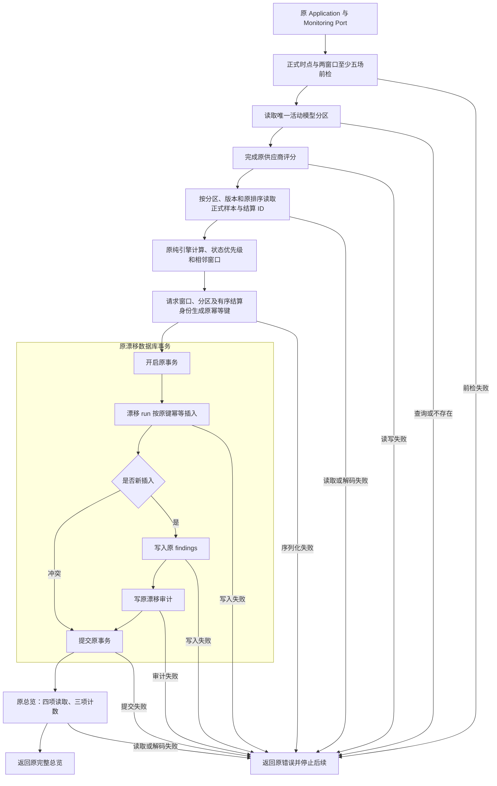

# R10-08 Drift Monitoring

状态：`DONE`（自身精确完整Windows全SUCCESS，下述VERIFYING为实施历史）。用户2026-10-13“收尾07开始08”授权；uniquenesssta/123 v0.23.0，唯一rewrite/r10-review-analytics-release-backend，基线33f718858e550aa4a39192255b3c6fc2c28b6cff。01～07自身精确Windows DONE，09～13BLOCKED、R10IN_PROGRESS。

### 1. 目标

形成唯一漂移监控模块及真实综合监控入口，保持原正式样本、窗口、幂等记录和人工模型/参数门禁。

### 2. 现状与来源

App原refresh_postmatch_monitoring/postmatch_overview两个透传入口和PG root混合监控/活动分区/总览/漂移。07已分离供应商评分。任务书drift-monitoring参考目录没有单独Drift Port；采用App monitoring表达原综合监控，PG drift_monitoring表达漂移专项，没有新增假API或透传层。

### 3. 目标文件与目录

App use_cases/postmatch/monitoring/{mod,refresh,overview,tests}.rs。PG adapters/postmatch/monitoring/{mod,refresh,overview,partition,validation,tests}.rs及drift_monitoring/{mod,samples,calculation,repository,read,mapping,tests}.rs。旧root postmatch.rs只保留原FORMAL_HORIZONS/non_negative_u64/round6共享规则。

### 4. 文件职责边界

App refresh/overview原Port透传；PG monitoring refresh原编排，overview原四读取/三计数，partition原活动绑定查询与共享分区，validation原时点/窗口前检。drift samples原SQL和顺序Row解码，calculation原引擎/状态/窗口/指纹准备，repository原幂等事务，read原run+findings查询，mapping原finding解码。三个mod仅登记/显式导出；测试仅cfg(test)。

### 5. 输入

原PostmatchMonitoringRequest(competition_id/horizon/baseline_size/current_size)、原overview limit、共享PostmatchPartition及原SQL得到的EvaluationSample与有序settlement_ids。原四正式时点T-N/T-24h/T-6h/T-1h和两个窗口最少5保持，无新字段/配置/request ID/上限。

### 6. 输出

原PostmatchOverview、PostmatchDriftRunRecord/PostmatchDriftFindingRecord、原不可变run/findings/审计。PreparedDrift只是本次调用内部准备值，携带原计算/状态/实际窗口计数/JSON与run_key，不是公共DTO或长期State。

### 7. 允许依赖

App原PostmatchMonitoringPort/Domain/ApplicationResult；PG原SQLx/Uuid/serde_json/PersistenceResult/Error/sha256_json/write_audit_event，以及既有football_analytics_engine::calculate_analytics和原Domain记录。供应商/漂移复用唯一monitoring::PostmatchPartition，共享原root纯数值/时点规则。

### 8. 禁止依赖

App不引SQL/具体PG/窗口验证/公式；calculation/validation不I/O，samples/read不结束事务。没有新通用Repository/State/框架/外部模型请求、自动证据判定、候选接受或参数晋升；不修改纯引擎/P4/P7/参数/Profile/Schema/Golden。

### 9. 状态所有权

原PG run/finding不可变账本与run_key唯一约束持有历史状态；准备对象/Vec只在一次刷新内。PG直接owner37/state19、43Ports/19Port文件保持，App422文件；唯一活动分区从root迁monitoring，原pub(crate)字段保持、向postmatch父模块导出供两个内部适配器使用。无新增跨模块共享可变状态。

### 10. 副作用边界

原请求前检→活动绑定→供应商评分→漂移→overview。漂移先pool读六分区/版本条件与原顺序样本，再原calculate_analytics(samples,10,baseline,current)、状态/窗口/run_key准备，随后单次begin→INSERT run ON CONFLICT(run_key) DO NOTHING RETURNING id；仅Some(id)插入findings及审计→一次commit。冲突不重复finding/审计。原供应商pool写入与漂移事务不合并，原overview在漂移提交后执行。

### 11. 异常路径

原错误文字/类型、Row字段解码顺序、时点优先于窗口验证保持。无绑定/SQL/序列化/写入/审计/提交失败按原?传播并停止后续；供应商已写快照不因漂移失败回滚，提交后overview失败不撤销已提交run。原读回两个计数non_negative_u64标签和finding可选relative_delta保持。

### 12. 并发/异步/生命周期

原run_key含partition_key、请求baseline/current size、有序settlement_ids与POSTMATCH_MONITORING_VERSION，实际窗口长度只进DB/审计，不偷换身份。原ON CONFLICT/不可变触发器/单事务边界保持，没有新增锁、重试、超时或取消State。样本SQL仍kickoff_time/run_id排序；最新run仍generated_at DESC/id DESC，findings按metric_name，limit仍1..500。真实并发/幂等/事务失败回滚仍最终新库待验。

### 13. 兼容要求

原7公共命令/facade/Service/两Ports/composition/公开PostgresStore签名/Domain/全部SQL/绑定/错误/JSON/配置/日志/UI/依赖/迁移/工作流/版本0.23.0保持。原pure engine计算/阈值完全不改；不足样本优先insufficient，再critical/warning/stable，大小写精确；两窗口原saturating_sub/相邻切片，window JSON保留输入顺序/纳秒/first-last。

### 14. 实施步骤

App两入口改具名函数/切Service/删旧注册与文件；PG整体监控/活动分区/总览/漂移8旧职责迁出，样本读、验证、纯准备段分别提取，原支持常量/数值保留。供应商repository只切共享partition import，函数正文不变；纯准备按借用切片去掉原Vec的额外&，状态分支直接返回避免新let_and_return。更新两原门禁/官方扫描、补17unit后等价/负向/文档，沿用原Windows。

### 15. 切换入口

Service直接monitoring::{refresh_postmatch_monitoring,postmatch_overview}。PG同名公开方法在monitoring实际实现；监控编排调用原供应商方法及新drift同名方法。漂移repository调用load_drift_samples和prepare_drift；总览直接复用drift read。旧root无空转发或重复SQL，原共享类型只保留一个定义。

### 16. 删除清单

删App旧postmatch_overview/mod.rs、refresh_postmatch_monitoring/mod.rs及注册。PG root移出8监控/漂移函数与PostmatchPartition，去掉SQL/引擎/JSON/Uuid等无用imports，保留2原共享纯规则与原常量。实际2D，无整文件重命名/root删除；原05/06/07评分实现与09Analytics职责不提前改写。

### 17. 最小验证

实际84/84原JS源码检查、完整npm run verify:architecture、22实际Rust独立Rustfmt1.88check、19等价核对、10负向拒绝且全文件bytes恢复、差异/23字段/33路径/链接核对通过。新增6App/11PG unit须自身Windows；预期171=165+6 / 227=216+11、Gateway112unit+41contract，不记本地动态PASS。

### 18. 阶段回归

沿用原Public Platform CI Windows Automated与原workspace unit/contract targets：frontend/contracts/TypeScript/Vite/17视口、fmt/locked Clippy all-targets -D warnings/workspace、Windowsrelease/MSI/NSIS/启动/日志。18PG静态契约原targets保持，不新增runner/workflow/dependency/DB专项；未非WindowsCargo/check/Clippy/build/test/frontendbuild/browser/loopback。

### 19. 失败停止条件

08自身精确完整WindowsSUCCESS前VERIFYING、09～13BLOCKED；失败只修同R10分支，不借07成功或减少测试/压警告。Windows job实际启动后停止CI查询并提示约20～30分钟；不创建阶段完成记录或提前启动09。

### 20. 回退点

33f718858e550aa4a39192255b3c6fc2c28b6cff（07纯文档收尾，源码同cdd2797/Windowsrun38350692611全SUCCESS）。受控revert08源码/门禁/清单/记录，不手工复制旧root函数造成双owner。

### 21. 根README摘要记录

根README记录07DONE、08唯一监控/漂移owner/保持事务与17新unit/本地验证及自身Windows待验，09～13BLOCKED，链接本节点/阶段索引。

### 22. docs阶段详细记录

本23字段与所有A/M/D、实际App综合入口取舍/内部共享分区/PreparedDrift与事务风险、等价/原unit/负向/保护/回退；index/R10任务书/TESTING同步。07收尾另5M[skip ci]，源码同精确成功证据，本08从33f7188独立实施。

### 23. 完成标准

唯一监控/漂移职责/真实入口/旧实现清理和静态复核完成；自身精确Windows完整SUCCESS才可DONE。真实PG/历史保护四项/不可变账本/并发回滚/有效XLSX/WindowsFull/私有P4P7固定回归及继承model.runs/0041删除风险仍最终封包新库待验，ignored/公开unavailable stub/static指纹不计这些实际PASS。

## 等价与测试证据

19等价核对全部通过：root仅2原共享规则和4时点常量；overview/partition/read/finding/window/horizon六完整原函数相同；共享partition字段/可见性相同；前检守卫及refresh逆内联相同；样本query/decoder/Vec/getter原顺序相同；状态原不足优先/critical/warning/stable逆替相同；窗口相邻切片/无新排序相同；pure prepare逆内联状态/窗口并还原Vec借用后相同；PreparedDrift投影原实际计数/值相同；transaction逆两提取与全部prepared字段还原后相同；生产SQL/错误/JSON字面量多重集相同；外部公开PG签名相同；供应商repository原函数全文相同仅partition import位置改变；App两原入口仅名/路径变化；Service逆两调用相同；05/06/07其余/09Analytics/纯引擎/Ports/models/UI/contracts/schema/deps/DB/workflow/targets/state冻结；365Domain/129文件/301映射保持；6App/11PG unit只登记原targets。

6App测试覆盖完整请求与包含provider/drift/finding/纳秒/可选字段的返回DTO，非法时点/窗口/usizeMAX透传仍由原PG前检，overview limit0/u32MAX不在App夹紧，refresh与overview六种原PortError保持并无重试/额外调用，空overview不发明记录。Fake只cfg(test)，不把fixture当正式统计。

3PG monitoring unit覆盖四原时点/5场边界与原无新窗口上限、未知/大小写/空白/T-90m先于窗口拒绝、任一短窗口原错误。8PG drift unit覆盖不足状态压过finding、complete时critical优先且顺序无关、warning/stable/大小写精确、空/短历史饱和窗口、13样本取相邻最新5+5且丢旧surplus、window JSON保留输入顺序/first-last/纳秒及空值、空准备仍使用请求窗口/版本/完整身份、相同重试同键且分区/请求size/有序结算ID变则key变化。调用原pure helper，不新增/更改engine阈值或复杂数值预期；期待171/227须08Windows实跑。

10负向全部拒绝且所有文件字节恢复：App新加trim、跳过监控前检、放宽最少5场、不足状态变stable、baseline/current重叠、取消样本版本过滤、审计前commit、冲突重试伪装新run审计、run键冲突改覆盖UPDATE、漂移读limit变1000。原Postmatch Service/settlement两门禁只切实际owner并补原分区/时点/顺序/事务/窗口/身份与原unit注册检查，没有新验证框架。19等价核对中的PreparedDrift投影起初只差Rustfmt尾逗号，调整源码比较的期望标点后通过；这不是业务修复或Windows失败。

实际命令：原84JS、npm run verify:architecture；verify-application-ports --refresh-source-scan；generate-domain-type-inventory；verify-postmatch-service/settlement；原保护资产/171命令/verify_database_baseline；22实际Rust独立rustfmt1.88 --edition2021 --config skip_children=true --check；19逐函数/逆内联/SQL字面量/公共签名/struct/冻结链与10负向；git diff --check/23字段/全部清单/链接。scratch r1008-static-checks.json/r1008-architecture.log/r1008-equivalence.json/r1008-negative-probes.json可重建，正式结论本记录保留。

Domain365/129/301映射/sourceDigest217241ac243726a5ab6805a7f169e222b97e78c7c971749a5904714af673ebdd保持；scan1232/rustUsageDigestf50e50dddd84c46d3d83ffb5a812d57a9fc922deba6fbb5341dcdbed51821a25。App422/43Ports/19Port文件、PG直接owner37/state19；18保护聚合d74e0936b60c69f444a498405fed3e704b8db63b81f26b40036f772b4b6eac57/171命令/46迁移18PG静态聚合d9f2eb50bacd747b7cbf08492189c2635b7c0ec2cf4c764def1d32a837f8ba93保持。原pure引擎无需重生成公式或模型资产。

## 实际监控与幂等事务

原供应商逐组pool写入先于漂移事务，不能声称全监控原子回滚；漂移commit结果未知/后续overview失败也不撤销已提交run。纯calculate_analytics无Result，不虚构该函数失败分支。实库并发/约束/回滚仍最终新库待验。

## 工具与来源

附件scratch既有复制SHA/rootAGENTS同前轮；skilmain0.0.1AGENTS sha5cc6750404092a080ddcd18685a25dfb90d3f809已fresh核对；总纲/08字段/source调用已读取。GitHub核对07精确Windows全部步骤、实际日志和artifact，07收尾33f7188[skip ci]。Mermaid Chart成功显示本原监控/漂移链；Create State按稳定足球UUID96f03270-c236-46de-99fa-db85d2fbf4ce保存精确交接。复用既有Rust/SQLx/serde与纯引擎接口，无新版本/API疑问不重复Context7；无子代理、第二分支或新依赖/runner/workflow/target/DB专项。

## 实际完整 A/M/D 清单

相对已验07收尾 33f718858e550aa4a39192255b3c6fc2c28b6cff：**18A / 13M / 2D，共33路径**，无整文件重命名/root搬移；实际职责提取与原共享支持保留。

| 类型 | 文件 | 实际职责/原因 |
| --- | --- | --- |
| M | `README.md` | 根摘要与08状态/链接 |
| M | `architecture/application-port-inventory.json` | App422源扫描及真实Port边界 |
| M | `architecture/domain-type-inventory.json` | 实际Domain使用路径和扫描摘要 |
| M | `crates/application/src/services/postmatch/service.rs` | 切两实际监控入口 |
| M | `crates/application/src/use_cases/postmatch/mod.rs` | 删除旧注册/登记monitoring |
| A | `crates/application/src/use_cases/postmatch/monitoring/mod.rs` | App：仅登记与导出 |
| A | `crates/application/src/use_cases/postmatch/monitoring/overview.rs` | App：原总览调用/读取与计数 |
| A | `crates/application/src/use_cases/postmatch/monitoring/refresh.rs` | App：原刷新编排/参数透传 |
| A | `crates/application/src/use_cases/postmatch/monitoring/tests.rs` | App：原target最小边界/错误/身份测试 |
| D | `crates/application/src/use_cases/postmatch/postmatch_overview/mod.rs` | 旧App独立入口退出，由具名monitoring入口替代 |
| D | `crates/application/src/use_cases/postmatch/refresh_postmatch_monitoring/mod.rs` | 旧App独立入口退出，由具名monitoring入口替代 |
| A | `crates/persistence-postgres/src/adapters/postmatch/drift_monitoring/calculation.rs` | PG漂移：原纯计算/状态/窗口/身份准备 |
| A | `crates/persistence-postgres/src/adapters/postmatch/drift_monitoring/mapping.rs` | PG漂移：原finding字段解码 |
| A | `crates/persistence-postgres/src/adapters/postmatch/drift_monitoring/mod.rs` | PG漂移：仅登记与导出 |
| A | `crates/persistence-postgres/src/adapters/postmatch/drift_monitoring/read.rs` | PG漂移：原最新run/findings读取 |
| A | `crates/persistence-postgres/src/adapters/postmatch/drift_monitoring/repository.rs` | PG漂移：原run/findings/审计单事务 |
| A | `crates/persistence-postgres/src/adapters/postmatch/drift_monitoring/samples.rs` | PG漂移：原分区样本查询和顺序解码 |
| A | `crates/persistence-postgres/src/adapters/postmatch/drift_monitoring/tests.rs` | PG漂移：原target最小边界/错误/身份测试 |
| M | `crates/persistence-postgres/src/adapters/postmatch/mod.rs` | 登记monitoring/drift_monitoring |
| A | `crates/persistence-postgres/src/adapters/postmatch/monitoring/mod.rs` | PG综合监控：仅登记与导出 |
| A | `crates/persistence-postgres/src/adapters/postmatch/monitoring/overview.rs` | PG综合监控：原总览调用/读取与计数 |
| A | `crates/persistence-postgres/src/adapters/postmatch/monitoring/partition.rs` | PG综合监控：唯一活动分区类型与原绑定查询 |
| A | `crates/persistence-postgres/src/adapters/postmatch/monitoring/refresh.rs` | PG综合监控：原刷新编排/参数透传 |
| A | `crates/persistence-postgres/src/adapters/postmatch/monitoring/tests.rs` | PG综合监控：原target最小边界/错误/身份测试 |
| A | `crates/persistence-postgres/src/adapters/postmatch/monitoring/validation.rs` | PG综合监控：原时点与窗口前检 |
| M | `crates/persistence-postgres/src/adapters/postmatch/provider_score/repository.rs` | 只切唯一共享partition import，方法正文保持 |
| M | `crates/persistence-postgres/src/postmatch.rs` | 八职责/分区移出，仅原共享常量/数值规则 |
| M | `docs/TESTING.md` | 实际验证/新增unit/最终新库延期 |
| M | `docs/football-model-platform-modular-rewrite-19-docs/10-R10-review-analytics-release-backend.md` | 任务书状态与真实边界订正 |
| A | `docs/modular-rewrite/R10-review-analytics-release-backend/R10-08-drift-monitoring.md` | 本23字段/全部文件/测试/风险/回退 |
| M | `docs/modular-rewrite/R10-review-analytics-release-backend/README.md` | 阶段索引/继续位置 |
| M | `scripts/verify-postmatch-service.mjs` | 原门禁切真实owner及原顺序/窗口/事务规则 |
| M | `scripts/verify-postmatch-settlement.mjs` | 原契约验证读实际新owner |

两旧App文件删除与两个具名实际入口A对应；PG root按函数退出、共享规则仍原路径，原supplier方法正文保持，仅分区引用改变。

## R10-08 精确 Windows 完成与09授权（2026-10-13）

精确提交 `f834e3152e65e791b91897ce4803cedd284f7311` / tree `bc48b5f701f2f2262bd1118390b7691c23ad17a0`，[Public Platform CI run38357781835](https://github.com/uniquenesssta/123/actions/runs/38357781835) / Windows job115164583225全SUCCESS，2026-10-13 15:06:50北京时间完成。实际Application171/171、Persistence227/227、Gateway112/112 unit及41/41 contract；本项新增6App/11PG unit全部通过。前端/contracts/TypeScript/Vite/17视口、Rust fmt/locked Clippy all-targets -D warnings/workspace、Windows release/MSI/NSIS/启动与日志扫描均通过（7条记录、3个完成操作）。报告windows-acceptance-20261013-063917.json及同名.txt。

证据artifact11794826120，14,048,433字节，SHA-256 `d188c4d0fae8316bde55f14089eac7a7240490a9bf8af36e64df0674db0f4756`。08自身完整SUCCESS后DONE；用户2026-10-13“收尾08开始09”授权09 Analytics Calculation READY，继续唯一rewrite/r10-review-analytics-release-backend，10～13BLOCKED、R10IN_PROGRESS。本次五既有文档收尾[skip ci]，源码同已验f834e31，09须自身完整Windows，无阶段完成记录。此前08 VERIFYING和预期计数保留为历史。

真实PG/历史保护四项/不可变账本/并发回滚/有效XLSX/WindowsFull/私有P4P7固定回归及继承model.runs/0041删除风险仍最终新库待验，ignored/公开unavailable stub/静态指纹不计这些真实PASS。

本收尾0A/5M/0D，根README/TESTING/R10任务书/阶段索引/本节点，源码不变。原18A/13M/2D完整清单和职责/回退保留。
