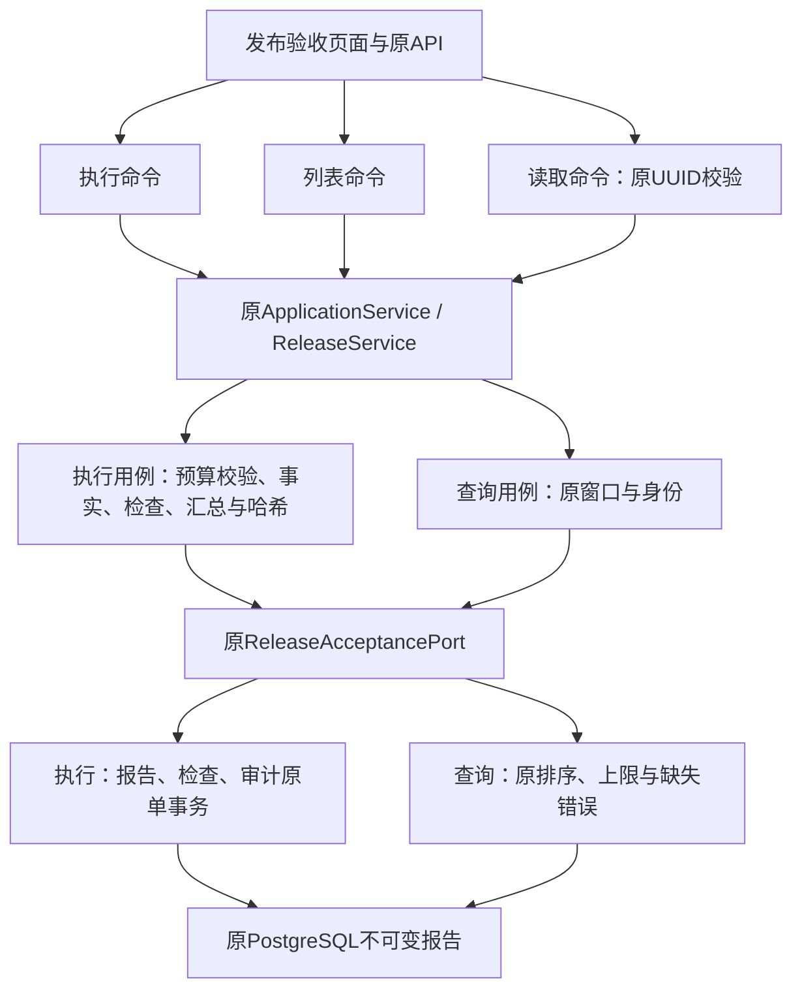

# R11-09 Release Commands

状态：`VERIFYING`（已实现与静态通过；09自身完整Windows待验）。

R11-01～08 DONE（08自身精确858288e / Windows run39974291282完整SUCCESS）；09 Release Commands已实施VERIFYING，10 BLOCKED，R11 IN_PROGRESS。用户2026-10-23“通过收尾08开始09”，继续唯一rewrite/r11-tauri-commands；09基线dd01f9d为08五文档[skip ci]收尾，源码同08已验树。

## 目标、来源与责任边界

原`src-tauri/src/commands/release_acceptance.rs`聚合执行、列表、读取三条命令。本节点将三个独立动作归入`commands/release/`，每条具名文件唯一真实命令；`mod.rs`只显式导出原函数及Tauri `__cmd__`、`__tauri_command_name_`双宏，根`commands.rs`只替换模块身份。没有引入转发占位层、dispatcher或新业务规则。

| 命令 | 目标文件 | 原真实委托 |
|---|---|---|
| run_release_acceptance | release/run_release_acceptance.rs | state.service.run_release_acceptance(request).await |
| list_release_acceptance_runs | release/list_release_acceptance_runs.rs | state.service.list_release_acceptance_runs(limit).await |
| read_release_acceptance_run | release/read_release_acceptance_run.rs | 原parse_uuid(&run_id, "验收运行 ID")后read_release_acceptance_run(...).await |

执行请求仍是唯一Domain `ReleaseAcceptanceRequest`；响应仍原Run/RunSummary，错误仍`error.to_string()`。列表limit不在命令层新增修剪/上限，run_id不trim或替换，UUID错误仍原标签。已有正确DTO无需复制，本层没有新增request/response/mapping/error空壳。

## 公共契约、状态与副作用

171公共命令名称、全局注册顺序、三签名/完整正文、DTO/Schema/配置/日志/UI/前端API字节保持。内部物理组从release_acceptance改为release，12组不变；其余11组完整保持。`bootstrap/command_registry.rs`与`lib.rs`冻结，不提前推进10。命令定义映射SHA-256为`c45a2d4b54fc5ad7eeaae3f3b57eda65f58ce03dc6b1d6be3576fb807b1d0696`；公共集合仍`dfc477a8b0bec95735fdad006349fcea0f367b4ebc85aede1b63a128a55de669`。

AppState/19状态owner、ApplicationService/ReleaseService与43Ports/19Port源、PG唯一owner全部冻结。命令只借原State并委托；不新增SQL、文件I/O、模型公式、服务实例、线程/锁/令牌/缓存/共享状态或重试。本来无独立取消生命周期的薄命令不套入新取消机制，沿原caller/服务错误生命周期。

真实执行链仍为原ReleaseService→run_acceptance：预算校验/窗口规范化→获取会话→runtime_facts→checks→summary→报告SHA256→persist_run→返回同一报告。Blocked报告也保存；未将公开unavailable stub或ignored计作真实模型/数据库成功。原PG ledger报告/checks/审计单事务、不可变策略与查询的排序/上限/不存在错误保持，命令不新增保存或覆盖逻辑。全部原Application15项与PG4项Release测试正文冻结。

Mermaid Chart已展示以下真实链路，图只表达原生产实现及本次命令入口：

## 入口、清单与原守卫

正式command-contract与module-boundaries切至release/mod.rs及三实际定义文件，删除旧单文件。Domain声明、365类型/129源/301映射保持，仅三类型的实际外部caller由旧聚合路径展开；Rust扫描1491→1494，sourceDigest `217241ac243726a5ab6805a7f169e222b97e78c7c971749a5904714af673ebdd`不变，usageDigest为`58d46aa55e321b266a05039f1dcdbda14716cace4679af9f22b4a71151c59f95`。

两个既有发布守卫改读三个实际定义文件；所有原断言经逆变换精确保持。只在原Release Service守卫补实际State/三签名/完整传输正文/参数/await/错误/唯一helper/纯双宏出口/实际清单与旧owner清零检查。正式command verifier、原82入口、package/CI/依赖/迁移与其余守卫冻结，无新增持续回归、runner、workflow、target或数据库专项入口。

## 实际验证与待验

- 82/82原只读Node源码检查、完整`npm run verify:architecture`通过。
- 5个现存变更Rust文件独立Rustfmt1.88（edition2021、skip_children=true、--check）通过；不是Windows Cargo fmt证据。
- 42项源码等价：三完整正文/签名/原State、root仅身份替换、公共契约/其余11组、唯一边界变化、两原守卫逆变换、全部365Domain项除三实际caller路径、扫描+3和全业务/UI/测试/模型/Ports/依赖/CI/state冻结通过。
- 21项隔离负向全部拒绝，3原守卫恢复正向通过，主250源码/架构/守卫/根/注册指纹不变。覆盖旧owner、根登记/双宏/出口、请求/limit/UUID/标签/trim/方法/await/错误/State/清单，及原下游保存/提交/排序丢失。仅隔离临时副本变异，未破坏主源码。
- 18模型保护资产aggregate `d74e0936b60c69f444a498405fed3e704b8db63b81f26b40036f772b4b6eac57`与46迁移/18PG静态契约aggregate `d9f2eb50bacd747b7cbf08492189c2635b7c0ec2cf4c764def1d32a837f8ba93`通过，`git diff --check`通过。

新增单测0、迁移单测0；三个薄命令原完整实现不变，复用现有targets。预期Desktop58/Application230/Persistence259/Gateway112unit+41contract须09自身精确Windows确认。当前没有在非Windows执行Cargo/check/Clippy/tests/前端构建/浏览器/loopback；所有动态验证继续原Windows workflow。需确认完整frontend/contracts/TypeScript/Vite/17视口、Rust fmt/locked Clippy all-targets -D warnings/workspace tests、release/MSI/NSIS/启动与日志；08成功只用于08收尾，不能替代09。

报告`r1109-static.json`、`r1109-architecture.log`、`r1109-equivalence.json`、`r1109-negative.json`、`r1109-primary-fingerprints.json`位于repo外临时工作区，可从源码复建；不新增生产或长期测试runner。既有测试中依赖真实数据库的ignored仍未执行，不是PASS。真实PG报告事务/并发回滚、历史保护四项、不可变账本、有效XLSX、Windows Full、私有P4P7固定回归及继承model.runs/0041删除风险仍最终封包新库待验；08真实API/凭据/会话取消端到端待验也未消失。

## 切换、偏差与回退

先在原Release Service门禁补本节点传输要求，确认旧结构因缺release/mod.rs失败；再原样迁移三命令、切换唯一根/正式清单、删除旧owner、刷新实际reader/Domain usage。最小命令契约、全静态/架构/格式、等价/隔离探针均通过。使用沿前序精确Windows证明的Tauri2.11.1双宏出口，无新增API或未核实的版本行为，不引入依赖升级；本节点无Context7新问题。

本次没有功能偏差或已知实现失败；初期按任务简称探查release.rs，实际旧owner由源码/正式清单定位为release_acceptance.rs。09自身Windows未完成时保持VERIFYING，10 BLOCKED；实际Windows job首次in_progress后停止全部CI查询，等待用户返回。回退点为本节点前`dd01f9d5cb4983637f25c639835fcfe66a1ad17f`（源码同08已验858288e）；使用Git revert本节点原子提交，不手工复制旧文件，不合入其他工作。

## 实际文件清单

基于dd01f9d5cb4983637f25c639835fcfe66a1ad17f，no-renames口径5A/10M/1D，共16路径。4新Rust（3命令与1纯出口）；既有Rust仅根登记修改，整文件逐字移动/重命名无，三原函数按职责迁移。

| 状态 | 路径 |
|---|---|
| M | `README.md` |
| M | `architecture/command-contract.json` |
| M | `architecture/domain-type-inventory.json` |
| M | `architecture/module-boundaries.json` |
| M | `docs/TESTING.md` |
| M | `docs/football-model-platform-modular-rewrite-19-docs/11-R11-tauri-commands.md` |
| A | `docs/modular-rewrite/R11-tauri-commands/R11-09-release-commands.md` |
| M | `docs/modular-rewrite/R11-tauri-commands/README.md` |
| M | `scripts/verify-release-acceptance.mjs` |
| M | `scripts/verify-release-service.mjs` |
| M | `src-tauri/src/commands.rs` |
| A | `src-tauri/src/commands/release/list_release_acceptance_runs.rs` |
| A | `src-tauri/src/commands/release/mod.rs` |
| A | `src-tauri/src/commands/release/read_release_acceptance_run.rs` |
| A | `src-tauri/src/commands/release/run_release_acceptance.rs` |
| D | `src-tauri/src/commands/release_acceptance.rs` |
