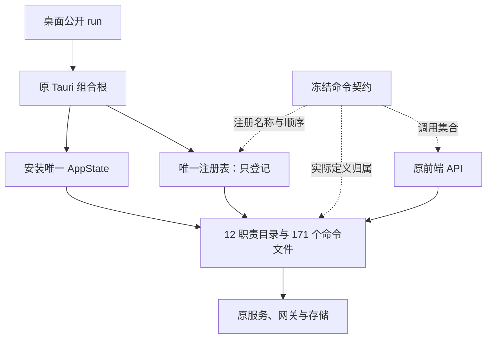

# R11-10 Command Registry 收敛

状态：`DONE`（自身精确ed11637 / Windows run39996999630完整SUCCESS；下文VERIFYING保留实施历史）。

用户2026-10-24“收尾09开始10”。基线`ec8c04c2a58a81bcd7df578c25c44d152581bc68`为09五文档[skip ci]收尾，生产源码同自身Windows完整SUCCESS的44f2047/run39986012998。继续唯一rewrite/r11-tauri-commands；01～09 DONE，10 VERIFYING，R11 IN_PROGRESS，R12未开始。

## 目标与现状核对

任务目标为唯一`src-tauri/src/bootstrap/command_registry.rs`只登记公开命令。该生产入口在R11开始前已存在，并由R11-01沿用；01～09逐组迁移后171条命令均进入12个真实职责目录；当前原同步泛型register接收调用方Builder，只有一次invoke_handler(generate_handler![171条明确命令])。lib.rs只声明原模块并将公开run委托bootstrap；application.rs仍原插件→状态安装→注册→context→启动错误映射。

本节点不为“重写”修改已正确的生产结构。实际缺口是原守卫只验证存在一个handler及名字/顺序，无法证明注册表没有夹带其他实现；在隔离副本追加`fn registry_probe() {}`，旧verify-tauri-bootstrap仍返回成功，已真实复现。现将只注册、唯一入口与完整实际归属要求补入原组合根门禁，不新增重复注册器、宏dispatcher或空壳文件。

## 实际变更与责任

只修改既有`scripts/verify-tauri-bootstrap.mjs`，追加51行具名注册边界检查，既有全部断言完整保持：

- 对原registry完整代码按保留字符串/标识符的token核对：原同步泛型Builder透传、唯一handler、冻结顺序171条明确命令之外不能混入函数、I/O、状态、替代Builder或宏路由。允许普通注释和空白，不用格式差异替代行为验证。
- 对lib公开入口与application组合根原完整结构核对，保留dialog、唯一State安装、唯一register调用、generate_context和原expect_startup错误处理链。
- 递归读取整个src-tauri/src，验证generate_handler、invoke_handler、command_registry::register和bootstrap::run各只有原实际所有者/调用方，不限于检查一个目标文件。
- 12组正式清单均指向实际mod.rs与module-boundaries；目录出口无实现/状态；171命令映射到所属目录内171个不同实际文件，各文件只有其对应真实#[tauri::command]函数。原两套command-contract校验继续验证前端/定义/注册集合、重复、孤立项与顺序。

没有改生产Rust、公共DTO/命令名称/参数/返回/错误/日志/配置/UI/架构清单/数据库/依赖/CI/现有单测。没有新状态或副作用，真实命令→服务/Port/Adapter链全部保持，取消/凭据/报告事务沿原唯一owner。commands.rs中的唯一通用UUID错误映射与共享后台失败投影仍原具名owner，不是注册表实现，不为本节点无关搬移。

## 实际调用链与命令归属

Mermaid Chart已展示本图；实线为原生产关系，虚线为本次强化的契约检查，不将校验脚本混作运行时逻辑。

| 正式职责目录 | 命令/实际文件 |
|---|---:|
| database | 3 |
| platform | 9 |
| ai_workspace | 13 |
| prediction | 17 |
| competition | 7 |
| catalog | 35 |
| lineups | 19 |
| exchange | 24 |
| review | 6 |
| postmatch | 14 |
| analytics | 21 |
| release | 3 |
| 合计 | 171 |

命令公共集合SHA-256仍`dfc477a8b0bec95735fdad006349fcea0f367b4ebc85aede1b63a128a55de669`，定义映射仍`c45a2d4b54fc5ad7eeaae3f3b57eda65f58ce03dc6b1d6be3576fb807b1d0696`。Domain365类型/129声明源/301PG映射/1494扫描、sourceDigest/usageDigest均保持；App422/43Ports19文件、State19和PG直接模块38保持。

## 实际验证、失败修正与待验

82/82原只读Node、完整`npm run verify:architecture`、原`verify_command_contract.mjs`与`verify-command-contract.mjs`、`verify_protected_assets.mjs`、`verify_database_baseline.mjs`及git diff --check通过。所有生产Rust/前端/业务/现有测试/architecture/契约/依赖/CI字节冻结；移除新增检查块后，bootstrap原守卫逐字等于基线，旧检查没有删除或抑制。

旧守卫的额外函数漏检已在隔离副本复现；新守卫16隔离破坏全部拒绝，覆盖注册表多职责/副作用/async/替代Builder、第二handler/调用方/公开入口、State跳过/错误吞掉、命令漏项/顺序/重新聚合、出口混业务与退役State中转。3原守卫恢复正向通过，另1个注释/空白正向通过，主262桌面源/清单/守卫指纹不变。探针只在repo外临时副本变异，无主源码破坏。

首次新增命令名正则只接受字母下划线，错误截断8条P4名称；已改为允许标识符后续数字，保留全部原171名称，随后全部检查通过。未调整实际名称或绕过这些命令。临时报告r1110-static.json、r1110-architecture.log、r1110-review.json、r1110-primary-fingerprints.json可由源码复建，不新增长期runner。

新增单测0、迁移单测0、新验证入口0。无Rust文件变化，不重复本地独立fmt；本轮未做非WindowsCargo/check/Clippy/tests/frontendbuild/浏览器/loopback。本次变更了交付中的Node门禁，故仍复用既有完整Windows workflow验收新提交，预期Desktop58/App230/PG259/Gateway112unit+41contract及完整前端/17视口、Rust、release/MSI/NSIS/启动/日志须10自身结果确认；09动态成功不等于本次新门禁已在Windows成功。

18保护资产aggregate `d74e0936b60c69f444a498405fed3e704b8db63b81f26b40036f772b4b6eac57`，46迁移/18PG静态aggregate `d9f2eb50bacd747b7cbf08492189c2635b7c0ec2cf4c764def1d32a837f8ba93`通过。真实PG/历史保护四项/不可变账本并发回滚、有效XLSX、Windows Full、私有P4P7固定回归与继承model.runs/0041删除风险仍最终封包新库待验；08真实API/用户凭据/会话取消端到端同样待环境。ignored、公开unavailable stub、静态指纹不得计这些真实PASS。

## 切换、工具与回退

生产调用入口本来符合目标，不新增切换或废弃模块；把缺失的边界验收并入原bootstrap守卫，该入口已在原完整frontend与architecture/Windows工作流中接通。没有依赖、API或编译版本问题，不新增Context7查询；保留已实际Windows证明的Tauri2.11.1/Rust1.88路径。中文实际Mermaid已更新，Create State保存09收尾与10待验。

09文档收尾后的shell git fetch因网络审批取消未完成；已通过GitHub插件读取远端实际commit/tree/parent/author/committer/message，按上一真实提交时区重建本地对象并严格匹配远端SHA，再用带旧SHA租约的本地双ref事务同步。没有把fetch失败记为成功，不改变远端已发布内容；当前本地/远端基线一致。第一次按UTC偏移重建未匹配SHA，未更新任何ref，核对原提交实际+0900偏移后精确匹配成功。

回退为Git revert本节点原子提交至`ec8c04c2a58a81bcd7df578c25c44d152581bc68`（生产同09成功44f2047），不复制旧文件，不更改模型资产。10自身Windows完整成功前保持VERIFYING；实际Windows job首次in_progress后停止全部CI查询。R11阶段完成记录须10自身与阶段出口通过后另行创建，当前不标记R11 DONE或启动R12。

## 实际文件清单

基于ec8c04c2a58a81bcd7df578c25c44d152581bc68，1A/5M/0D，共6路径；生产Rust新增/修改/移动/删除均无；无重命名。

| 状态 | 路径 |
|---|---|
| M | `README.md` |
| M | `docs/TESTING.md` |
| M | `docs/football-model-platform-modular-rewrite-19-docs/11-R11-tauri-commands.md` |
| A | `docs/modular-rewrite/R11-tauri-commands/R11-10-command-registry-收敛.md` |
| M | `docs/modular-rewrite/R11-tauri-commands/README.md` |
| M | `scripts/verify-tauri-bootstrap.mjs` |

## R11-10 精确 Windows 与阶段收尾（2026-10-24）

精确提交`ed116376880062eaf0901ec9395303741d8badd8` / tree`db4eb74ac52dd2c1541081d538b6bb9381f8b217`，[Public Platform CI run39996999630](https://github.com/uniquenesssta/123/actions/runs/39996999630) / Windows job120563013553完整SUCCESS，run于2026-10-24 02:08:47北京时间完成。已fresh核对head/branch、全部步骤/完整日志/artifact；实际Desktop58/58、Application230/230、Persistence259/259、Gateway112/112 unit与41/41 contract、完整前端/contracts/TypeScript/Vite/17视口、Rust fmt/locked Clippy all-targets -D warnings/workspace tests、Windows release/MSI/NSIS/启动及日志通过（7条记录、3个完成操作）。10新增/迁移单测0，静态源码探针不计动态测试。

报告logs/windows-acceptance-20261023-174142.json及同名.txt；artifact12521059525，14,060,932字节，SHA-256 `1d8b893a6003363a8ac64c842493a2a860a36feb542fb435e10c5c75d0ba864a`，查询未过期。10 DONE，01～10均有自身精确Windows成功；本次仅文档[skip ci]收尾，生产及验证源码同该已验提交，不重复全Windows。详[R11阶段完成记录](R11-stage-completion.md)。

追溯订正：原注册表与lib公开入口在R11开始前的Git树中已经存在且全阶段字节未改；10初版将入口建立归于R11-01不准确，现明确为R11-01沿用原组合根，逐组收敛命令，10补强真实边界检查。R11任务书止于10，没有R11-11；按现有序列，下一项为R12-01。真实PG/历史保护/账本并发回滚/XLSX/Windows Full/私有固定回归及继承model.runs/0041风险、08真实API/凭据/会话取消端到端仍待最终实际环境，ignored/公开stub/静态不计这些PASS。
