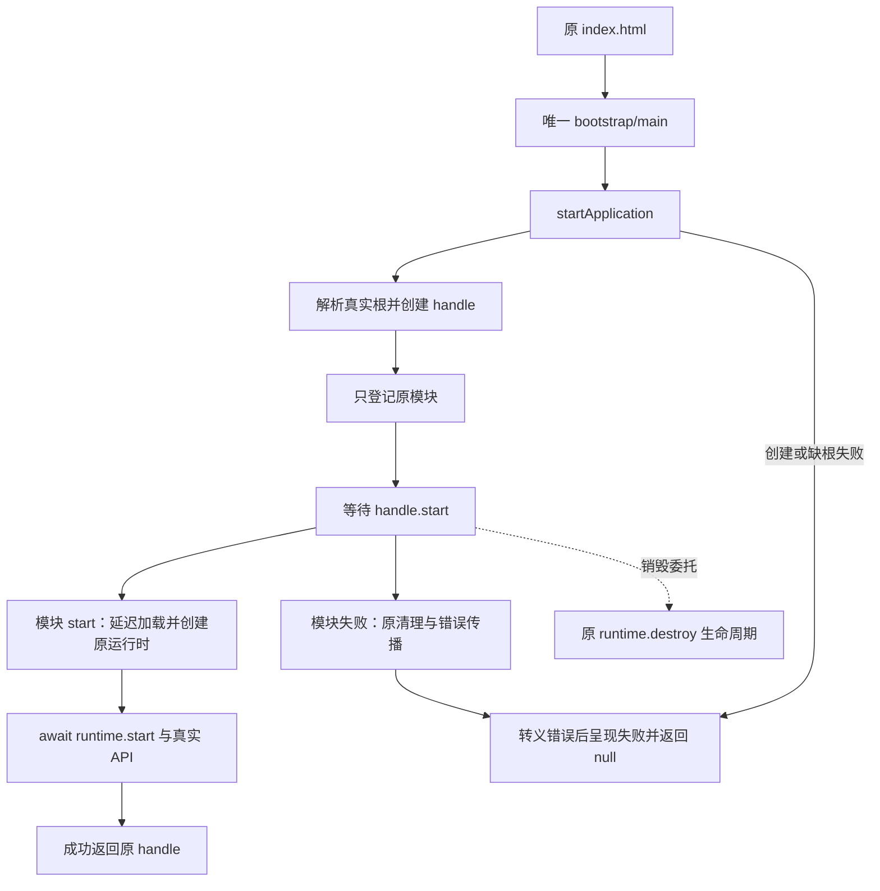

# R12-01 Bootstrap 组合根

状态：`VERIFYING`（启动边界与唯一真实链路已核对/补守卫，01自身完整Windows待验）。

R11已通过自身Windows Automated阶段出口并收尾，基线`e5952dffa47daf689a12085cc2c003b03162767b`为纯文档闭合，生产同已验ed11637/run39996999630。用户“10收尾开始11”没有对应R11-11节点；按现有任务书下一项对应R12-01，已明确此解释，未新增任务。独立唯一分支rewrite/r12-frontend-foundation-ui-system，02～19 BLOCKED，R12 IN_PROGRESS。

## 目标、真实现状与范围

R12-01要求bootstrap入口只启动与顶层失败处理，创建与模块注册有唯一职责。五个现存文件main.ts/startApplication.ts/createApplication.ts/registerApplicationModules.ts/applicationHandle.ts及index.html真实入口在先前基础工作中已有；原src/main.ts已是可注册的真实应用模块，仍承载后续业务Feature重写的存量职责。本节点复用正确实现，不复制空壳/第二模块，不把后续Router/Shell/Session/UI业务移入启动层。

真实缺口在原verify-browser-bootstrap：main文件只需包含startApplication文字，删除真正调用仍PASS；已在隔离副本复现。现只补原守卫的实际启动与组合契约，不为满足文件模板改动已正确的生产实现。所有生产TypeScript、CSS、Rust、API与后端数据链保持原字节，没有硬编码业务结果或运行时假模块。

| 现存位置 | 唯一职责 |
|---|---|
| index.html / bootstrap/main.ts | 唯一模块入口，实际调用一次startApplication |
| startApplication.ts | 创建→await start→成功返回原handle；原首错/转义/顶层失败呈现及null返回 |
| createApplication.ts | 从传入Document解析真实#app，缺根报原错误，创建一个handle并注册后返回 |
| registerApplicationModules.ts | 每handle闭包只登记一个browser-application；到模块start才延迟载入原main、创建真实runtime并await start；destroy委托原runtime |
| applicationHandle.ts | 既有唯一生命周期owner，失败逆序清理与错误传播；R12-02尚未开始，不冒称该节点完成 |
| src/main.ts | 原createBrowserApplicationModule及真实页面/API/工作区/日志逻辑，仍原注册模块入口，非mock |

## 本次修改与不变量

只修改既有scripts/verify-browser-bootstrap.mjs，读取目录新增内置readdirSync，追加具名composition boundary块；去块并还原这一读取依赖后，所有原检查逐字等于基线。新断言检查唯一入口实际调用/HTML单入口、四组合文件允许的静态/动态依赖及职责函数、禁止业务I/O/监听器泄露、真实根校验→handle→注册→返回顺序、每handle闭包/runtime/start/destroy真实连通、顶层await与失败root/首错/转义/null投影，以及整个src只能有原startApplication定义与唯一入口调用。

不改变ApplicationHandle接口、状态/所有者、原错误语义/文案、配置/Schema/DTO/171命令、真实服务/DB/凭据/取消、UI与样式；既有生命周期实现留原owner供02按自身边界继续，不增加跨请求或全局启动状态。没有新生产依赖/迁移/runner/workflow/target/数据库专项入口、新验证脚本或新unit；原完整frontend/architecture入口已接该守卫。

原失败文案与日志行为保持；本节点没有新增针对缺根/模块加载故障的日志写入保障，不把每一故障均已写日志当验收结果。真实异常日志扩展与平台诊断归对应后续任务，本次静态链路不代替实际故障注入或整产品运行时验收。

## 实际链路

中文Mermaid已展示实际顺序；登记阶段只建立模块，延迟载入由handle.start触发，未把登记画成即时加载：

## 实际验证与未验

82/82原只读Node、完整npm run verify:architecture、原verify_command_contract、verify_protected_assets、verify_database_baseline及git diff --check通过。生产src/全部Rust/旧tests/architecture/契约/依赖/CI冻结，原浏览器守卫断言逆变换精确保持。旧守卫空启动漏检已先复现；23隔离破坏全部拒绝，3原守卫恢复正向/1注释空白正向通过，主68前端/清单/守卫/组合根指纹不变。探针只在repo外临时副本变异，没有破坏主源码。

23项覆盖漏/重复启动、Feature导入、重复HTML入口、错误根/缺校验/漏注册/早返回/多handle、假runtime/错root/漏start/漏destroy/全局runtime、未await/失败错root或返回假成功/未转义、旁路启动、业务I/O、重复模块及侧效/动态Feature导入。它们是源码结构负向验证，不是浏览器单元/集成测试。

新增/迁移单测0，无TypeScript/Rust生产变化，不在非Windows跑类型编译/Cargo/check/Clippy/tests/frontendbuild/browser/loopback。交付Node守卫变化由既有Windows workflow验收新提交，预期Desktop58/App230/PG259/Gateway112unit+41contract与完整frontend/contracts/TS/Vite/17视口、Rust、release/MSI/NSIS/启动/日志均待01自身结果，R11成功不替代本次新门禁Windows成功。

18保护aggregate d74e0936b60c69f444a498405fed3e704b8db63b81f26b40036f772b4b6eac57，46迁移/18PG静态aggregate d9f2eb50bacd747b7cbf08492189c2635b7c0ec2cf4c764def1d32a837f8ba93保持；真实PG/历史保护四项/账本并发回滚/XLSX/Windows Full/私有固定回归与继承model.runs/0041删除风险仍最终新库待验，08真实API/用户凭据/会话PG取消UI端到端同样待环境。ignored/公开stub/静态指纹不计这些真实PASS。临时报告r1201-static.json、r1201-architecture.log、r1201-review.json、r1201-primary-fingerprints.json在repo外，可从源码复建。

## 设计来源、工具与回退

执行前已核ui-design-system最新HEAD eadd8026eb65263a95aed904b05537ac8e6417aa的docs/README.md与FIGMA_SCREENS_STATE.json；分别blob d7ff716b9aefa6687690d499069e51b887393580与dc10eca24dc01cfe0d458e298ccd020bb41e9aaa。最新明确accepted检查点2026-10-11，Figma PN0Whgu6HLWIHx4Mv6aHfu / Screens页3:5；17/17视觉与局部状态accepted，整体原型NOT_PASSED、完全运行时0，普通业务弹窗主题/真实输入/焦点/滚动等仍待验。该最新记录替代R12书中13/17旧快照作为后续视觉接入参考；本节点无独立视觉画板/像素变更，不读取或改造新的Figma画面、不用旧CSS定义后续新外观，也不把视觉accepted当代码PASS。

无新增第三方API、依赖或版本问题，未新增Context7查询；中文Mermaid已核真实链路，Create State保存R11完成/新分支与01待验。新分支从已确认闭合点创建，原本单分支fetch映射不识别新分支跟踪，补只针对该新分支的映射后本地/远端/upstream一致；未请求额外权限或覆盖其他分支。

回退为Git revert本原子提交至e5952dffa47daf689a12085cc2c003b03162767b，生产同R11成功ed11637，保留模型/数据；不手工复制旧文件。自身Windows完整成功前01 VERIFYING、02～19 BLOCKED；实际Windows job首次in_progress后停止所有CI查询。阶段仍IN_PROGRESS，不创建R12-stage-completion.md。

## 本节点实际文件清单

基于e5952dffa47daf689a12085cc2c003b03162767b，1A/5M/0D，共6路径；生产TS/CSS/Rust新增/修改/删除/移动均无，整文件重命名无。

| 状态 | 路径 |
|---|---|
| M | `README.md` |
| M | `docs/TESTING.md` |
| M | `docs/football-model-platform-modular-rewrite-19-docs/12-R12-frontend-foundation-ui-system.md` |
| A | `docs/modular-rewrite/R12-frontend-foundation-ui-system/R12-01-bootstrap-组合根.md` |
| M | `docs/modular-rewrite/R12-frontend-foundation-ui-system/README.md` |
| M | `scripts/verify-browser-bootstrap.mjs` |
